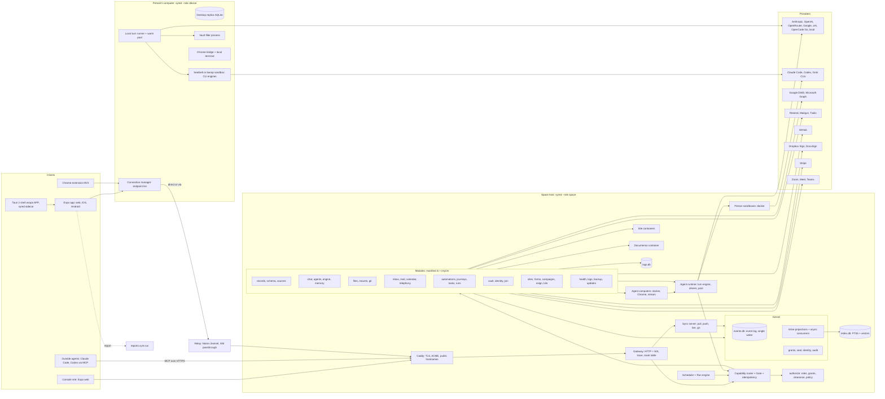
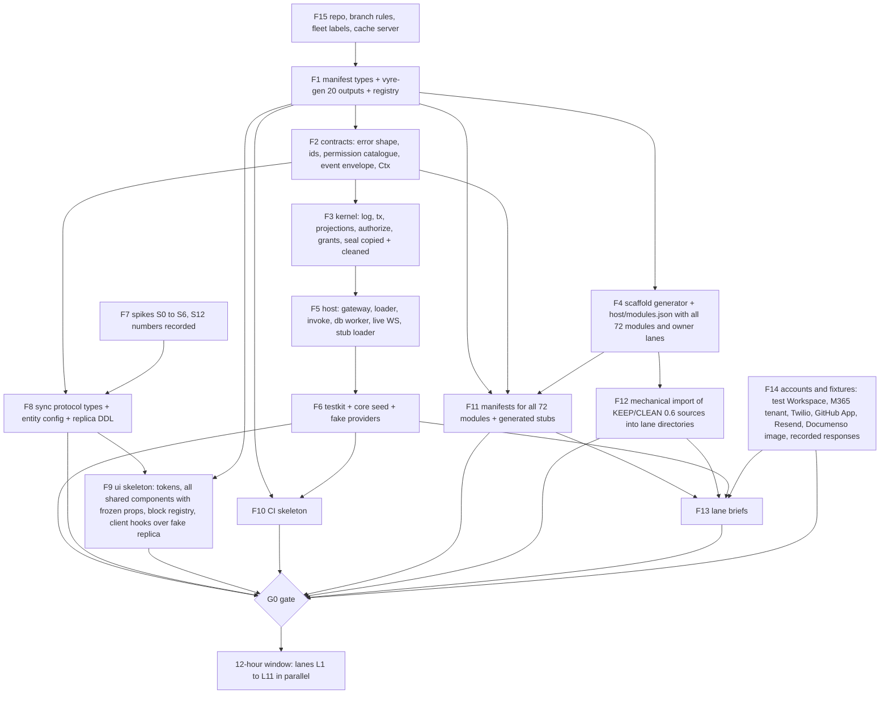

# Vyre v1 architecture

Status: build input for the 12-hour parallel window. Inputs: ARCH-DECISIONS.md (binding), V1-SPEC.md, REUSE-MAP.md, research-sync.md, CONSOLE-SPEC.md. Where this file says "decision N" it means ARCH-DECISIONS.md item N. Where it says "spec 2.9" it means V1-SPEC.md section 2.9. A rule stated here with "MUST" is checked by a script in CI (section 10), not by review. Adversarially reviewed on 24 Oct against V1-SPEC.md, ARCH-DECISIONS.md, the lead rulings and the real 0.6.9 interfaces; every change is in the Review log at the end, the row-by-row coverage matrix is Appendix C, and the build order that lets lanes run in parallel without waiting on each other is section 12.

Conventions used below:
- `<primitive>.<verb>` names events and capabilities (spec b10). Capability names and event names share one namespace per primitive: `records.update` is the capability, `record.updated` is the event it emits.
- All code is TypeScript run directly by Node 24 type stripping. Only erasable syntax is allowed (no `enum`, no `namespace`, no parameter properties, no decorators). `tsc --noEmit` is the type check. Imports carry the `.ts` extension. The Expo app is bundled by Metro, which accepts the same subset.
- SQLite is `node:sqlite` on the server and on the desktop daemon, `expo-sqlite` on phones, `wa-sqlite`/sqlite3mc on web.
- No em dashes, no section sign, in code, copy or docs.

---

## 1. Overview and system diagram

### 1.1 The shape in six sentences

1. One daemon per Space host, `vyred`, owns one SQLite event log per Space (single writer) and everything derived from it.
2. Every feature is a module: a folder with a typed manifest and an implementation. Modules never import each other; they call capabilities through the gateway.
3. Every call from a screen, Kit, agent, outside tool, connector or automation is the same thing: a capability invocation through the gateway, which runs the one `authorize`, writes events, and returns the shared result or error shape.
4. Clients keep an encrypted partial SQLite replica per Space, read only from it, and write by queueing capability ops in an outbox that the sync client pushes. The server is authoritative.
5. Agents are processes (API drivers in-process, CLI engines in sandboxes) driven by a queue-per-thread turn engine whose state is events in the log; their tools are generated from the same manifests as the API.
6. A person's computer runs the same `vyred` binary in `device` role (local turns, vault filler, local terminal, Chrome bridge); a Personal Space is a `space` role daemon on that same computer.

### 1.2 Roles of the one binary

| Role flag | Where | Does |
|---|---|---|
| `vyred --role space` | Team Space server (Linux or Mac); also the person's computer for a Personal Space | Hosts a Space: event log, projections, modules, scheduler, sync server, public ingress (Caddy), docker services |
| `vyred --role device` | Each person's Mac/Windows/Linux computer | Runs private-chat turns with the person's CLI logins and keys, the separate vault filler process, local terminal and Chrome bridge, endpoint connection manager, a `node:sqlite` device replica used by the headless runner, the CLI and the Chrome bridge (the desktop shell's own UI uses the web replica, 5.10) |
| `vyred --role space,device` | Person's computer with a Personal Space | Both, one process tree |

Phones and the plain browser run no daemon. They use the sync client in the app and talk to the Space host. A private chat started on a phone runs on the Space (spec b8). For a Personal Space the host is one of the person's own desktop devices, reached through the relay while it is online (5.13, lead ruling Q2).

### 1.3 System diagram



### 1.4 Request path (one call, end to end)

1. A screen calls `api.records.update(input)` from the generated typed client. The client creates `traceId` (128-bit hex) if the call is a new user action, writes a row to the local replica (optimistic) and an op to `pending_ops`.
2. The sync client pushes the op batch (HTTP `/sync/v1/push`) or, for online-only capabilities, calls `POST /api/v1/<ns>/<verb>` directly. Both carry `x-vyre-trace`.
3. Gateway: verify session token, resolve principal and `actingFor`, load the route record from the generated route table, validate input with the compiled schema, check idempotency key.
4. `authorize(principal, actingFor, action, resource, ctx)` returns a Decision (allow with scope, deny with reason steps, or hold with Gate obligation).
5. Handler runs inside `kernel.tx(...)`: it reads projections, calls `ctx.emit(event)`; the kernel appends events and runs inline projections in the same transaction, writes audit rows when the capability is audited, commits.
6. Gateway returns `{ok, data}` or `VyreError`. Async consumers (FTS, vectors, automations, notifications, webhooks out, sync fan-out) see the events through durable cursors. The sync server pushes `{seq}` and filtered change frames over the WebSocket; the originating device gets its own confirmation and reconciles.
7. A structured log line (trace id, capability, result, duration, cost) goes to `logs.db`.

---

## 2. Repository layout

New repository: `vyre-ai/vyre-v1` (renamed to `vyre-ai/vyre` at cutover).

Reasons for a new repo over a `v1/` root in the old one: the old repo has about 20,500 commits, 89 workflows, ratchets, golden files and generated-file bots that would apply to a `v1/` root unless removed; a `v1/` root keeps CI path filters and branch rules entangled with 0.6 until cutover; history is not carried (decision 1); license/NOTICE hygiene (MIT/Apache only, build-checked) is cleaner from a first commit. The cost is that copied files lose blame; every copied file gets a header comment `// from vyre 0.6.9 <path>@<sha>` for traceability, removed after a cleanup pass.

### 2.1 Top level

```
vyre-v1/
  package.json                 npm workspaces, scripts: gen, check, test, perf, golden, release
  tsconfig.base.json           strict, erasableSyntaxOnly, allowImportingTsExtensions, noEmit
  .node-version                24
  NOTICE, LICENSE, changelog.md
  lib/                         @vyre/lib       pure helpers, no I/O beyond node builtins
  contracts/                   @vyre/contracts hand-written shared types + generated registry (committed)
  manifest/                    @vyre/manifest  defineManifest, schema helpers, validator, vyre-gen CLI
  kernel/                      @vyre/kernel    trusted core
  host/                        @vyre/host      vyred: gateway, module loader, scheduler, supervisor
  sync/                        @vyre/sync      protocol, hlc, server pull/push, client engine, device store adapters
  agent/                       @vyre/agent     turn engine, drivers, warm pool, MCP server, transcript
  sandbox/                     @vyre/sandbox   sandbox adapters (docker, seatbelt, bwrap), computer image control
  modules/<name>/              @vyre/mod-<name> one folder per module (section 2.3)
  client/                      @vyre/client    typed client (generated), local query layer, reactive store, connection manager
  ui/                          @vyre/ui        shared components, tokens and skins, Kit runtime, block renderers
  apps/app/                    Expo app (all places, web/iOS/Android)
  apps/console/                Expo web entry for the Console site (shares @vyre/ui)
  apps/desktop/                Tauri 2 shell (Rust; system webview loads the web build; `vyred` device daemon as sidecar binary)
  apps/chrome/                 MV3 extension "Vyre for Chrome"
  apps/reports/                reports.vyre.run service
  relay/                       @vyre/relay-client, relay-node, relay-worker (publishable as its own repo)
  kits/                        built-in Kits (default, law-firm intake, estate planning, harbor-studio fixture)
  connectors/                  built-in connector folders (hubspot first)
  images/                      Dockerfiles: vyred, person-sandbox, agent-computer, pinned third-party (documenso)
  testkit/                     @vyre/testkit   createTestSpace(), fake clocks, fake providers, recorded HTTP
  fixtures/seed/               the seeded Space (section 12.3)
  golden/                      golden flows (section 10.3)
  perf/                        perf harness and budgets.json (section 9)
  scripts/                     ci-select, boundaries, license-check, release, sign, bump, gen wrapper
  docs/                        ADRs (short) + generated reference (committed, checked by gen --check)
```

### 2.2 What each package owns and may import

Layers are a DAG. A package may import only from layers strictly below it, plus the named exceptions. `scripts/boundaries.ts` parses every import (static and dynamic) and fails on a violation.

| Layer | Packages | Owns | May import |
|---|---|---|---|
| 0 | `lib`, `manifest` (types and schema helpers part) | ids, canonical JSON, hlc, urn, md utils, diff, acme, error types; manifest types | node builtins, third-party allowlist |
| 1 | `contracts`, `kernel` | shared types and generated registry; event log, authorize core, grants, seal, identity, audit, idempotency, tx | layer 0. `kernel` MUST NOT import `contracts/generated` (the kernel is generic; it receives the registry at boot) |
| 2 | `host`, `sync` (server and client halves are separate entry points), `client` (types, query layer, connection manager) | gateway, loader, scheduler; sync protocol and engines; typed client runtime | layers 0 and 1. `client` imports `contracts` and `sync/client` only; never `kernel`, `host`, `modules` |
| 3 | `modules/*`, `agent`, `sandbox` | features | layers 0 to 2 through public entry points (`@vyre/kernel` public API via `ctx`, not file paths). Modules MUST NOT import another module. They call capabilities with `ctx.call('<cap>', input)` or the generated typed stub `@vyre/contracts/stubs` (types plus a thin `ctx.call` wrapper) |
| 4 | `ui` | components, tokens, Kit runtime, block renderers | `client`, `contracts`, `lib`. Never server code |
| 5 | `apps/*`, `kits/*` (screens only), `relay/*` | entry points, glue | any lower layer; `apps/*` MUST NOT import `kernel`, `host`, `modules`, `agent`, `sandbox` |

Specific rules, each a boundary check:
- B1. Modules are leaf nodes: `modules/a` never imports `modules/b`. Shared logic goes to `lib` (pure) or becomes a capability.
- B2. Only `host` constructs the `ctx` passed to modules. A module touches the database only through `ctx.db` (scoped to its own tables, prefix `<module>_`), `ctx.emit`, `ctx.call`, `ctx.vault`, `ctx.http` (egress restricted to the connector's declared domains), `ctx.log`, `ctx.schedule`. No `node:sqlite` import outside `kernel`, `sync` (device adapters) and `modules/search`.
- B3. Only `kernel` and `modules/vault` import crypto primitives for key handling; others use `ctx.seal`/`ctx.unseal`.
- B4. `ui` components get data only through `client` hooks; no `fetch` in `ui` or `apps` outside `client`.
- B5. Generated files (`**/generated/**`) are never hand-edited; `gen --check` fails on drift.
- B6. Third-party allowlist in `scripts/allowlist.json` (license MIT, Apache-2.0, BSD, ISC, MPL-2.0 file-level only; AGPL/GPL/SSPL blocked by `license-check`). New dependency = one line in the allowlist with a reason.
- B7. A package's tests live inside the package and import only what the package may import, plus `@vyre/testkit`.
- B8. Named exceptions to the layer rule, all listed in `scripts/boundaries.json`: `modules/{engine,chat,mcp,memory,agents}` may import `@vyre/agent`; `modules/{computers,terminal,engine}` may import `@vyre/sandbox`; `@vyre/agent` and `@vyre/sandbox` MUST NOT import any module (they reach capabilities only through the `invoke` function injected at construction); `modules/sites` may import `host/src/caddy.ts` through the `ctx.platform` handle, not by path. Without B8 the rule 'layer 3 imports layers 0 to 2' would forbid `modules/engine` from bridging `@vyre/agent` (both are layer 3), which section 6 requires.

Initial third-party allowlist (all MIT/Apache-2.0/BSD): `@sinclair/typebox`, `ws`, `yjs`, `y-protocols`, `@noble/curves`, `@noble/hashes`, `@noble/ciphers`, `imapflow`, `mailparser`, `nodemailer`, `mailauth`, `docxtemplater`, `pizzip`, `exceljs`, `@ai-sdk/*` (adapters only), `expo`, `expo-sqlite`, `expo-router`, `react-native`, `react-native-web`, `@tauri-apps/api`, `@tauri-apps/cli` (Rust crates of the shell are MIT/Apache only, checked by `cargo deny` inside `license-check`), `sigma`, `graphology`, `@dicebear/*`, `boring-avatars`, `minidenticons`, `@twilio/voice-sdk`, `tiptap` (web editor), `playwright` (dev), `@xterm/xterm`, `@xterm/addon-*`, `wa-sqlite` or `sqlite3mc` wasm, `@huggingface/transformers` (embeddings, WASM backend). Docker is driven through the Engine API on the unix socket with `fetch` and the `docker` CLI via `execFile`; no docker SDK. Git is the `git` binary.

### 2.3 Module folder anatomy

```
modules/records/
  package.json                 name @vyre/mod-records, "vyre": {"manifest": "./manifest.ts"}
  manifest.ts                  pure data: defineManifest({...}); no functions
  impl.ts                      export const handlers: Handlers<typeof manifest>; export const projections; export const codecs
  projections.ts               reducers (inline) and consumers (async)
  migrations/0001_init.sql     DDL for the module's own tables (prefix records_)
  migrations/ts/0002_x.ts      data migrations (optional)
  generated/                   committed: handler types, route glue, contract tests, docs, schema.sql
  tests/*.test.ts              human tests (unit + module integration through createTestSpace)
  fixtures/                    recorded responses for connectors; seed rows for the seeded Space
  README.md                    ten lines max: owner, scope, what to call
```

`defineManifest` returns the manifest object typed with literal capability names so `Handlers<typeof manifest>` forces `impl.ts` to export exactly one handler per capability with the declared input and output types. A handler signature: `(ctx: Ctx, input: In) => Promise<Out>`. Handlers are the only place logic lives; anything callable by name is a capability.

### 2.4 Scaffold generator

`vyre-gen new module <name>` creates the folder above with a valid manifest (one capability, one event, one entity), handler stubs, migration, a contract test and a seeded-Space test, and registers the module in `host/modules.json`. The 12-hour lanes start from this scaffold, so the shape of every module is identical (freeze item F4, section 12).

### 2.5 Module list (server) and owner lane

`kernel-adjacent`: `identity`, `access` (roles, groups, grants, policies, labels, outside actors, access checker, reviews, generic folders and sharing 4.12, Ask for access 4.13), `members` (invites, join page, remove wizard, SSO, second factor), `spaces` (switcher data, stars and follows, onboarding checklist state), `devices`, `audit`, `settings`.
`runtime`: `events` (webhooks out, subscriptions), `tasks`, `runs`, `gate`, `notifications`, `search`, `logs`, `health`, `backup`, `updates`, `network`, `reports-client`, `sync` (server half of section 5: pull, push, snapshot, live, Yjs), `conflicts` (5.5), `home` (aggregate reads for Home), `governance` (retention jobs, holds, erase a person, tombstones; owns 4.11).
`work`: `chat` (channels, threads, messages), `agents`, `engine` (bridges `@vyre/agent` into capabilities), `memory`, `computers`, `terminal`, `mcp`.
`data`: `records` (includes merge and the RecordStore facade 4.3.1), `schema`, `sources`, `connectors`, `projects` (Projects/Journey record templates and plan), `import`, `files`, `mounts`, `git`, `previews`, `documents`, `runbooks` (md fenced block runner over `terminal`).
`comms`: `inbox`, `mail`, `calendar`, `telephony`, `meetings`, `contacts-link` (matching, preferences, suppression).
`automate`: `automations`, `journeys`, `steps-core`, `scheduler-api`.
`vault`: `vault`, `vault-requests`.
`apps`: `sites`, `forms`, `campaigns`, `email-builder-api`, `templates`, `kits`, `esign`, `portal` (site end-user accounts).
`console`: `console-assistant`, `console-views` (aggregate read capabilities for Overview, Usage).
`integrations`: `google`, `microsoft`, `github`, `zoom`, `stripe`, `twilio`, `resend`, `mailgun` (each a connector module with `kind: 'connector'`).

Seventy-two modules. Names used in section 7 that are not folders are folded: `stars`, `onboarding` into `spaces`; `merge` into `records`; `forms-core`, `bookings` into `forms`; `deployer` into `sites`; `send` into `mail`; `warmup` (client of the opt-in pool service) into `campaigns`; `models`, `spend`, `incidents` into `engine`; `connections` into `connectors`; `join`, `sso`, `second-factor` into `members`; `labels`, `actors` into `access`; `retention`, `holds`, `erase` into `governance`; `services` into `health`. Each module has exactly one owner lane (12.3 table is generated from `manifest.owner` and checked against this list by `scripts/lanes-check.ts`).

---

## 3. The manifest format

One format declares every extension point (spec b9, "Built to extend"). Manifests are `.ts` files that export pure data (no functions, no imports of runtime code). Schemas use TypeBox (JSON Schema plus static types), so one declaration yields the validator, the TS type, the MCP tool schema and the docs.

### 3.1 Root and shared types

```ts
// manifest/src/types.ts
import type { TSchema } from '@sinclair/typebox';

export type Schema = TSchema;                       // JSON Schema 2020-12 subset produced by TypeBox
export type Semver = string;
export type Level = 'view' | 'use' | 'edit' | 'manage';
export type Risk = 'low' | 'medium' | 'high';
export type Label = 'public' | 'internal' | 'confidential' | 'restricted';   // ranks 0..3
export type PermissionKey = string;                 // must exist in some manifest's permissions[]
export type CapName = `${string}.${string}`;        // 'records.update'
export type EventName = `${string}.${string}`;      // 'record.updated'
export type ComponentKey = string;                  // key in the @vyre/ui component registry, e.g. 'ui:RecordPage'
export type RoleName = 'owner' | 'admin' | 'developer' | 'member' | 'guest' | (string & {});
export type PlaceId = 'home' | 'chats' | 'inbox' | 'records' | 'files' | 'apps' | 'automations' | 'vault' | 'settings' | 'console';
export type ResourceType =
  | 'space' | 'record_type' | 'record' | 'project' | 'folder' | 'file' | 'channel' | 'thread' | 'inbox' | 'mailbox'
  | 'vault_folder' | 'vault_item' | 'automation_group' | 'automation' | 'agent' | 'connector' | 'connection'
  | 'site' | 'form' | 'campaign' | 'kit' | 'terminal' | 'computer' | 'task' | 'run' | 'number' | 'domain';

export interface Manifest {
  manifest: 1;
  id: string;                          // kebab, unique: 'records', 'google'
  version: Semver;                     // module semver; bump rules in section 3.6
  title: string;
  kind: 'module' | 'connector' | 'kit';
  owner: string;                       // lane id, for review routing; checked against the lane table (12.3)
  status: 'stub' | 'live';             // 'stub': the host serves generated example responses (3.7 output 19); the owning lane flips it to 'live' when handlers land
  requires?: Record<string, Semver>;   // other manifest ids this one calls (capabilities) or extends
  permissions?: PermissionDef[];
  capabilities?: CapabilityDef[];
  events?: EventDef[];
  entities?: EntityDef[];              // core synced tables
  recordTypes?: RecordTypeDef[];       // built-in record types (agents, projects, contacts ...)
  fieldTypes?: FieldTypeDef[];
  viewKinds?: ViewKindDef[];
  steps?: StepDef[];
  triggers?: TriggerDef[];
  connectors?: ConnectorDef[];
  agentTools?: AgentToolDef[];         // tools that are not 1:1 with a capability
  blocks?: BlockTypeDef[];             // native blocks agents send
  screens?: KitScreenDef[];
  health?: HealthCheckDef[];
  gateActs?: GateActKindDef[];
  taskKinds?: TaskKindDef[];
  notificationKinds?: NotificationKindDef[];
  importSources?: ImportSourceDef[];
  settings?: SettingDef[];             // per-Space policies and per-person settings rows
  retention?: RetentionDef[];
  fixtures?: { seed?: string; golden?: string[] };   // paths relative to the module
  lists?: ListDef[];                   // resource lists that get Personal / Shared with me / Space sections, folders and the share sheet (4.12)
}
```

### 3.2 Permission, capability, error

```ts
export interface PermissionDef {
  key: PermissionKey;                  // 'records.edit'
  area: 'space' | 'records' | 'files' | 'chats' | 'agents' | 'automations' | 'comms' | 'vault' | 'ai' | 'server'
      | 'apps' | 'sites' | 'kits' | 'runs' | 'terminal';
  title: string;                       // matrix row label
  risk: Risk;
  defaults: Partial<Record<RoleName, boolean>>;   // built-in role columns
  appliesTo: ResourceType[];
}

export type ErrorGroup = 'auth' | 'rate_limit' | 'validation' | 'provider' | 'timeout' | 'permission' | 'internal';
export type ErrorCode = `${ErrorGroup}.${string}`;   // 'permission.above_clearance', 'validation.field_locked'

export interface CapabilityDef {
  name: CapName;
  v: number;                           // contract version, starts at 1; breaking change = new v (section 3.6)
  summary: string;                     // one line, used by docs, MCP, tool_search
  input: Schema;
  output: Schema;
  errors: ErrorCode[];                 // every code the handler may return; contract test enforces
  resource: ResourceBinding;           // what authorize checks
  permission: PermissionKey | null;    // role permission needed; null = grant-only
  level: Level;                        // grant level needed on the resource
  risk: Risk;
  effects: 'read' | 'write' | 'outward';       // outward = leaves the Space (send, post, pay, deploy, push)
  gate?: { act: string; when?: string };       // GateActKind key; `when` is an Expr over input (e.g. recipients.external)
  emits: EventName[];                  // every event the handler may append
  idempotency: 'key' | 'natural' | 'none';     // 'key' = input.idempotencyKey required
  audit?: 'always' | 'sensitive' | 'none';
  label?: 'check' | 'filter';          // how sensitivity labels apply to results (check = fail; filter = omit)
  offline?: 'patch' | 'queue' | 'online';      // sync: 'patch' = field ops, 'queue' = replay as call, 'online' = never queued
  run?: { kind: string; stoppable: boolean };  // capability starts a Run and returns {runId}
  rate?: { n: number; perSeconds: number; scope: 'principal' | 'space' };
  surfaces: {
    http?: 'auto' | { method: 'GET' | 'POST' | 'PUT' | 'PATCH' | 'DELETE'; path: string };
    mcp?: { toolset: Toolset; name?: string; deferred?: boolean };   // deferred = found by tool_search, not listed
    agent?: boolean | { planMode: 'allowed' | 'blocked'; blocks?: string[] };   // default: true when mcp set
    cli?: string;                      // 'vyre records query'
    outboundWebhook?: boolean;         // may be subscribed from Console > Webhooks
  };
  examples: { name: string; input: unknown; output: unknown }[];            // >= 1; drives contract tests and docs
  forbids?: { name: string; as: RoleName | 'guest-no-grant'; input: unknown; error: ErrorCode }[];  // permission matrix tests
  teamOnly?: boolean;                  // refused with `permission.needs_team` in a Personal Space (spec 2.1 matrix); the screen shows 'Needs a Team Space'
  since: Semver;
}
export type Toolset =
  | 'records' | 'files' | 'memory' | 'vault' | 'automations' | 'chats' | 'inbox' | 'sites' | 'terminal'
  | 'computer' | 'agents' | 'tasks' | 'meta' | 'engineer';

export type ResourceBinding =
  | { type: ResourceType; id: string /* JSON pointer into input, e.g. '/recordId' */; parent?: string }
  | { type: ResourceType; create: true; parent: string }       // creation checks the parent
  | { type: 'space' };

// The shared error shape, spec 4.18. Runtime type in contracts/src/error.ts.
export interface VyreError {
  code: ErrorCode;
  message: string;                     // plain words, no ids
  cause?: { source: 'provider' | 'upstream' | 'internal'; provider?: string; status?: number; code?: string; message?: string };
  next: NextStep[];                    // never empty for a user-visible error
  retryable: boolean;
  traceId: string;
  details?: Record<string, unknown>;   // never secret values
}
export interface NextStep {
  kind: 'retry' | 'switch_model' | 'use_backup_key' | 'ask_access' | 'open_settings' | 'reconnect' | 'edit_input' | 'wait' | 'contact_admin' | 'report';
  label: string;
  action?: { cap: CapName; input: unknown };
}
```

### 3.3 Events, entities, record types, fields, views

```ts
export interface EventDef {
  name: EventName;                     // 'record.updated'
  sv: number;                          // schema version
  summary: string;
  payload: Schema;                     // no secret values; sealed fields appear as {sealed:true,changed:true}
  subject: { type: ResourceType | 'entity'; id: string /* JSON pointer in payload */ };
  vis: 'space' | 'participants' | 'owner' | 'private';  // who the sync/live filter may deliver it to (before ACL)
  e2e?: 'none' | 'owner';              // 'owner' = payload is ciphertext under the person's key
  label?: Label | 'subject';           // 'subject' = inherits the subject's label; redaction by clearance
  redact?: string[];                   // payload JSON pointers removed for readers below clearance
  trigger?: { fields?: string[]; title: string };   // usable as an Automation trigger; fields = filterable payload pointers
  notify?: string;                     // NotificationKind key
  retention?: string;                  // RetentionDef key
  replay: 'pure' | 'stub';             // 'stub' = outward effects recorded not executed in replay sandbox
}

export interface EntityDef {           // a core synced table (messages, tasks meta, files meta ...)
  key: string;                         // 'message'
  table: string;                       // projection table name, prefixed by module id
  idPrefix: string;                    // 'msg_'
  fields: Record<string, EntityFieldDef>;
  parent?: { entity: string; field: string };          // ACL inherits from parent
  acl: { resource: ResourceType; parentField?: string; ownerField?: string };
  sync: {
    profile: { desktop: 'all' | 'window' | 'none'; phone: 'all' | 'window' | 'none'; web: 'all' | 'window' | 'none' };
    window?: { days?: number; starred?: boolean; recentCount?: number };
    e2e?: 'none' | 'owner';
    maxLabel?: Label;                  // above this, rows are never mirrored (restricted: never on laptops)
    text?: string[];                   // fields that are Yjs docs
    protectedFields?: string[];        // go to the assistant on conflict (status, owner, money, locked, sealed)
  };
  fts?: string[];                      // fields indexed by search
  retention?: string;
}
export interface EntityFieldDef { type: string /* FieldTypeKey */; label?: Label; writeOnlyBy?: CapName[]; required?: boolean }

export interface RecordTypeDef {       // dynamic table rt_<key>; created by schema.apply at runtime or by manifests
  key: string;                         // 'contact', 'project', 'agent'
  title: string; plural: string; icon: string;
  system?: boolean;                    // cannot be dropped; some fields locked
  template?: 'project' | null;         // Journeys clone 'project'
  label: Label;
  titleField: string; summaryField?: string; statusField?: string; ownerField?: string;
  fields: FieldDef[];
  views?: SavedViewDef[];
  workspace?: boolean;                 // channel + folder + plan (Projects and Journey types only)
  group?: string;                      // sidebar group in Records
  scope?: 'space' | { site: string };  // site tables
  retention?: string;
  attribution?: boolean;               // First/Latest source field group
}
export interface FieldDef {
  key: string; type: string /* FieldTypeKey */; title: string;
  label?: Label;
  required?: boolean; unique?: boolean; default?: unknown | { expr: string };
  validate?: { expr: string; message: string };
  lockAfter?: 'approval';
  merge?: 'lww' | 'assistant' | 'text-crdt' | 'append';       // default from the field type
  writeOnlyBy?: CapName[];
  options?: Record<string, unknown>;   // validated by the field type's `options` schema
}

export type FilterOp = 'eq' | 'ne' | 'gt' | 'gte' | 'lt' | 'lte' | 'in' | 'contains' | 'starts' | 'empty' | 'notempty' | 'between' | 'rel_in';
export interface FieldTypeDef {
  key: string;                         // 'money', 'sealed', 'ai', 'button' ... full list in spec 2.9
  title: string;
  storage: { columns: { suffix: string; sql: 'TEXT' | 'INTEGER' | 'REAL' | 'BLOB' }[] } | { derived: 'formula' | 'lookup' | 'rollup' | 'auto' | 'none' };
  value: Schema;                       // JSON shape of one value
  options?: Schema;                    // shape of FieldDef.options
  merge: 'lww' | 'assistant' | 'text-crdt' | 'append';
  sealed?: boolean;                    // value is ciphertext at rest; agents get a handle
  filterOps: FilterOp[]; sortable: boolean; groupable: boolean; indexable: boolean;
  cell: ComponentKey; editor: ComponentKey; csv: 'text' | 'json' | { codec: string };
  codec?: string;                      // named codec exported from impl.ts: parse, format, compare, toText
}

export interface ViewKindDef {
  key: 'table' | 'board' | 'calendar' | 'timeline' | 'gallery' | 'list' | 'map' | 'form' | 'chart' | (string & {});
  title: string;
  needs?: { fieldType: string; as: string }[];         // e.g. board needs a choice or status field as 'group'
  config: Schema;
  component: ComponentKey;
  query: 'rows' | 'aggregate';
}
export interface SavedViewDef { key: string; kind: string; title: string; config: unknown; shared?: boolean; filter?: unknown; sort?: unknown; group?: string }
```

### 3.4 Steps, triggers, connectors, agent tools

```ts
export interface StepDef {             // an Automation / Journey / Campaign step kind
  key: string;                         // 'records.update', 'send_email', 'ai', 'wait_stage'
  title: string; category: 'data' | 'send' | 'ai' | 'control' | 'wait' | 'code' | 'sheet' | 'sign' | 'journey';
  kind: 'capability' | 'ai' | 'control' | 'wait' | 'code';
  cap?: CapName;                       // kind 'capability': the step is exactly this capability call (input mapping + templating)
  input: Schema; output: Schema;
  effects: 'read' | 'write' | 'outward';
  gateAct?: string;
  errors: ErrorCode[];
  retry: { max: number; backoff: 'none' | 'linear' | 'exp'; baseMs: number };
  idempotency: 'key' | 'natural' | 'none';
  compensate?: CapName;                // used by "Undo this run" where possible
  editor: ComponentKey;
  sample: unknown;                     // sample output for test mode
  waits?: { timeoutDefault: string; cancelsOn: EventName[] };
}
export interface TriggerDef {
  key: string;                         // 'record_change', 'schedule', 'webhook', 'form_submit', 'email_received' ...
  title: string;
  source:
    | { event: EventName; filter?: Schema }
    | { schedule: true; ifMissed: ('skip' | 'run_once')[] }
    | { webhook: true; path: string }
    | { manual: true } | { button: true };
  payload: Schema;                     // what the run receives as $trigger
  sample: unknown;
  allowSelfTrigger: boolean;           // default false; chain depth limit 8 enforced by the engine
  personalOk: boolean;                 // false for webhook triggers (needs a Team Space); capabilities carry the same flag as `teamOnly` (3.2)
}

export interface ConnectorDef {
  key: string;                         // 'hubspot', 'google', 'zoom'
  title: string;
  mode: 'api' | 'mcp' | 'dwd' | 'oauth_app' | 'webhook_only';
  scope: 'person' | 'space';           // who owns a Connection
  auth:
    | { type: 'api_key'; secret: string }
    | { type: 'oauth2'; authUrl: string; tokenUrl: string; scopes: string[]; pkce: boolean }
    | { type: 'service_account_dwd'; scopes: string[] }
    | { type: 'client_credentials'; tokenUrl: string; scopes: string[] }
    | { type: 'hmac_webhook'; header: string; algo: 'sha256' | 'sha1'; secret: string };
  domains: string[];                   // the only egress hosts (enforced by ctx.http)
  secrets: { name: string; description: string }[];    // names only, resolved from the Vault
  sources?: { key: string; path: string; verify: 'hmac' | 'signature' | 'none'; event: EventName; dedupe: string /* JSON pointer */ }[];
  syncedTypes?: SyncedTypeDef[];
  actions?: CapName[];                 // capabilities this connector contributes
  rate: { rps: number; burst: number };
  health: string;                      // HealthCheckDef key
  tests: string;                       // folder of recorded responses
}
export interface SyncedTypeDef {
  type: string;                        // record type key
  remote: string;                      // remote object name
  fields: { key: string; remote: string; dir: 'pull' | 'push' | 'both' | 'off'; transform?: string }[];
  match: string[]; createAtSource: boolean; deletes: 'off' | 'soft' | 'travel';
  conflict: 'newest' | 'source' | 'vyre' | 'ask';
  polling: { activeSec: number; idleSec: number; dormantSec: number }; nightlyReconcile: boolean;
}

export interface AgentToolDef {        // agent-only tools (capability-backed tools come from capabilities[])
  name: string;                        // 'terminal_run', 'ask_question', 'plan_propose', 'wait_for'
  summary: string;
  input: Schema; output: Schema;
  cap?: CapName;                       // if backed by a capability, input/output default to it
  local?: 'terminal' | 'chrome' | 'screen' | 'files' | 'none';   // where it executes
  effects: 'read' | 'write' | 'outward';
  planMode: 'allowed' | 'blocked';
  blocks?: string[];                   // BlockType keys the result renders as
  deferred?: boolean;
  examples: { input: unknown; output: unknown }[];
}
```

### 3.5 Blocks, Kit screens, health, Gate acts, tasks, notifications

```ts
export interface BlockTypeDef {        // spec "native blocks"; unknown types render as a generic block with the trace id
  type: string;                        // 'terminal', 'changeset', 'question', 'plan', 'deploy', 'mount', 'record_card',
                                       // 'table', 'doc_excerpt', 'diff', 'file', 'screenshot', 'form_fields', 'checklist', 'tab_opened',
                                       // 'memory_saved' ("Saved to your layer, Propose for team"), 'vault_used' ("Used TWILIO_KEY by name, never shown"),
                                       // 'access_request', 'secret_input' (client-only paste field for a Vault value), 'model_switch' (sub-task model and effort), 'helper', 'diff_card' (Console assistant)
  v: number;
  data: Schema;
  actions?: { key: string; label: string; cap: CapName; input: Record<string, string> /* pointers into block data */ }[];
  opens?: { tab: string; input: Record<string, string> };     // "open as tab"
  waitsForAnswer?: boolean;            // question, plan: the turn parks until answered
  component: ComponentKey;
  fallback: string;                    // text template for CLI/mail/phone-notification rendering
}

export type LayoutNode =
  | { t: 'stack' | 'row'; gap?: number; children: LayoutNode[] }
  | { t: 'list' | 'table' | 'board'; bind: string; row: LayoutNode; empty?: string }
  | { t: 'text'; value: string; style?: string }
  | { t: 'field'; bind: string; field: string }
  | { t: 'button'; label: string; action: string }
  | { t: 'use'; component: ComponentKey; props?: Record<string, string> }
  | { t: 'when'; expr: string; then: LayoutNode; else?: LayoutNode };

export interface ListDef {             // spec 2.4: every list of things is organised the same way
  type: ResourceType;                  // 'site', 'form', 'automation', 'agent', 'record_type', 'vault_item', 'channel', 'terminal', 'file' ...
  title: string; plural: string;
  items: CapName;                      // capability that lists items (receives {section, folder})
  folders: boolean;                    // folders with counts in the sidebar
  newItemStartsPersonal: true;         // fixed by the spec; present so a lint can assert nobody sets it false
  shareLevels: Level[];                // which of view/use/edit/manage the share sheet offers (vault: use/edit/manage)
}

export interface KitScreenDef {
  id: string;                          // 'inbox.contact-tab'
  place: PlaceId | 'shell';
  slot: 'main' | 'side' | 'sidebar' | 'sheet' | 'tab' | 'popover';
  builtin?: ComponentKey;              // built-in screens bind to a registered component
  layout?: LayoutNode;                 // declarative screens (Kit-authored)
  queries: Record<string, { cap: CapName; input: Record<string, string>; live: boolean; local?: 'sql' }>;
  actions: Record<string, { cap: CapName; input: Record<string, string>; confirm?: string; undo?: boolean }>;
  states: { empty: { line: string; primary?: string }; offline: { line: string }; error: { line: string; primary: string } };
  menus?: { target: string; items: { label: string; icon: string; action: string; keys?: string; when?: string }[] }[];
  keys?: { combo: string; action: string; when?: string }[];
  needs?: PermissionKey[];
  perf?: { firstPaintMs: number; completeMs: number };         // checked by the perf harness
  ask?: { suggestions: Partial<Record<Level, string[]>> };     // Ask pane greeting and chips by the viewer's level (4.13)
}

export interface HealthCheckDef {
  key: string;
  title: string;
  cap: CapName;                        // cheap idempotent read; returns {state, detail?}
  intervalSec: number; timeoutMs: number;
  states: { degradedWhen?: string; downWhen?: string };        // Expr over result/latency
  dependsOn?: string[];
  pauses?: ('automations' | 'sync' | 'sends' | 'campaigns')[]; // visible reason shown on the paused thing
  next: string;                        // plain next step shown when not healthy
}

export interface GateActKindDef {
  key: string;                         // 'send', 'post', 'pay', 'delete', 'push_protected', 'campaign_launch', 'secret_export',
                                       // 'site_promote', 'signature_send', 'spend_raise'
  title: string; risk: Risk;
  preview: { blocks: { type: string; from: string /* template over input */ }[] };    // exact preview
  approvers: { default: string /* 'role:admin' | 'owner' | 'asker' */; peopleOnly: boolean; agentOkFor?: Risk };
  timeout: { afterHours: number; onTimeout: 'drop' | 'escalate'; escalateTo: 'delegate' | 'role'; emailBackstopHours: number };
  appliesTo: { actors: ('agent' | 'automation' | 'campaign')[]; humanToo: boolean };   // humanToo: launches, promotes, protected pushes, exports
  sendsOnApprove: CapName;             // re-invoked with an approval token bound to the payload hash
}

export interface TaskKindDef {
  key: 'work' | 'approve' | 'review' | 'answer' | 'unblock' | 'signature' | (string & {});
  title: string;
  needsYou: boolean;                   // appears in Needs you when Ready
  slots: ('assigned' | 'reviewer' | 'approver')[];
  initial: TaskState;
  closeOn: 'complete' | 'act';
  actions: { key: string; label: string; to?: TaskState; cap?: CapName; note?: 'required' | 'optional' }[];
  blocks: string[];
}
export type TaskState = 'todo' | 'doing' | 'in_review' | 'awaiting_approval' | 'done' | 'canceled';

export interface NotificationKindDef {
  key: string;
  level: 'interrupt' | 'badge' | 'digest';
  place: PlaceId;
  title: string; body?: string;        // templates; push never includes content, only `pushTitle`
  pushTitle?: string;
  collapseKey: string;                 // template: 'approval:{{subject}}'
  respectHours: boolean;
  actions?: { label: string; cap: CapName }[];
  agentRateKey?: string;               // counts toward the 3 per hour agent interrupt cap
  backstopEmailAfterHours?: number;
}

export interface ImportSourceDef { key: string; title: string; accepts: string[]; parse: CapName; mapsTo: 'record_type' | 'vault' | 'files' | 'contacts' }
export interface SettingDef { key: string; scope: 'space' | 'person'; page: string; title: string; schema: Schema; default: unknown; floorable?: boolean }
export interface RetentionDef { key: string; title: string; default: string /* '90d' */; holdable: boolean; tombstone: boolean }
```

### 3.6 Versioning rules (checked by `vyre-gen diff`)

- A released capability `v` is immutable in shape except: new optional input fields, new output fields, new error codes, new examples.
- Breaking change (remove or retype a field, tighten validation, change effects): new `v` (`records.update@2`). The old route and tool name stay for two minor versions of the server, then are removed. The client and MCP always bind the latest `v`; Kits and outside tools may pin.
- Events: payload additions are free; any breaking change bumps `sv`; the sync client and automations handle the previous `sv` through an upcaster exported from the owning module (`upcast(event) => event`).
- `vyre-gen diff --against release/<tag>/registry.json` runs in `check.yml`; a breaking diff without a version bump fails.
- The server supports apps within 2 minor versions (spec 3.10); the sync handshake carries `{appVersion, registryHash}`; an older app gets `update_required` and read-only mode.

### 3.7 Code generator (`vyre-gen`) outputs

Input: every `modules/*/manifest.ts`, `connectors/*/connector.toml` (compiled to the same ConnectorDef), `kits/*/manifest.ts`. Output is committed; `vyre-gen --check` regenerates into a temp dir and diffs (no generated-file bots).

| # | Output | Path | Consumed by |
|---|---|---|---|
| 1 | Merged registry (capabilities, events, permissions, entities, kinds) | `contracts/generated/registry.json`, `registry.ts` | host boot, sync handshake, docs, diff |
| 2 | Route table and compiled validators | `host/generated/routes.ts`, `validators.ts` | gateway |
| 3 | Handler types, one per module | `modules/*/generated/handlers.d.ts` | `impl.ts` (type-checked) |
| 4 | Typed client: one function per capability, live query hooks for `queries` in screens | `client/generated/api.ts`, `hooks.ts` | `ui`, `apps` |
| 5 | Module call stubs (types plus `ctx.call` wrapper) | `contracts/generated/stubs.ts` | other modules (B1) |
| 6 | MCP tools: names, descriptions, JSON Schemas, toolsets, deferred flags; agent tool list | `agent/generated/tools.ts`, `mcp-tools.json`, `tool-index.json` | MCP server, API drivers, `tool_search` |
| 7 | CLI command table | `host/generated/cli.ts` | `vyre` CLI |
| 8 | Contract tests per capability: examples validate, output validates, declared errors only, permission matrix per role from `permission`/`level`/`forbids`, emitted events subset of `emits`, idempotent replay returns the same result, events carry the trace id | `modules/*/generated/*.contract.test.ts` | CI |
| 9 | Event contract tests: payload schema; `vis`, `label` and `redact` applied for a reader below clearance | `modules/*/generated/events.contract.test.ts` | CI |
| 10 | Permission catalogue, built-in role defaults, risk dots | `contracts/generated/permissions.ts`, `modules/access/generated/seed.sql` | Console matrix, `authorize` |
| 11 | Event catalogue (also the Automation trigger palette and notification rules) | `contracts/generated/events.ts`, `docs/generated/events.md` | automations editor, docs, webhooks |
| 12 | Sync entity config (profiles, windows, protected fields, e2e) and replica DDL for core entities | `sync/generated/entities.ts`, `sync/generated/replica.sql` | sync server and client |
| 13 | Core entity DDL for projections | `modules/*/generated/schema.sql` | migration runner |
| 14 | Kind tables (gate acts, task kinds, notification kinds, health, retention, settings) | `contracts/generated/kinds.ts` | gate, tasks, notifications, health, settings UI |
| 15 | Block registry types and fallback renderers | `ui/generated/blocks.ts` | chat renderer |
| 16 | Docs: one page per capability, event, permission, error code, connector | `docs/generated/**` | docs site |
| 17 | Screen index and perf probes | `ui/generated/screens.ts`, `perf/generated/probes.json` | Kit runtime, perf harness |
| 18 | Agent skill index (capability summaries for `tool_search`) | `agent/generated/tool-index.json` | agent runtime |
| 19 | Stub handlers: for every capability a handler returning its first `examples[].output` (and emitting its declared events with example payloads in the test clock), used when the module's `status` is `stub` | `modules/*/generated/stub-impl.ts` | host, testkit, other lanes (12.3) |
| 20 | Lane brief skeleton per `owner` lane: owned directories, module list, every capability and event to implement, contract tests that must go green, spec sections, budgets and golden flows touched | `docs/lanes/<lane>.md` | worker briefs (12.2 F13) |

The generator is under 1,500 lines and is tested by golden-output tests against a two-module fixture manifest.

Validation before emit (fails the build): duplicate names; `emits` names a declared event; `cap` references resolve across `requires`; every `permission` exists; every capability with `effects:'outward'` has a `gate` or an explicit `gate: { act: 'none', reason }`; every entity field type exists; every `screens.queries` capability exists; every `blocks.actions.cap` exists; every `examples` entry validates against its schema; every `errors` code is in the global catalogue (`contracts/src/errors.ts`); agent parity: every capability that a screen action or query reaches has `surfaces.agent` true or is listed in `contracts/agent-optout.json` with a reason (spec: every feature a person has is a native agent tool, nothing missing); every `ListDef.items` capability exists; every versioned resource type (records, files, automations, memory notes, Kits, agent definitions) declares `<type>.versions` and `<type>.restore_version` (spec 4.5 History), consumed by the single `ui/HistoryTab` and `ui/DiffTab`; every manifest `owner` is a lane in `scripts/lanes.json` and every module appears in exactly one lane; every `status:'live'` module has a handler for each capability (`impl.ts` type-checks against `handlers.d.ts`).

---

## 4. Core

### 4.1 Storage files per Space

| File | Contents | Writer |
|---|---|---|
| `events.db` | event log, projections (inline), principals, roles, grants, resources, policies, outbox/idempotency, runs, tasks, thread queue | the single writer (db worker thread) |
| `index.db` | FTS5 tables, vector table (BLOB + brute-force cosine, `sqlite-vec` optional accelerator), graph edges | async consumer `search` |
| `logs.db` | structured logs, spans, health samples | log sink worker |
| `blobs/` | content-addressed file bytes, AES-GCM under the Space key (or owner key for private) | files module via kernel blob API |
| `docs/` | Yjs update logs live in `events.db` table `doc_updates`; snapshots in `doc_snapshots` | sync/yjs |

All databases run in WAL. `node:sqlite` `DatabaseSync` blocks the thread, so `events.db` lives in a dedicated `worker_threads` Worker (the db worker): writes are batched (group commit window 2 ms or 64 ops) and applied as one transaction each; reads use a pool of 2 to 4 read-only worker connections. The main thread never runs SQL. This is how a write path stays under 10 ms server-side while the gateway handles other calls.

### 4.2 Event log schema (events.db)

```sql
CREATE TABLE events (
  seq         INTEGER PRIMARY KEY,           -- monotonic per Space; the cursor
  id          TEXT NOT NULL UNIQUE,          -- uuidv7, minted by the emitter (idempotent re-append)
  type        TEXT NOT NULL,                 -- 'record.updated'
  sv          INTEGER NOT NULL,              -- event schema version
  hlc         TEXT NOT NULL,                 -- hybrid logical clock, server-assigned or clamped client
  at          INTEGER NOT NULL,              -- server wall ms when appended
  trace_id    TEXT NOT NULL,                 -- 32 hex
  span_id     TEXT,
  actor       TEXT NOT NULL,                 -- principal id: usr_, agt_, act_ (outside actor), svc_
  on_behalf   TEXT,                          -- person id the actor acted for
  device      TEXT,
  run_id      TEXT,                          -- Run (automation run, agent run, wait ...)
  cause       TEXT,                          -- event id that caused this one
  origin      TEXT,                          -- 'automation:aut_x' | 'agent:agt_x' | 'sync:con_x' | 'user'
  depth       INTEGER NOT NULL DEFAULT 0,    -- chain depth for self-trigger limit (8)
  entity      TEXT,                          -- entity key or record type key
  entity_id   TEXT,
  fields      TEXT,                          -- JSON array of changed field keys (for filters, no values)
  label       INTEGER NOT NULL DEFAULT 0,    -- subject label rank 0..3
  vis         TEXT NOT NULL,                 -- 'space' | 'participants' | 'owner' | 'private'
  enc         INTEGER NOT NULL DEFAULT 0,    -- 0 plain, 1 space key, 2 owner key (E2E)
  key_id      TEXT, nonce BLOB,
  payload     BLOB NOT NULL,                 -- JSON, or ciphertext when enc>0
  commit_     BLOB NOT NULL,                 -- H(salt || canonical payload); salt stored in event_salts and erased with the payload
  prev        BLOB NOT NULL,                 -- hash chain (kernel/core/events.js `hashOf`/`verifyEvents`, genesis `vyre-genesis:<space>`)
  hash        BLOB NOT NULL
);
CREATE INDEX ev_entity ON events(entity, entity_id, seq);
CREATE INDEX ev_type   ON events(type, seq);
CREATE INDEX ev_trace  ON events(trace_id);
CREATE INDEX ev_run    ON events(run_id, seq);
CREATE TABLE event_salts (event_id TEXT PRIMARY KEY, salt BLOB NOT NULL);   -- erased on "erase a person"
CREATE TABLE checkpoints (seq INTEGER PRIMARY KEY, hash BLOB, at INTEGER, key_id TEXT, sig BLOB);  -- every 1000 events or 10 min
CREATE TABLE consumers (name TEXT PRIMARY KEY, cursor INTEGER NOT NULL, updated INTEGER NOT NULL); -- durable async cursors
CREATE TABLE idempotency (key TEXT PRIMARY KEY, principal TEXT, cap TEXT, result BLOB, at INTEGER);  -- 30 days
CREATE TABLE tombstones (kind TEXT, subject TEXT, at INTEGER, PRIMARY KEY(kind, subject));  -- reapplied after any restore (spec 2.26)
```

- Events are append-only; payload bytes can be erased (set to a tombstone marker, salt deleted) without breaking the chain, because `hash` covers `commit_`, not the payload (reused from `kernel/core/events.js`). The 0.6 durable log (`kernel/store/sqlite-log.js`) keeps one JSON `event` per `kernel_events(seq, space, event, salt, generated columns)` row; v1 keeps that design: the columns listed above (except `seq`) are the 0.6 pattern of indexed VIRTUAL `GENERATED ALWAYS AS (json_extract(event, ...))` columns, extended with `entity`, `entity_id`, `trace_id`, `run_id`, `vis`, `label`, `origin`, so a database edit cannot disagree with the hashed event and the chain catches any change; v1 also keeps `kernel/audit` signed checkpoints (every 1,000 events or 10 minutes) as the `checkpoints` table.
- `fields` carries only keys, so filters and the Automation trigger "fields changed" work without reading payloads.
- Heartbeat: the live connection sends `{t:'hb', seq}` every 15 s. Catch-up is `pull(after=N)` (section 5).
- Per-chat sequence numbers (needed for "everything after N" on a thread) are the `thread_seq` column of the `messages` projection, assigned in the same transaction; the live frame carries both `seq` and `thread_seq`.

### 4.3 Projections

```ts
// kernel public API (kernel/src/projection.ts)
export interface ProjectionDef {
  name: string;                         // 'records.rows', 'access.acl_index'
  version: number;                      // bump = rebuild from log on boot
  mode: 'inline' | 'async';             // inline = same transaction as append; async = durable consumer
  on: Record<EventName, (tx: Tx, e: EventEnvelope) => void | Promise<void>>;
  upcast?: Record<EventName, (e: EventEnvelope) => EventEnvelope>;
  rebuild: 'replay';                    // all projections are rebuildable: `vyre rebuild --projection name`
}
```

Inline projections (must be fast, pure SQL, no I/O): `records.rows` plus `records.field_meta` (see below), `records.field_history`, `chat.messages` and `thread_queue`, `tasks.state`, `runs.state`, `files.meta`, `access.principals/roles/grants/resources`, `access.acl_index`, `sync.changes` (the change feed, section 5), `notifications.inbox`, `memory.facts`.
Async consumers (durable cursor in `consumers`): `search.fts`, `search.vectors`, `memory.graph`, `automations.triggers`, `events.webhooks_out`, `notifications.fanout`, `audit.export`, `logs.metrics`, `connectors.outbox` (sync pushes to remote apps), `sites.deployer`.

Record type tables. A record type compiles to table `rt_<typeKey>`:
- Columns: `id TEXT PRIMARY KEY (rec_<6 alnum>-style: lowercase alphanumeric)`, `owner`, `label INTEGER`, `version INTEGER`, `created_at`, `updated_at`, `deleted_at`, `holds INTEGER`, then one or more columns per field from the field type's `storage.columns` (`<field>`, `<field>__cur` for money currency, and so on). Indexed fields get indexes.
- Side table `rt_<typeKey>__fm (id, field, hlc, actor, seq, PRIMARY KEY(id, field))` holds the current clock per field; `field_history (type, id, field, value, hlc, actor, seq, reason)` holds losers and previous values.
- Schema changes are `schema.changed` events whose reducer runs the DDL (add column is `ALTER TABLE ADD COLUMN`; destructive changes first write a copy to `_trash_<field>` for 30 days). The replica applies the same DDL from the same event, so server and replica tables match.
- The 100,000-row table opens under 100 ms because the replica reads `SELECT <visible columns> FROM rt_x WHERE <view filter> ORDER BY <sort> LIMIT 200` from an indexed table, with the virtual list asking for windows (section 9).

### 4.3.1 The RecordStore facade (reuse of the 0.6 `Store` contract)

The 0.6 `Store` interface (`kernel/contracts/store.d.ts`: `define`, `types`, `describe`, `get`, `query`, `aggregate`, `create(type, id, data)`, `update(type, id, patch, base_version)`, `remove`, `restore`, `search`, `changes(since, limit)`, `health`, `version`, `export`, `features`; cursor paging; `StoreError` codes incl. `version_conflict`) is kept as the contract of two things, so its conformance suite (`kernel/conformance/suite.js`, ported to TS) keeps guarding them:
1. `modules/records` exposes a `RecordStore` over the `rt_<type>` tables. `define` is `schema.apply`; `update(..., base_version)` compares the row `version` column and returns `version_conflict` for API callers (HTTP, MCP, outside actors) who read a row and write it back. Sync ops do not use it: they carry per-field `baseSeq` and merge by field (5.4). The `changes(since)` feed is the `sync.changes` projection; `export` is the snapshot page generator (5.8).
2. Every connector `SyncedTypeDef` target (HubSpot, GitHub PRs, Sheets) implements the same interface against the remote system, with `features()` declaring what it lacks, so `connectors.sync` is one engine over any `Store`.
The kernel never trusts a store to enforce who may see what: `authorize` and `scopeFor` are applied by the gateway before and after, as in 0.6 (invariant 10).

### 4.4 Gateway and capability invocation

```ts
// host/src/invoke.ts (signature, not the whole body)
export interface Ctx {
  space: SpaceId;
  principal: Principal;                 // who acts: person, agent, actor, service
  actingFor?: PersonId;                 // the person whose access intersects
  trace: { traceId: string; spanId: string; parent?: string };
  run?: RunId;                          // enclosing Run
  thread?: ThreadId;
  origin: string; depth: number;        // self-trigger bookkeeping
  device?: DeviceId;
  now(): number;
  db: ScopedDb;                         // module-prefixed tables only
  emit<T>(name: EventName, subject: Urn, payload: T, opts?: EmitOpts): EventEnvelope;
  call<C extends CapName>(cap: C, input: In<C>, opts?: CallOpts): Promise<Out<C>>;   // goes through the gateway again, same authorize
  authorize(action: string, resource: ResourceRef): Decision;
  vault: { fill(handle: string, into: FillTarget): Promise<void>; use(handle: string): Handle };
  http: GuardedFetch;                   // egress restricted to the connector's domains
  log: Logger;                          // structured, no content
  schedule(at: number | Cron, cap: CapName, input: unknown): Promise<ScheduleId>;
  seal: { seal(v: Uint8Array, scope: SealScope): Sealed; unseal(s: Sealed): Uint8Array };   // vault service only for shared/sealed
}
```

`invoke(cap, input, ctxSeed)`:
1. Resolve `CapabilityDef` from the registry by name and `v`. Unknown name: `validation.unknown_capability`.
2. Validate input with the compiled validator. Failure: `validation.bad_input` with JSON pointers in `details`.
3. Idempotency: if `idempotency:'key'`, require the key; lookup in `idempotency`; return stored result.
4. Rate limit (token bucket per principal or per Space).
5. `authorize` (section 4.5). Deny returns `permission.*` with `next:[ask_access]` and logs an audit row of class deny. Hold returns `{status:'held', taskId, runId}` and parks the call (section 4.6).
6. Open `kernel.tx()`. Run handler. On throw: map to `VyreError` (unknown exceptions become `internal.unexpected` with the trace id, and an error log line with stack, never content).
7. Commit. Append events, inline projections, audit row, idempotency row, in the one transaction.
8. After commit: publish to the in-process bus (live subscriptions), log line, return.

### 4.5 Authorize

One function, used by the gateway for every call, by the sync filter, by search, by the MCP server and by the Console Access checker. It never reads module tables except through the access projections.

Data it reads (all in `events.db`, all inline projections; cached in memory with an epoch bumped by `access.changed`): `principals(id, kind, owner, status)`, `principal_roles`, `group_members`, `roles(id, clearance)`, `role_perms(role, perm)`, `grants(id, subject_kind, subject_id, resource_type, resource_id, level, conditions JSON, expires_at, by)`, `resources(id, type, parent_id, label, owner_id, holds)`, `policies(key, scope, value)`.

```ts
// kernel/src/authorize.ts
export interface Req {
  principal: PrincipalId; actingFor?: PersonId;
  action: { perm: PermissionKey | null; level: Level; destructive?: boolean };
  resource: ResourceRef;                 // {type, id} or {type, id: null, parent} for create
  fields?: string[];                     // fields touched/read, for hidden-field conditions
  row?: RowCtx;                          // row values for row-filter conditions (when checking one record)
  provider?: ProviderId;                 // when the result goes to an AI provider
  cap?: CapName; input?: unknown;        // for Gate rule matching
  now: number;
}
export interface Decision {
  effect: 'allow' | 'deny' | 'hold';
  reason: ReasonCode;                    // stable code
  steps: Step[];                         // plain-words trace for the Access checker
  scope?: Scope;                         // on allow: rowFilter, hiddenFields, labelCeiling, level
  obligations: Obligation[];             // gate, spend meter, audit class
  decisionId: string;                    // dec_<uuid>, carried by the events produced
}

function authorize(req: Req): Decision {
  const steps: Step[] = [];
  const subjects = [req.principal, ...(req.actingFor && req.actingFor !== req.principal ? [req.actingFor] : [])];
  const perSubject: Scope[] = [];
  for (const s of subjects) {
    const r = evalSubject(s, req, steps);
    if (r.deny) return deny(r.reason, steps);          // rule 5: intersection means every subject must allow
    perSubject.push(r.scope);
  }
  const scope = intersect(perSubject);                 // level = min; rowFilter = AND; hidden = union; labelCeiling = min
  // rule 4: policies, after access
  const obligations: Obligation[] = [];
  for (const p of policiesFor(req)) {
    if (p.kind === 'provider_label' && req.provider && !providerAllowed(p, resourceLabel(req), req.provider))
      return deny('provider_label', steps);            // "Restricted: not available to <provider>"; logged
    if (p.kind === 'spend' && overLimit(p, req)) return deny('limit', steps);
    if (p.kind === 'gate' && gateApplies(p, req)) obligations.push({ type: 'gate', act: p.act, approver: p.approver });
  }
  if (obligations.some(o => o.type === 'gate')) return { effect: 'hold', reason: 'needs_approval', steps, scope, obligations, decisionId: id() };
  return { effect: 'allow', reason: 'ok', steps, scope, obligations, decisionId: id() };
}

function evalSubject(s: PrincipalId, req: Req, steps: Step[]): { deny?: true; reason?: ReasonCode; scope?: Scope } {
  const p = principal(s);
  if (p.status !== 'active') return d('suspended');
  // rule 1: role permission (union over own roles and group roles). Agents never hold owner/admin.
  const roles = rolesOf(s);                              // includes groups' roles
  if (req.action.perm && !roles.some(r => hasPerm(r, req.action.perm))) return d('role_lacks_permission');
  steps.push(ok(`${p.name}: role ${roleNames(roles)} allows ${req.action.perm ?? 'this action'}`));
  // rule 6 pre-check: owners hold Manage on what they own, unless a hold or label blocks (checked below)
  const res = resource(req.resource);                    // walks ancestors lazily via resources.parent_id
  const isOwner = res.owner_id === s;
  // rule 2: grants on the resource or an ancestor (record -> record type -> folder; file -> folder ...)
  const chain = ancestors(res);                          // [res, parent, ..., root]
  const subjectKeys = subjectSet(s);                     // {actor:s, groups:[...], roles:[...]}
  const cands = grantsOn(chain, subjectKeys).filter(g => levelIncludes(g.level, req.action.level) && !expired(g, req.now));
  const matched = cands.filter(g => conditionsMatch(g.conditions, req));   // row filter, hidden fields, time window, label ceiling
  if (!matched.length && !(isOwner && !blockedByHoldOrLabel(res, roles, req)))
    return d('no_grant');
  steps.push(ok(matched.length ? `grant ${describe(matched[0])} (${matched[0].level})` : 'owner of the resource (Manage)'));
  // rule 3: clearance
  const clearance = Math.max(...roles.map(r => r.clearance));
  const label = effectiveLabel(res, req.fields);         // container label, raised by touched field labels
  if (label > clearance) return d('above_clearance');
  steps.push(ok(`label ${labelName(label)} within clearance ${labelName(clearance)}`));
  // holds: deny wins only through clearance and holds
  if (req.action.destructive && res.holds > 0) return d('on_hold');
  return { scope: {
    level: isOwner ? 'manage' : maxLevel(matched),
    rowFilter: orFilters(matched.map(g => g.conditions.rowFilter)),     // a grant without filter = all rows
    hiddenFields: intersectHidden(matched),                              // hidden only if hidden by every matching grant
    labelCeiling: clearance } };
}
```

Properties:
- `authorize` is synchronous and allocation-light; target under 50 microseconds per decision on a warm cache, 500 per second per core in the fast lane perf test. Caches: principal+roles+groups map, grants indexed by `resource_id` and by `subject_id`, resource ancestry cached with the `resources` projection. All invalidated by `access.changed` (epoch counter).
- Explainability: `steps` is the Access checker output. The checker calls `authorize` with `explain:true`; normal calls do not build step strings (they build them only on deny).
- Scope compilation for lists, search and sync: `scopeFor(principal, actingFor, entityType, level) => SqlPredicate` compiles to a `WHERE` on the entity table using `acl_index` (below) for explicit/record-level grants and type-wide grants' row filters compiled to SQL over field columns. Row filters are limited to an expression subset that compiles to SQL (field op value, `owner = me`, AND/OR). `authorize` on one row and `scopeFor` over a table MUST agree; a property test generates random grants and checks both.
- `acl_index(person, entity_type, entity_id, level)` is the materialized membership index used by sync pull and by `scopeFor` for record-level and folder-flow-down grants. It is maintained by the `access.acl_index` inline projection on: grant created or revoked, resource moved, record owner change, row-filter column change (the filter columns are indexed and re-evaluated for affected rows), role change, group membership change. Type-wide grants without a row filter are not materialized; they are a `(person, entity_type)` flag, so a pull for that type is a range scan with no per-row ACL join.
- Agents: `principal = agent`, `actingFor = asker` for interactive turns; `actingFor = owner` for routines and scheduled runs (the setter for routines); `actingFor = undefined` is refused for agent principals except Automation service principals, which act on grants given to them. An agent can never carry `owner` or `admin` roles.
- Outside actors and Services are principals with explicit roles and grants; a Service's grants are capped by its owner's at grant time and re-checked on every call (cap-by-owner is an `authorize` step for `kind='svc'`).
- Label vs provider (step 4) is also run at tool-result time: the engine passes `provider` for the active model; the capability result is withheld and replaced by the "Restricted: not available to <provider>" error, with an audit row.
- No explicit deny grants exist; the grants table has no `effect` column.

### 4.5.1 Mapping from the 0.6 authorize and grants contracts (checked against `kernel/contracts/{authorize,grant,store,gateway}.d.ts` in 0.6.9)

The 0.6 contract is `Authorizer.authorize(input: {chain, action, resource: Urn, input_class?, origin?, presence?}): Promise<{effect: 'allow'|'deny'|'ask', reason, grants[], obligations[], decision, policy_version}>`, over `Grant{subject: actor|role|group, actions[], action_set_version, resource: Selector{prefix, where, fields}, conditions{where,when,how,budget,delegate,audience,rate}, issuer, source, parent, status}`. Section 4.5 differs in shape; these are the deliberate changes, so nobody ports a call site by guesswork:

| 0.6 | v1 | Note |
|---|---|---|
| `effect: 'ask'` | `effect: 'hold'` | same meaning (approval needed); `Obligation{type:'ask'}` becomes `{type:'gate'}` keeping `approver` and `checker_must_be_person` |
| `Promise<AuthorizeOutput>` | synchronous `Decision` | decisions read only cached projections; the async signature is kept only by an adapter used by the kernel conformance suite |
| `chain` (hops of actors, each evaluated) | `{principal, actingFor}`; the hop chain survives as `ctx.chain` for audit and for `actor`/`on_behalf` on events | 0.6 already evaluates every hop and takes the intersection; 4.5 rule 5 is the same idea limited to person plus agent or service |
| `resource: Urn` prefix selector with kernel-attribute predicates (`owner`, `sensitivity`, `project`, `created_by`) | `ResourceRef{type,id}` walked up `resources.parent_id`; the attribute predicates become `conditions.rowFilter` over `owner`, `label` and record fields | `Selector.fields` becomes `conditions.hiddenFields` |
| `Grant.actions[]` plus `action_set_version` | `Grant.level` in view/use/edit/manage (the capability's `level`); no action-set versioning | `contracts/src/grant.ts` replaces `grant.d.ts`; `GrantsApi.create/revoke/list` keep their names |
| `Grant.conditions.how.presence`, `how.approval` | removed; approval is a Policy (Gate act), presence does not exist (password-only) | `needs_presence`, `wrong_node`, `tainted`, `chain_not_person`, `pattern_not_covered`, `undeclared` reason codes are dropped |
| `Grant.conditions.budget`, `rate` | `policies` rows of kind `spend` and `limit` | same meters |
| `Grant.parent` containment, `source`, `issuer`, `status`, revocation | kept | delegated grants must stay structurally inside the parent (`not_contained`) |
| `ReasonCode` list | kept: `ok no_grant expired wrong_space needs_approval sealed limit not_a_member revoked unknown_action bad_input not_found not_contained`; added: `role_lacks_permission above_clearance on_hold suspended provider_label` | `needs_approval` is the `hold` reason |

The 0.6 `grantProofVerifier`/presence hooks in `kernel/gateway/index.js` are not copied.

### 4.6 Gate

The Gate is a step in `invoke`, driven by `GateActKindDef` rows and Policies.

```
invoke(cap, input):
  d = authorize(...)
  if d.effect == 'hold':
      act = registry.gateAct(d.obligations.gate.act)
      preview = renderBlocks(act.preview, input)               // exact: recipients, subject, body, attachments, amounts, diff
      payloadHash = H(canonical({cap, v, input, principal, actingFor}))
      task = tasks.create(kind='approve', title, blocks=preview, approver=resolve(act.approvers, policy, agent.toml floor),
                          source={run|thread}, expires=act.timeout, decision=d.decisionId, payloadHash)
      run = runs.markWaiting(ctx.run, reason='approval', task)
      park(call: {cap, input, ctxSeed}, task.id)               // durable row in gate_holds
      return {status:'held', taskId: task.id, runId: run.id}   // agent turn / automation step shows "Waiting for approval"
on tasks.act(task, 'approve', by):
      verify by is a person unless policy names an agent for the act's risk class; verify by != asker unless policy allows
      token = approvalToken(decisionId, payloadHash, by, expiresIn 10 min)   // reused kernel/approval-token
      result = invoke(act.sendsOnApprove, input, {approval: token})          // authorize accepts the token for this hash only
      resume parked turn/step with result
on timeout (scheduler):  onTimeout == 'drop' -> task canceled, call dropped, run notified; 'escalate' -> reassign to delegate/role;
                         at 4 h one email backstop (notification kind `approval.backstop`)
on deny ('send back'):   task -> doing semantics for the asker thread: note carried into the agent thread; call dropped
```

Rules from spec 2.14 in code: ordinary human sends skip the Gate (`appliesTo.humanToo` false); the effective rule is the strictest of Space policy, owner floor and `agent.toml` (computed by `gate.effectiveRule(principal, act)`); Ask/Allow/Auto only govern local tool prompts (terminal, Chrome) in the device runner and cannot loosen the Gate (separate code path: `localPrompt` vs `gate`; there is a test that Auto cannot suppress a Gate hold).

### 4.7 Tasks and Runs

Task (one primitive; record type `task` marked `system`, `status` field `writeOnlyBy: ['tasks.transition']`).

| From | Action (kind) | To | Notes |
|---|---|---|---|
| todo | start | doing | assignee takes it; for group/role assignment the first Take locks it |
| todo, doing | submit (has reviewer) | in_review | |
| todo, doing | submit (no reviewer, has approver) | awaiting_approval | |
| todo, doing | submit (no reviewer, no approver) | done | |
| in_review | approve review | awaiting_approval if approver else done | reviewer may not equal assignee unless policy |
| in_review | send back (note) | doing | review loop counter +1; at 2 (default) a person decides |
| awaiting_approval | approve | done | |
| awaiting_approval | reject (note) | doing | |
| any open | cancel | canceled | |
| done, canceled | reopen | todo | audit row |
| Approve/Answer kinds created by Gate or agents | start state | awaiting_approval or (Answer) todo | close when acted on |

Blocked is derived: `EXISTS open Unblock child OR EXISTS unmet dependency`. Needs you query (`tasks.needs_you`): my tasks where Ready (not blocked, state doing/todo for kinds Approve, Review, Answer, Unblock) OR due today or overdue OR blocking another person/agent/Run. All tasks visible to participants and to anyone who sees the parent record. Delegation never widens access: `tasks.delegate` evaluates `authorize` for the delegate on the source item and walks the chain (delegate, next delegate, role) until one passes.

Run (one model for automation runs, routines, campaign sends, deployments, runbook runs, agent background waits, terminal sessions).

```
queued -> running -> succeeded
                 \-> failed            (lands in owner's Needs you as Unblock/Review task)
                 \-> stopped           (stop by owner or Manage holder)
running -> waiting(approval | background | key) -> running
waiting(key): a lost key falls to the backup key, then waits in the owner's Needs you; never fails silently
waiting(background): subscription token expired -> Unblock to starter, fall back to backup key if set; Run shows Waiting
```
Table `runs(id, kind, owner, started_by, subject, status, wait_reason, definition_version, key_used, model_used, cost_micros, started_at, ended_at, parent_run, thread_id, trace_id)`. Every write by a Run carries `run_id` on its events; `runs.undo(runId)` replays the inverse for events still at the Run's version (compensation per step kind) and reports the rest; sent messages and deployments are listed as not undoable.

### 4.8 Error shape and mapping

The shape is `VyreError` (section 3.2). Mapping rules, in `host/src/errors.ts`:
- Handler returns `fail(code, message, {next, details})` or throws `VyreErr`. Anything else is `internal.unexpected`.
- HTTP status: auth 401, permission 403 (or 404 when existence must not leak: `permission.not_found`), validation 422, rate_limit 429 with `Retry-After`, provider 502, timeout 504, internal 500.
- Provider errors are normalised by `lib/provider-error.ts` into `provider.<kind>` (`rate_limited`, `auth_failed`, `overloaded`, `context_too_long`, `content_filtered`, `network`) with `cause.provider/status/code` and `next` chosen by kind: `provider.auth_failed` gives `[use_backup_key, switch_model, open_settings]`; `provider.rate_limited` gives `[retry (after), switch_model]`.
- The client renders every `VyreError` with one component (message, next buttons, Copy trace id). A test asserts no capability returns an error without `next` when `retryable:false`.

### 4.9 Trace propagation

- `traceId`: 16 random bytes hex, created on the device when an action is queued (the op in `pending_ops` carries it), or at the gateway if absent. `spanId`: 8 bytes. Header `x-vyre-trace: <traceId>-<spanId>-<parentSpanId>`; WebSocket frames carry `tr`.
- Every layer opens a span via `ctx.trace.span(name, fn)`: client (optimistic apply, outbox wait, network), gateway (validate, authorize, handler, commit), module internals, provider call, driver, tool call. Spans are rows in `logs.db spans(trace_id, span_id, parent, name, started_us, dur_us, attrs)`. The perf harness reads them.
- Events carry `trace_id`, `span_id`, `run_id`, `cause`. Child work (Run, agent turn, automation step, sync push of a connector write) inherits the trace id; a long-lived Run keeps its own `trace_id` and links to the starting one by `links`.
- Outbound: Resend/Mailgun header `X-Vyre-Trace`, Twilio status callback query `?t=`, Stripe `metadata.vyre_trace`, GitHub issue/PR body footer `<!-- vyre-trace:... -->`, webhooks out header `x-vyre-trace`, LLM providers where supported (Anthropic `metadata`, OpenRouter `X-Title` plus `user` field, OpenAI `metadata`). Inbound webhooks create a new trace linked to the outbound one when the provider echoes the id.
- Console "Trace view": `logs.db` + `events.db` joined by trace id (one capability `logs.trace`).
- Client ring-buffer log keyed by trace id (4 MB, rotating) included in the support bundle and uploaded on reconnect.

### 4.10 Logs schema (logs.db)

```sql
CREATE TABLE logs (
  id INTEGER PRIMARY KEY, at INTEGER NOT NULL, level INTEGER NOT NULL,       -- 10 debug 20 info 30 warn 40 error
  trace_id TEXT, span_id TEXT, space TEXT NOT NULL,
  actor TEXT, on_behalf TEXT, run_id TEXT, thread_id TEXT, device TEXT, place TEXT,
  cap TEXT, entity TEXT, entity_id TEXT,
  result TEXT,                         -- 'ok' | error code
  dur_ms REAL, cost_micros INTEGER, tokens_in INTEGER, tokens_out INTEGER,
  label INTEGER,                       -- highest label touched
  app_version TEXT, server_version TEXT, machine TEXT,
  msg TEXT NOT NULL,                   -- fixed message template key, no user content
  attrs TEXT                           -- JSON of ids and counts; a lint forbids content-bearing keys (body, text, subject, value, secret)
);
CREATE INDEX logs_trace ON logs(trace_id); CREATE INDEX logs_actor ON logs(actor, at); CREATE INDEX logs_cap ON logs(cap, at);
CREATE TABLE spans (trace_id TEXT, span_id TEXT, parent TEXT, name TEXT, at INTEGER, dur_us INTEGER, attrs TEXT);
CREATE TABLE health_samples (check_key TEXT, at INTEGER, state TEXT, latency_ms REAL, detail TEXT);
CREATE TABLE log_tombstones (actor TEXT PRIMARY KEY, at INTEGER);     -- erase a person: rows keep ids only; tombstone blanks actor on read
```
Writing: structured JSON per line to the sink worker, batch insert every 250 ms. Reading `logs` requires `server.logs` or `audit.read` and is itself audited. Secrets: the logger has a redaction pass that drops any attr whose key matches the lint list and any string equal to a currently known secret (vault handle values are never in memory of the module process; they exist only in the filler).

### 4.11 Retention

Defaults from spec 2.26, implemented by one `retention` job (daily, per kind) reading `RetentionDef` and Space overrides:

| Kind | Default | Mechanism |
|---|---|---|
| Trash (records, files) | 30 days | `deleted_at` purge; holds skip |
| Run logs and run chats | 90 days | delete log rows and run-chat messages; keep Run row summary |
| Transcripts | 1 year | erase message payloads (tombstone marker), keep metadata |
| Audit entries | 2 years, then archived (file `audit-archive/YYYY.jsonl.zst`, encrypted), never edited | move |
| File versions | all 30 days, then daily for 90 days, then monthly unless named | thinning job on `file_versions` |
| `logs.db` | 30 days full, 180 days aggregates | prune |
| `events.db` | forever for state-bearing events; payloads of non-state events (turn deltas, health) compacted after 30 days into snapshots; replay needs `field_history` and the log, kept in archive tables | compaction |
| Backups | per policy | rotation; erase purges next rotation |

Holds block expiry and erase; "erase a person" produces tombstones (`tombstones` table) reapplied after any restore (restore job replays tombstones before opening for traffic).

### 4.12 Folders and sharing (spec 2.4, 4.9, 2.23)

Spec 2.4 gives every list of things (sites, forms, campaigns, automations, agents, record types, vault items, channels, runbooks, terminals, files) one organisation: Personal, Shared with me, Space; folders with counts; one share sheet; a folder's sharing covers everything in it. This is one mechanism in module `access`, not per-module code.

```sql
-- events.db (access module projections)
folders   (id, resource_type, name, parent_id, owner, scope TEXT CHECK(scope IN ('personal','space')), created_at)
placement (resource_type, resource_id, folder_id, PRIMARY KEY(resource_type, resource_id))
my_access (person, entity, id, level, via TEXT CHECK(via IN ('owner','grant','folder','space')))   -- the synced entity `access_view`
```
- A folder is a `resources` row of type `folder` whose children are the placed items, so grants on a folder reach its items through the ancestry walk `authorize` already does (4.5). Moving an item into a shared folder changes its `parent_id`; moving it out removes the inherited access. No grants are copied.
- New items start Personal: the creating capability writes `owner` and no grants. The section a row belongs to is `via`: Personal = `owner` and no other subject has access; Shared with me = `grant` or `folder`; Space = `space` (a grant to the all-members group or a Space-scoped folder).
- `my_access` is maintained by the `access.acl_index` projection (the same one sync uses, 5.3), is a synced entity, and lets the replica compute all three sections, counts and Starred/Following filters with local SQL, offline, without asking the server.
- Capabilities (module `access`): `folders.create/rename/move/delete`, `folders.place(resource, folder)` (emits `item.moved`), `access.share(resource, subject, level)` and `access.unshare` (emit `folder.shared` when the resource is a folder; audit), `access.shares_of(resource)`, `access.lists(type, section, folder)`. Level offers per type come from `ListDef.shareLevels`. Public and guest sharing: `files.share_external` and Console sharing rules create a `link` subject grant (token hash, expiry, level view only); the public listener resolves the token to that grant and nothing else.
- Project roles write grants through `access.share` with `source:'project:<id>'` (Lead = manage, Member = edit, Reviewer = view plus edit on tasks assigned to them, Guest = view); removing a member revokes by source.
- Client: `ui/ListSections`, `ui/FolderTree`, `ui/ShareSheet` are the only way a place renders a list; a lint forbids a place sidebar that does not use `ListSections` for a type declared in `lists`.
- Tests: (1) property test: random folder trees, moves and grants; `access.lists` sections equal `authorize` results per row; (2) replica test: local sections equal server `access.lists` after each change (part of the sync property test, 5.7); (3) golden 12 extended with a folder share, a move out, and a revoke; (4) contract test: `folders.place` into a shared folder emits `item.moved` then `folder.shared`-visible access for the folder's members.

### 4.13 Ask panes and Ask for access (spec 2.5, 4.8, 4.12, FINAL-PASS rule)

**Ask pane.** A thread of kind `ask` with `scope_type/scope_id` naming the object being looked at (record, file, event, page, site, automation). It is a private chat: members are the asker and agents, messages are `enc=2` like any private chat, same account and memory rules (`starter` pays). `listed=0` keeps it out of Recent; it appears in the object's pane history (`chat.asks_of(resource)`, a query over the replica) and `chat.open_as_chat(thread)` sets `listed=1`. Suggested agent: the agent that booked the event (`calendar_event.booked_by`), else the contact's agent (`contact.agent`), else the person's last-used Ask agent (a person setting). The suggested agent starts as lead (6.5).

**Access rule.** What Ask offers follows the viewer's access, enforced by `authorize`, not by the UI. `toolsFor(agent, asker, planMode, scope)` computes `level = authorize(asker, scope).scope.level`:
- `view`: read tools on that object (explain, summarise, runs, versions, history, memory search) plus `access.propose_change`, which stores a drafted change as a changeset or a Review task for the object's editors and writes nothing.
- `use`: plus capabilities whose `level` is `use` on that type (run an automation, use a connection).
- `edit` and `manage`: the full set the agent and asker share.
The greeting and chips come from `KitScreenDef.ask.suggestions[level]`, so they can never offer what the tools refuse. Test: for each type in the seed, an Ask thread opened as a view-only person never emits a tool call above `view` (property test over the generated tool list) and the chips for each level are a subset of what the level's tools can do.

**Ask for access.** A deny with reason `no_grant` or `role_lacks_permission` returns `next:[{kind:'ask_access', action:{cap:'access.request', input:{resource, level}}}]`. Locked states (a folder, a Console page, Server shell needing `server.services`) show the `ui/LockedState` component with that button. `access.request(resource, level, note)` creates a Review task whose block is `access_request` (who, what, level, why) for the resource's Manage holders (owner when none; admins for permission keys); approving runs `access.share` as the approver and emits `access.granted`; rejecting carries the note back; the requester sees Waiting/Granted/Declined on the locked state; one open request per (person, resource); Guests cannot request. Events: `access.requested*`, `access.granted*`, `access.declined*`. Audit class `deny` rows link to the request. Test: golden 12 extended: deny, request, approve, retry succeeds; contract test: every deny with those reasons carries `ask_access`.

---

## 5. Sync protocol

Decision 4: a custom server-authoritative op-log sync on our event log, Yjs for long text. The server's `events` table is the log; sync never invents a second one. The server is the single writer and the only place a merge decision happens.

### 5.1 Terms

- Entity: a synced row type (a record type table, or a core entity from `EntityDef`).
- Change: the sync-visible effect of an event on one entity row: `{seq, entity, id, op, fields}`. Produced by the inline projection `sync.changes` (table `changes(seq, entity, id, op, fields JSON, hlc, actor, vis, label, enc)`, an index over the log, same `seq` as the event).
- Op: a client-originated mutation in the outbox. Always a capability call, in one of three forms: `patch` (field ops on one row: `set`, `unset`, `add`, `remove`), `create`/`delete`/`restore`, or `call` (any capability flagged `offline:'queue'`). All pass through `invoke`, so permissions, Gate, validation and audit are the normal ones.
- HLC: `"<ms-hex>-<counter-hex>-<device-id>"`. Client clock is `max(local wall, lastSeenServerHlc + 1)`. The server clamps any client hlc greater than `server now + 5 minutes` to `server now` and records `skew_ms`. Order is `(ms, counter, deviceId)`.

### 5.2 Transport and handshake

HTTP for bulk and request/response, one WebSocket per device per Space for live frames. Both authenticate with the device session token. Endpoint selection is the connection manager's job (section 5.9).

```ts
// POST /sync/v1/hello  (also first WS frame)
interface Hello { deviceId: string; deviceClass: 'desktop' | 'phone' | 'web'; appVersion: string; registryHash: string; cursor: number; epoch: number; replica: { entities: Record<string, number> /* schema versions */ } }
interface HelloOk { serverVersion: string; epoch: number; serverHlc: string; mode: 'live' | 'update_required' | 'resync' | 'purge'; head: number; entityVersions: Record<string, number> }
```
`update_required` makes the client read-only. `resync` means schema or registry drift beyond what incremental DDL events can fix: client drops the replica and takes a snapshot. `purge` means revocation (5.7).

### 5.3 Pull

```ts
// POST /sync/v1/pull
interface PullReq { cursor: number; epoch: number; limit?: number /* default 2000 */; entities?: string[] }
interface PullRes {
  epoch: number;
  changes: Change[];                 // ordered by seq, already permission- and label-filtered for this person and device class
  hide: { entity: string; id: string; seq: number }[];     // row left the person's view: delete locally incl. FTS and docs
  next: number;                      // new cursor (seq of last item scanned, not only last returned)
  more: boolean;
  serverHlc: string;
  conflicts?: ConflictNotice[]; rejected?: RejectedOp[];   // about this device's earlier ops
}
interface Change { seq: number; entity: string; id: string; op: 'upsert' | 'patch' | 'delete'; fields: Record<string, FieldVal>; trace?: string }
interface FieldVal { v: unknown; hlc: string; actor: string; enc?: { key: string; nonce: string } }   // v is ciphertext when enc is set
```

Server algorithm (`sync/server/pull.ts`):
```
scan = changes WHERE seq > cursor AND entity IN replicaEntities(deviceClass) ORDER BY seq LIMIT limit*4
for each c in scan:
   rule = entityDef(c.entity).sync
   if c.label > min(personClearance, rule.maxLabel, deviceMaxLabel[deviceClass]):   skip (restricted never to laptops/phones)
   if c.enc == 2 and c.owner != person:                                              skip
   if c.entity not in window profile for this device class: skip
   visible = c.entity has type-wide grant flag for person  ? rowFilterMatches(c.row)
           : EXISTS acl_index(person, c.entity, c.id)
   wasVisible = person_seen(person, device, c.entity, c.id)           // table seen_rows keyed by (person, device), updated below
   if visible and !wasVisible: emit full upsert of the row (all fields the person may see) and mark seen
   if visible and wasVisible:  emit c (fields filtered: drop hiddenFields, drop labelled fields above clearance)
   if !visible and wasVisible: emit hide, unmark seen
   (not visible and not seen: nothing)
return first `limit` emitted, next = seq of the last scanned change
```
`seen_rows(person, device, entity, id)` (per device, not per class: two devices of one person sit at different cursors, and a class key would hide a row from the second one; sync spike, Review log S-1) is what makes "row became visible" and "row stopped being visible" correct without replaying rules over history. It is maintained here and also by `access.acl_index` changes: when a grant is created or revoked, the indexer emits synthetic changes (`op:'upsert'`/`'hide'`) at a fresh seq for affected rows, so pull needs no special case. A grant change affecting more than 5,000 rows is expressed as one `scope_changed {entity, filter}` change that tells the client to refetch that entity range (it runs the snapshot path restricted to the entity).

Field-level filtering: `hiddenFields` from the grant conditions and field labels above clearance are omitted from `fields`. The client treats an omitted field as unknown (shown locked), never as empty.

### 5.4 Push

```ts
// POST /sync/v1/push
interface PushReq { deviceId: string; epoch: number; ops: Op[] }       // in outbox order, at most 200
interface Op {
  opId: string;                       // uuidv7, idempotency key, also the capability idempotencyKey
  traceId: string;                    // created when the user acted
  hlc: string;
  cap: CapName; v: number;
  entity?: string; id?: string;
  input: unknown;                     // for 'patch': { fields: { f: value }, base: { f: seq } }
  baseSeq: Record<string, number>;    // per field: the seq of the field version the client saw (for a field with queued ops: the base of the first queued op)
  after?: Record<string, string>;     // per field: opId of this device's previous queued op on that field; a current value written by that op is not concurrent (no self-conflict on protected fields)
  enc?: { key: string; nonce: string };    // E2E ops carry ciphertext values
}
interface PushRes { applied: { opId: string; seq: number }[]; rejected: RejectedOp[]; conflicts: ConflictNotice[]; held: { opId: string; taskId: string }[]; serverHlc: string }
interface RejectedOp { opId: string; error: VyreError; copyOut: unknown /* the values, so the person can copy them out */ }
```

Server apply (`sync/server/push.ts`), per op, in order, each op its own `invoke` so partial batches are fine:
1. Idempotency: `opId` already in `idempotency` returns the stored result.
2. `invoke(cap, input)` with the person as principal (agents' offline ops do not exist; agents run on the server). Permission denial, label denial, lock-after-approval, hold: op goes to `rejected` with `copyOut`. The client shows it in the Rejected list (spec 4.11).
3. For `patch` ops, per field with `base = baseSeq[f]` and `cur = field_meta.seq`:
   - `cur == base` (or the field is untouched): apply.
   - `cur > base` (concurrent): look up the merge policy for the field (`merge` on FieldDef or type):
     - `lww`: compare `(clampedHlc, actor)` with the stored field hlc. Newer wins; the loser value goes to `field_history(reason:'lww_loser')`. The pull stream delivers the winning value to the other side.
     - `assistant` (status, money, owner, locked-after-approval, sealed): server keeps the current value, writes `conflict.opened` (both values, base, actors, trace) and parks the op in `conflicts(id, entity, id, field, ours, theirs, base, state)`. Restricted-label fields set `conflict.plain_choice=true` (never sent to a provider).
     - `text-crdt`: not a field op; handled by Yjs (5.6).
     - `append`: always applied (messages, comments).
4. Emit events (`record.updated` etc.) with the person's `device` and the op's `traceId`.

Idempotent retry is exact: an op may be pushed any number of times. Network drop mid-batch is safe.

### 5.5 Conflicts reach the assistant

`conflict.opened` is consumed by the `conflicts` module (async consumer), which:
1. For non-restricted conflicts: creates a Run owned by the person's assistant (agent `assistant`), calls the assistant with both values, base and field metadata, via the normal turn engine (account = person's). The assistant answers with a per-field proposal and a one-line summary. The module applies `conflicts.resolve(conflictId, choice, summary)` which writes `conflict.resolved` with an Undo op, applies the value through `invoke` as the person (assistant resolutions cover only fields the person can edit; `authorize` enforces).
2. Protected fields (`status`, `money`, `owner`, `locked`, `sealed`): after the proposal, create an Answer task (Needs you) for confirmation. Value is not applied until confirmed.
3. Restricted: create an Answer task with a plain two-value choice; no provider call.
4. Binary files: the newest save is current; the other becomes a labelled version and a Conflicts row. Docs and notes: Yjs merges, no conflict.
5. The Conflicts tab is a query over `conflicts` + `field_history` joined to `conflict.resolved` events. Redo restores. Undo of a resolution is `conflicts.undo(resolutionId)` which re-applies the previous value as a normal op.

### 5.6 Long text: Yjs documents

Docs: notes, documents, AGENT.md, VYRE.md, memory notes, plans, comments bodies (short ones are plain fields), email drafts. Entity field flagged `text`.

```sql
CREATE TABLE doc_updates (doc TEXT, seq INTEGER, actor TEXT, at INTEGER, bytes BLOB, enc INTEGER DEFAULT 0, PRIMARY KEY(doc, seq));
CREATE TABLE doc_snapshots (doc TEXT, upto INTEGER, bytes BLOB, md TEXT, at INTEGER, named TEXT, PRIMARY KEY(doc, upto));
```
- Protocol on the live WebSocket with y-protocols: `ydoc.sync1 {doc, sv}` / `ydoc.sync2 {doc, update}` / `ydoc.update {doc, update, tr}` / `ydoc.awareness`. Access checked per doc through `authorize(view|edit)` at subscribe and on every update (a revoked editor is dropped mid-session).
- The server appends each accepted update to `doc_updates` (and emits `doc.updated` with the doc id and byte size, no content, so Automations and sync cursors see it); compaction every 500 updates or 10 minutes writes `doc_snapshots` with the Markdown projection `md`. The Markdown snapshot updates the owning row's text projection (for search, agents, memory) and creates a named history version every N minutes or on close (One History).
- Agents edit through the server as a Yjs client with the agent's actor id; their changes are attributed spans; "suggestions as tracked changes" are a Yjs attribution layer (insert/delete with `suggest:true` mark accepted per change).
- AGENT.md/agent.toml/VYRE.md saves go through `files.save` which snapshots first, shows the diff (client), lints, then commits as a version. The lint runs server-side in `files.lint`.
- E2E docs (personal memory notes): updates are encrypted per update under the person's key (`enc=2`); the server orders and stores them blind. Compaction is done by the owner's device (a device-side job pushes a new snapshot and a `compact` marker), or by the server runtime during a turn using the wrapped runtime key. Server search does not index them (b11).
- Hermes runs Yjs (pure JS). The editor is TipTap/ProseMirror on web and in the desktop shell; RN uses a WebView editor behind the same `ui` `RichEditor` component until a native one exists (accepted weak spot, risk R6).

### 5.7 Purge, revocation, leaving

- Per person per device: `devices(id, person, class, epoch, revoked_at)`. `epoch` also lives per person (`persons.sync_epoch`). Increments on: device revoked, person suspended or removed, password reset, role change that lowers clearance, Space data key rotation.
- A client presenting a lower epoch gets `mode:'purge'` in `hello` or `reset:'purge'` in pull. Client action (`sync/client/purge.ts`): delete all replica tables, FTS, doc stores, blob cache, outbox is exported to a "Rejected" archive only if the person is still active; keychain entries removed; show the Offline/Error state.
- Online devices receive a live `{t:'purge', epoch}` frame immediately.
- Leaving a Space or Remove wizard: same path plus Space data key epoch rotation (new key wrapped for remaining members; old payload re-encrypted lazily by the server in the background, keyed by `key_id`).
- Test (mandatory, fast lane): after every grant/revoke/label change in the sync golden suite, diff the replica against a fresh filtered snapshot; they must be identical, including FTS rows and open Yjs docs.
- Honest limit (spec 3.10): data already on a malicious device cannot be recalled; Restricted data is never mirrored, which is the mitigation.

### 5.8 Snapshots (initial sync and resync)

```
POST /sync/v1/snapshot/begin  {entities, deviceClass}  -> {asOfSeq, plan: [{entity, estimatedRows}]}
GET  /sync/v1/snapshot/page?entity=&after=<lastId>&asOf=   -> NDJSON gzip, up to 5000 rows/page, rows carry field hlc/seq
then pull(cursor = asOfSeq)
```
The server generates pages from the projection tables with `scopeFor(person, entity)` applied (no event replay), using a read connection pinned to a WAL snapshot at `asOfSeq` (a read transaction held open for the snapshot duration, with a 10-minute limit). Order: small core entities first (principals, roles visible, record types, Starred, tasks), then window-limited heavy entities (messages by recency, files meta), so the app is usable early. Target: 100k rows (records) in under 10 s on a mid laptop (spike S1).

### 5.9 Live frames and the connection manager

One WebSocket per device per Space. Frames (JSON, or MessagePack for deltas):

| Frame | Dir | Meaning |
|---|---|---|
| `hello`/`hello_ok` | both | cursors, epoch, registry hash |
| `hb` | both | every 15 s; `{seq}` head; client missing heartbeats for 40 s marks the endpoint unhealthy and fails over |
| `ev` | S to C | numbered, filtered change or event items with `seq`; client acks cumulatively |
| `pull_hint` | S to C | `{seq}` head moved; client may pull |
| `turn` | S to C | ephemeral streaming delta of an agent turn (not numbered, coalesced into persisted `turn.block` events on the server) |
| `presence`, `typing`, `computer.frame` | both | ephemeral |
| `ydoc.*` | both | section 5.6 |
| `purge` | S to C | revoke |
| `op` | C to S | optional low-latency push of one op (same semantics as push) |

Connection manager (`client/src/connection.ts`; on desktop it lives in the local daemon so the endpoint list is shared by app, extension and CLI): endpoint list per Space: `[{kind:'direct'|'relay'|'tunnel', url, lastOk, health, rttMs}]`. Race the top two healthy endpoints on connect; stick to the winner; fail over on 2 missed heartbeats; replay from `cursor` after any drop. Devices pin the Space key fingerprint (not the address), so a relay path carries ciphertext for app traffic (Noise channel from `relay/client`). One connection per device is shared by all tabs (SharedWorker on web, daemon on desktop, singleton on RN).

### 5.10 Device storage and encryption

Replica per Space per device. Tables: `rt_*` and core entity tables (same DDL as server, no triggers), `field_meta`, `seen_rows` (server side only), and client-only tables:

```sql
CREATE TABLE pending_ops (n INTEGER PRIMARY KEY AUTOINCREMENT, op_id TEXT UNIQUE, trace_id TEXT, hlc TEXT, cap TEXT, v INTEGER, entity TEXT, id TEXT, input BLOB, base_seq TEXT, state TEXT, tries INTEGER, last_error TEXT, at INTEGER);  -- "3 changes waiting"
CREATE TABLE sync_state (k TEXT PRIMARY KEY, v);       -- cursor, epoch, server hlc, entity versions, last full snapshot
CREATE TABLE rejected (op_id TEXT PRIMARY KEY, error BLOB, copy_out BLOB, at INTEGER);
CREATE TABLE conflicts_local (id TEXT PRIMARY KEY, ...);   -- mirrors server conflicts for the Conflicts tab
CREATE TABLE doc_local (doc TEXT PRIMARY KEY, state BLOB, sv BLOB, dirty INTEGER);
CREATE VIRTUAL TABLE fts USING fts5(entity UNINDEXED, id UNINDEXED, title, body, tokenize='unicode61 remove_diacritics 2');
CREATE TABLE blob_cache (hash TEXT PRIMARY KEY, bytes BLOB, size INTEGER, last_used INTEGER);
```

Pull apply (client): changes are applied in one transaction with multi-row upserts (about 400 rows per statement, `ON CONFLICT DO UPDATE ... WHERE pending=0 OR local hlc <= server hlc`); per-field statements are not allowed (spike: 11.7 s against 2.0 s for 10k rows on wa-sqlite). A `hide` records the hide seq and the client drops any later-arriving change with `seq <=` that seq, so a replayed page never resurrects a purged row.

Optimistic apply and rebase (client): a local op applies to the replica immediately (field value with a local hlc, marked `pending`); on pull, the server value for a field replaces the optimistic one if newer or if the op was rejected; then remaining pending ops are re-applied on top (the Replicache rebase idea, simple here because merge is per field). Reactivity: every local write and every applied pull change invalidates subscribed queries by `(entity, id)`; a ~200-line store using `useSyncExternalStore` re-runs only subscribed SQL.

Encryption at rest on device:
| Target | Engine | Key |
|---|---|---|
| iOS, Android | `expo-sqlite` with SQLCipher (config plugin `useSQLCipher`; dev build, not Expo Go) | `replicaKey` in Keychain/Keystore |
| Desktop shell (Tauri 2) | `node:sqlite` has no SQLCipher and decision 2 bans native optional deps, so the shell UI uses the web replica (sqlite3mc WASM on OPFS inside the system webview: WKWebView on Mac, WebView2 on Windows), same code as web. Fallback if spike S12 fails on a platform (WebKitGTK on Linux is the likely one): the UI talks to the `vyred --role device` sidecar, which holds a `node:sqlite` replica with app-layer AES-GCM row encryption and in-memory FTS rebuilt at unlock | `replicaKey` wrapped by a non-extractable WebCrypto key in IndexedDB, exactly as web. No OS keychain, because the 0.6 owner ruling is password-only and an ad-hoc signed Mac app cannot save keychain items; an OS keychain entry is an optional extra only when the build is Developer-ID signed |
| Web | sqlite3mc WASM (SQLite3 Multiple Ciphers, MIT) on OPFS, package `sqlite-wasm-cipher` 2.2.4 (sqlite3mc 2.2.4 on SQLite 3.50.4; FTS5 present; at-rest encryption proven in Node, real-browser OPFS check pending in S12/S5); fallback if that check fails: wa-sqlite 1.0.0 (no FTS5) plus app-layer AES-GCM on each row payload and in-memory FTS rebuilt at unlock. `sqlite3_js_db_export` returns decrypted pages: any export is plaintext | `replicaKey` wrapped by a non-extractable WebCrypto key in IndexedDB; sign out deletes both |

Key derivation: `replicaKey = HKDF(personKey, "replica" || spaceId || deviceId)`. `personKey` is a random 32-byte key made on first device; stored on the server only wrapped (by an Argon2id key from the password, and by the recovery code key if saved), and unwrapped on each sign-in (password-only model, project memory). The unlocked `replicaKey` lives in the platform keystore where one exists. Space data key epochs are wrapped for each member with their x25519 public key (private half wrapped by `personKey`). Private chats, personal memory and Mine vault items are encrypted under `personKey`-derived item keys (`enc=2`). The runtime key (opt-in "continue my chats when my computer is off") is `personKey` item-key material wrapped for the Space runtime's key; revocable.

Server at rest (lead ruling Q1): the installer requires full-disk or volume encryption (7.13); on top of that `blobs/` and backups are AES-GCM under the Space key and sealed fields, Restricted-label fields, vault values and `enc=2` rows are encrypted in the database by `kernel/seal`. There is no native SQLite cipher. The Console security page states exactly this (what is and is not encrypted).

Search offline: local FTS5 over the replica; Cmd-K merges local hits with server hits (server within 300 ms). Private-chat text is indexed only on the owner's devices.

### 5.11 Replica profiles

| Class | Entities | Windows |
|---|---|---|
| desktop, web | everything the person may access up to Confidential | files meta all, blobs LRU 2 GB, messages all |
| phone | smaller: records (all types the person owns or follows, plus starred), messages 90 days, file meta recent and starred, blobs LRU 300 MB | Restricted and Confidential-restricted-by-policy never; label policy can lower phone ceiling to Internal |
| any | Restricted never mirrored | |

Phone searches only what its replica holds and says so (spec 3.0).

### 5.13 Personal Space hosting (lead ruling Q2)

A Personal Space is a `--role space` daemon on one of the person's desktop devices, its host device: the same event log, projections, sync endpoints and vault service as a Team Space, with the Personal Space matrix (spec 2.1) turned on as a policy set (`space.kind = 'personal'` disables the capabilities whose manifest says `teamOnly: true`: public ingress, campaign sending, agent computers, webhooks triggers, always-on runs; their screens show the one-line "Needs a Team Space" state from `ui/NeedsTeamSpace`). The person's phone, browsers and other computers connect like to any Space through the connection manager, with the host device's relay endpoint in the endpoint list, and keep their own encrypted partial replica (profiles `phone` and `web`, 5.11) for offline use. While the host device is off they read from the replica, queue ops in the outbox and show the Offline state with "Your computer is off"; ops apply on return and merge by 5.4. Agent runs in a Personal Space run on the host device only; a phone chat there waits with "Your computer is off, turn it on to continue". Optional encrypted backup uses the `backup` module. Revocation, epochs and purge behave exactly as 5.7. Test: golden flow 15 (10.3).

### 5.12 What is not sync

Terminals, computer frames, softphone audio, presence: live-only frames. Files bytes: blob store with a manifest row; fetched on demand. Mounted-folder contents are not replicated into the replica beyond metadata.

---

## 6. Agent runtime

Package `@vyre/agent` (library, no module manifest) plus module `engine` (capabilities that start, steer, stop and inspect turns) and module `chat` (threads and messages). The runtime runs in two places with the same code: the Space host (`--role space`) and the person's computer (`--role device`). A lease decides where a given turn runs.

### 6.1 Tables and events

```sql
threads        (id, kind, space_scope, title, starter, record_id, folder_id, scope_type, scope_id, listed INTEGER DEFAULT 1, mode_plan INTEGER, created_at, closed_at)   -- kind: chat|channel|thread|ask|run|helper|console; ask: scope_type/scope_id name the object and listed=0 until 'Open as chat' (4.13); run: one per Run (7.7)
thread_members (thread_id, principal, role)                                  -- person/agent membership
thread_agents  (thread_id, agent_id, mode TEXT CHECK(mode IN ('lead','listen')), model, provider, effort, account_ref, added_by)
messages       (id, thread_id, thread_seq, author, kind, body_ref, blocks JSON, reply_to, edited_at, created_at, enc)   -- append entity, synced
thread_queue   (thread_id, qseq INTEGER, kind TEXT, message_id, from_principal, priority INTEGER, state TEXT, enqueued_at)  -- kind: message|interrupt|wake|handoff
thread_lease   (thread_id PRIMARY KEY, holder TEXT, kind TEXT, expires_at INTEGER, turn_id)               -- holder: 'host:<space>' | 'device:<id>'
turns          (id, thread_id, agent_id, asker, account_ref, engine, model, state, trace_id, run_id, started_at, ended_at, tokens_in, tokens_out, cost_micros, error)
transcript     (turn_id, idx, role, kind, content BLOB, tool_name, tool_call_id, at)                       -- canonical, all engines write here
```
Events (all `<primitive>.<verb>`): `message.received`, `message.edited`, `thread.started`, `agent.engaged`, `agent.handoff`, `turn.queued`, `turn.started`, `turn.block` (a persisted coalesced chunk: text, tool call, tool result, block), `turn.waiting`, `turn.completed`, `turn.failed`, `turn.cancelled`, `agent.limit_hit`, `plan.proposed`, `plan.approved`, `plan.step_done`. Streaming deltas are not events: they are ephemeral `turn` frames on the live connection, coalesced server-side into `turn.block` every 250 ms or at a block boundary, so the log stays small and a teammate opening the chat sees progress.

### 6.2 Turn engine: queue per thread over the log

Invariant: at most one turn runs per thread at a time; everything else waits in `thread_queue`. A turn's state is entirely in events plus the `turns` row; any host can resume after a crash from the last `turn.block`.

```
onEvent message.received (thread T, message m):
  responders = route(T, m)                 // 6.5
  for a in responders:
      enqueue(T, {kind:'message', message:m.id, agent:a, priority:0})
      emit turn.queued
onEvent wake (background wait fired) : enqueue(T, {kind:'wake', ...})
interrupt (Interrupt button / "stop and send"): enqueue(T, {kind:'interrupt', priority:10}); cancel current turn via driver.cancel()

worker(T):   // runs on whoever holds the lease
  loop:
     lease = acquire(T, holder)                          // CAS on thread_lease; heartbeat every 5 s; expires 20 s
     item = dequeue(T)                                   // highest priority, then qseq
     if !item: release; return
     placement = placeTurn(T, item)                      // 6.3
     if placement != me: handoff lease; return
     runTurn(T, item)

runTurn(T, item):
  turn = startTurn()                                     // emit turn.started, trace span "turn"
  acct = resolveAccount(thread.starter or message.author_for_steer, agent, step key)   // 6.4
  ctx  = buildContext(T, agent, acct)                    // 6.8: guide, VYRE.md, AGENT.md, MAP.md, pointer block, transcript window
  tools = toolsFor(agent, asker, planMode)               // 6.7, filtered by authorize(intersection) and plan mode
  engine = pool.acquire({engineKind, acct, model, sandbox})   // 6.6 warm
  stream = engine.send(ctx, tools)
  for await (ev of stream):
      switch ev.type:
        'text'|'thinking'      -> live frame + buffer
        'tool_call'            -> result = await callTool(ev, ctx) ; engine.sendToolResult(result)      // API drivers: we run the loop
        'block'                -> persist as turn.block (renders natively)
        'usage'                -> meter spend; if over agent.toml limits: emit agent.limit_hit; stop; Needs you card
        'done'                 -> emit turn.completed; write transcript; memory capture; release engine to pool
        'error'                -> map to VyreError; try fallback (switch model / backup key per policy); else turn.failed
  after turn: if item queue non-empty continue loop
```

Steering: a message while the agent works becomes a `thread_queue` row consumed at the next step boundary (the API driver checks `queue.peek()` between tool calls and injects queued user messages into the next model call); the CLI driver injects via its stdin protocol or at the next prompt turn. Interrupt cancels now.

Hop and loop limits (Policies, defaults): `agent_hops` 4 between agents before a person must reply, counted in `message.depth` along the thread; `review_loops` 2; `ci_fix_loops` 3. The counters are enforced in `route()` and `tasks.transition`, not in prompts.

Failed thread accepts the next message as a fresh turn (fixes 0.6 weak point): `runTurn` catches everything, always writes `turn.failed`, always releases the lease; there is no "sending forever" state because the UI state comes from `turns.state`, never from a client flag.

### 6.3 Placement

```
placeTurn(thread, item):
   if thread.kind in (channel, group chat with >1 person, run chat, ask on shared record) or item.kind == 'wake' for non-private
        or trigger is routine/automation/journey/campaign or agent has computer:      -> HOST
   if private chat (one person + agents):
        if asker has an online device-role daemon with the engine allowed and 'local runs' on:   -> that DEVICE
        else if asker enabled "Let the Space continue my chats when my computer is off":        -> HOST using runtime-wrapped key
        else                                                                                      -> queue, show "Your computer is off" with a one-tap enable
   phone/web asker (no local daemon): -> HOST (spec b8)
```
The device runner pulls the thread's queue over the live connection (it is a sync client of the Space for threads it owns), holds the lease, and writes events through the normal push path encrypted `enc=2` for private chats. Fill-in of vault handles happens in the process where the call runs: the device's vault filler or the Space's vault service.

### 6.4 Accounts, keys, fallback

`resolveAccount`: the account of the person whose message started the thread (`starter`); anyone who steers pays for the turns their message causes (`turn.account = steerer`). Background wake-ups run on the starter's account. Tasks and Journey agent tasks use the key chosen on the step plus a backup. Order: step key, backup key, else the run waits in the owner's Needs you (Unblock). Allowed accounts policy (Any or Company only) is checked here. Subscription sign-ins are `vault` items of kind `ai_subscription` (Mine): CLI drivers materialize them into a tmpfs in the sandbox for the session and shred on exit; revoking "Let the Space run work on my subscription" kills the person's sandbox. API keys are used by handle through the vault filler into the provider client's Authorization header, never visible to module code (the filler injects at the HTTP layer of the provider adapter).

### 6.5 Lead and listen

`thread_agents.mode`:
- `route(T, m)`: if `m` @mentions agents A: responders = A. Else if `m` is addressed to a person (@person with no agent mention): none. Else: the one lead agent of the thread if any. Listeners never run inference per message; their identity and role line are included in the lead's context ("Docs is listening"); they are invoked only by @mention or "Ask Docs to review this" (which becomes an @mention).
- Defaults at creation: chat or Ask with an agent: that agent leads. A thread an agent started: that agent leads. Channels and human threads: agents listen. "Watches this channel" is a separate flag that lets an agent act unmentioned, logged as a routine.
- Exactly one lead per thread (unique partial index). L toggles; `engine.setMode`.
- Listening agents cost nothing until invoked (lead ruling 35): the router never enqueues an inference for a listener, and a lead never answers a message addressed to a person with `@`. Test: a scripted thread with one lead, two listeners and 50 messages produces turns only for the lead and for explicit @mentions, and zero spend rows for listeners.
- Composer line "Intake will reply" is derived from the same `route()` function on the client over the local replica (shared code in `lib/route.ts`), so the label can never disagree with the server.

### 6.6 Drivers, sandboxes, warm pool

```ts
// agent/src/driver.ts
export interface EngineDriver {
  readonly kind: 'api' | 'cli';
  readonly id: string;                                  // 'anthropic' | 'openai' | 'openrouter' | 'google' | 'xai' | 'opencode_go' | 'local' | 'claude_code' | 'codex' | 'grok'
  models(acct: AccountRef): Promise<ModelInfo[]>;       // lists only what the account can reach
  probe(acct: AccountRef): Promise<{ ok: boolean; error?: VyreError }>;   // "test this account"
  open(spec: SessionSpec): Promise<EngineSession>;      // spawn/connect; may be pre-warmed
}
export interface EngineSession {
  send(input: TurnInput): AsyncIterable<DriverEvent>;   // text, thinking, tool_call, tool_result_request, block, usage, done, error
  sendToolResult(callId: string, result: ToolResult): void;   // API drivers; CLI drivers receive results via MCP instead
  inject(msg: UserMessage): void;                       // steering between steps
  cancel(): Promise<void>;
  checkpoint(): Promise<SessionState>;                  // resume handle (CLI session id, API message list hash)
  close(): Promise<void>;
  readonly pid?: number; readonly warm: boolean;
}
```

API drivers (`agent/src/drivers/api/*`): our own tool loop (streaming, retries with backoff, cancel, compaction at 80% of context, subagents as helper threads, allow/ask/auto for local tools). The Vercel AI SDK provider packages are used as thin HTTP/stream adapters only (`@ai-sdk/anthropic`, `@ai-sdk/openai`, `@ai-sdk/google`, `@ai-sdk/xai`, `@openrouter/ai-sdk-provider`, an OpenAI-compatible adapter for OpenCode Go and local models). Prompt caching: system prefix and tool list hashed (`prefixHash`), cache-control markers on the stable prefix (guide, VYRE.md, AGENT.md, MAP.md, tool schemas), so a resumed chat's first token benefits.

CLI drivers (`agent/src/drivers/cli/*`): 
- Claude Code: `claude -p --input-format stream-json --output-format stream-json --include-partial-messages --mcp-config <session.json> --strict-mcp-config --permission-mode <mapped> --allowedTools mcp__vyre__* [--add-dir workdir] --resume <id>`; hooks (`SessionStart`, `PostToolUse`, `Stop`) POST to the session's loopback hook endpoint, which writes the canonical transcript and enforces the allow/deny list.
- Codex: `codex exec --json` (or the app-server protocol when stable) with MCP config pointing at the same endpoint; Grok CLI: headless `grok -p --output-format stream-json` equivalent. Each is a ~400-line adapter mapping its event stream to `DriverEvent`.
- The CLI's own file/terminal tools are disabled by default (device chat: Vyre tools only); when a work folder is granted the CLI runs with `cwd = workFolder` inside the sandbox profile below.
- Vyre tools reach the CLI through one MCP server per session: `127.0.0.1:<port>/mcp` with a session token that encodes `{principal, actingFor, thread, run, trace}`; the server is the same `@vyre/agent` MCP server used for outside agents, with the session token in place of an outside-actor token.

Sandboxes (`@vyre/sandbox`):
| Where | Sandbox | Notes |
|---|---|---|
| Space host, per person | Docker container `vyre-sbx-<person>` from `images/person-sandbox` (non-root, read-only rootfs, tmpfs `/home/agent`, bind of the person's work folders, network allow-list through a proxy sidecar, CPU/mem limits, no docker socket) | CLI credential files are materialized into tmpfs at session start from the Mine vault and shredded at stop |
| Space host, agent computer | Docker container `vyre-comp-<agent>` from `images/agent-computer` (headless Chrome, Xvfb + VNC/WebRTC stream on demand, `agentd`, Vyre for Chrome signed in as the agent, `~/Vyre` bind of the agent's Files folder) | profile disk encrypted with the Space key at rest (per-profile LUKS-less approach: profile directory tarred and AES-GCM sealed on sleep, unsealed to tmpfs-backed volume on wake) |
| Person's Mac | `sandbox-exec` (Seatbelt) profile generated per session: write only to the work folder and a scratch dir, network egress allowed to the provider hosts and loopback | used for CLI engines only; API drivers run in the daemon process |
| Person's Linux | `bwrap` with the same policy | |
| Person's Windows | no native Windows sandbox (lead ruling Q6): CLI engines run inside WSL2 using the Linux `bwrap` profile, or on the Space server (the person's sandbox container); API drivers run in the daemon | Windows is a client, never a host |

Warm pool (`agent/src/pool.ts`), the speed requirement ("a resumed chat never cold-starts its engine"):
- Key: `(driver.id, accountRef, model, sandboxId, mcpProfile)`. For CLI drivers a warm session is a spawned CLI process attached to its MCP endpoint, idle, with `--resume` state loaded; for API drivers a warm session is a resolved provider client with an open HTTP/2 connection and the cached prefix.
- Targets: `max_warm` per driver (default 4 on a device, 2 per active person on the host, 24 total), idle TTL 10 minutes, evict LRU; pre-warm on chat open (client sends a `warm` hint when a thread with an agent is opened or the composer gains focus) and after each turn.
- A warm CLI session is bound to one thread transcript; switching engine mid-chat builds the new engine's context from the canonical transcript (6.9) and warms it in the background after the switch.
- Host budget guard: a warm session counts toward `ai.spend` only when it makes calls; memory ceiling enforced by the sandbox limits.

### 6.7 Tool calls through the capability API

Agent tools are generated (section 3.7 output 6) from `CapabilityDef.surfaces.agent/mcp` plus `AgentToolDef`s. Default listed toolset about 60 tools; others `deferred` and found with `tool_search(query)` (returns names and schemas, then callable). Tools by toolset: records (describe, query, get, create, update, bulk_upsert, history, as_of, relate), files (list, read, write, mount, git ops, diff, commit, changeset), memory (search, read_note, facts_as_of, propose_fact), vault (use handle, request key), automations/journeys, chats (post, thread, handoff, ask_question, plan_propose, open_tab), inbox (search, draft, send via Gate, calendar), sites (build, tables, deploy, preview, promote), terminal (run, session), computer (screen, chrome), agents, tasks, meta (tool_search, wait_for, switch_model).

```
callTool(ev, ctx):
   cap = registry.byToolName(ev.name)
   input = validate(ev.input, cap.input)                      // fail -> tool error result with VyreError, model can retry
   if planMode && cap.effects != 'read'  -> error 'permission.plan_mode' ("plan mode: propose with plan_propose")
   res = invoke(cap.name, input, { principal: agent, actingFor: asker (or owner for routines), thread, run, trace })
   // label vs provider checked inside authorize when result returns: provider = current engine's declared provider
   if res.held -> turn parks with turn.waiting {task} ; resume when approved/denied
   return toToolResult(res, cap.surfaces.agent.blocks)        // {ok, data, blocks?, error?}
```
Every call is the intersection of agent and asker access, same Gate, same audit with `actor=agent`, `on_behalf=asker`. Outside agents use the same MCP server with an outside-actor token (one-time 10-minute registration, then a token; revoke one click; permissions: read, post in threads, read changesets; changing files on a branch needs approval; vault values never available).

Local tools (`terminal_run`, `screen_*`, `chrome_*`, `files_*` on the agent computer) execute where the target lives: the host calls `agentd` on the agent computer over a unix socket / authenticated loopback; the device runner calls the local Chrome bridge and local terminal. They are still capabilities (so they authorize and audit), with handlers that delegate to the executor.

### 6.8 Native block rendering contract

Tool results and agent messages carry `blocks: Block[]` persisted in `messages.blocks` / `turn.block`:

```ts
interface Block<T = unknown> {
  type: string; v: number; id: string;                     // type from BlockTypeDef, e.g. 'terminal', 'changeset'
  data: T;                                                 // validated against BlockTypeDef.data at emit time
  state?: 'live' | 'done' | 'waiting' | 'error';
  traceId: string;
}
```
Contract:
1. The client renders blocks only through the registry `blockRenderers[type@v]` from `ui`. Unknown or newer `type@v` renders `GenericBlock` (title from `fallback` template, JSON-collapsed data, trace id, Copy trace id). A test feeds every registered type plus one unknown to the chat list and asserts no crash.
2. Block actions are capability calls declared in the manifest (`actions[]`); the client never invents an action. A `waitsForAnswer` block (`question`, `plan`) parks the turn (`turn.waiting`) until `chat.answer_block(blockId, answer)` is called; the answer is queued as a `wake`.
3. `opens` blocks (terminal, changeset, diff, record_card, file, deploy) open a side tab through the shared tab registry; `tab_opened` is the block an agent produces with `open_tab` ("Opened client-intake.pdf beside the chat").
4. Streaming blocks (`terminal`, `deploy`, `screenshot` timeline) update through `block.patch {id, ops}` ephemeral frames plus a final persisted `turn.block`.
5. Fallback text is used by the notification pipeline, email replies and the CLI.
6. Sealed and Restricted values in `data` are replaced by handles/masks by `authorize` at emit time, not by the renderer.

Plan mode: `threads.mode_plan` per-thread switch. `toolsFor` returns only `effects:'read'` capabilities plus `plan_propose`, `ask_question`, `memory_search`. `plan.proposed` emits a `plan` block (steps with ids). Approving (`chat.approve_plan(planId, edits)`) emits `plan.approved`, clears plan mode for those steps, and the agent executes; each finished step emits `plan.step_done` and the block ticks.

Background waits: tool `wait_for({on: {event, filter} | {run} | {at}, timeout})` creates a Run `kind:'wait'` and ends the turn with `turn.waiting`. The scheduler subscribes to the event types of all open waits (index `waits(event_type, filter_hash)`); on match it enqueues a `wake` in the same thread, which runs on the starter's account (6.4). A wait has a timeout (default 30 days) and cancels when its subject record is deleted or leaves the stage. The chat shows "Waiting on: build 42".

### 6.9 Canonical transcript, engine switching, handoff

Every turn of every engine writes `transcript` rows (API driver: directly; CLI: via hooks and the stream adapter). Files `chats/<id>/transcript.md` is a rendered view regenerated lazily (rolling, append-only) for agents to `read`. Index: FTS5 (BM25) updated in the same transaction; embeddings (a small local model through `@huggingface/transformers` WASM, 384 dims) computed by the async consumer within seconds; hybrid search fuses BM25, cosine (brute force over a per-Space BLOB table; fine to about 200k vectors, `sqlite-vec` optional) and recency.

Switch engine mid-chat (`engine.switch`): build `HandoffContext = {summary (rolling, maintained by a background summarizer turn on a cheap model), lastTurns (min(20 turns, ~12k tokens)), pointer to chats/<id>/transcript.md, instruction}`; start the new engine with it; write the quiet line event `turn.engine_switched` ("Switched to Codex, picked up from the summary and the last 20 turns"). Tools `transcript_search`, `transcript_read`, `transcript_get(turn)` are capabilities in the `chat` module, scoped to threads the asker may see. Long chats compact to summary + retrieval (`rollover.ts` from 0.6 reused).

### 6.10 Memory layers and the "Working in Vyre" skill

Module `memory` (not the 0.6 12k-line module). Storage: Markdown notes are `files` entities under the owning folder; facts are rows:

```sql
facts (id, layer TEXT CHECK(layer IN ('person','agent','project','space')), owner_ref, note_id, text, valid_from, valid_to, learned_at, closed_at, source_kind, source_ref, status TEXT CHECK(status IN ('proposed','current','closed','removed')), enc INTEGER)
fact_links (fact_id, kind, ref)           -- came_from chat/task/record
```
- Bi-temporal and never overwritten: a change closes the old fact (`valid_to`, `closed_at`) and inserts a new one. `facts_as_of(date)` filters on `valid_from/valid_to`.
- Layers: person layer rows are `enc=2` under the person's key, stored in `People/<person>/memory/<agent>/`; agent, project, Space layers are plain (shared). A chat reads only layers it may read (authorize on the layer's folder resource); nothing is copied between layers except by an explicit promotion capability (`memory.promote`) that creates a task for the right approver and carries name and time.
- Capture at chat end (`memory.capture` called by the engine after `turn.completed` when the thread closes or idles 10 minutes): a cheap-model pass proposes facts to the person layer. Low-risk kinds auto-merge; the rest wait in `memory/proposed/` with a weekly nudge. Facts from channel messages go to the project layer with their source; from Automation runs to `proposed/` for the agent owner. Nightly job: merge accepted facts, close old versions, rewrite MAP.md (under 200 lines).
- Loading per turn: `.vyre/guide.md`, VYRE.md, AGENT.md, MAP.md (cached prefix) plus a per-message pointer block: a local lookup, no model call (FTS5 over note titles and current facts, 20 to 50 ms), at most about 5 lines, capped at 300 to 400 tokens, placed in the user turn, deduplicated against earlier pointer blocks in the thread, skipped for short acks and mid-tool-loop steps. Thresholds tuned by the 50-question proof set (seed: 0.6 `scripts/eval-memory.js`, `eval-answer`, `eval-said`, `eval-realuse`).
- Engines' own memory is switched off (CLI flags / config); one memory.
- Graph: `memory.graph` consumer builds `graph_nodes/graph_edges` in `index.db` (notes, records, chats; edges: links, relations, came-from); built per viewer by filtering through `authorize`; client renders with sigma.js + graphology.

The built-in skill "Working in Vyre" is a system skill file (`agent/skills/working-in-vyre/SKILL.md`, shipped with the server, rewritten by updates, never editable by agents) listed in every agent's skills. Content (about 80 lines): save facts to the asker's layer with `memory_propose`; propose promotions, cite sources (chat/task/record links); search memory (`memory_search`, `facts_as_of`, `transcript_search`) before asking the person; use secrets only by name through the Vault (`vault_use("#Handle")` returns a handle; pass the handle in terminal/http/browser tools; never print, store or transmit values; request a missing key with `vault_request`); never copy data across Spaces; prefer capabilities over screen scraping; open tabs for the person only with `open_tab`; ask structured questions with `ask_question` rather than prose; use `plan_propose` when plan mode is on; every outward act goes through the Gate and may return `held`; how to read an error shape and report a problem. An eval set ships with the skill (checked in the 50-question set).

Skill evals: `agent/skills/working-in-vyre/eval.json` holds ten scripted scenarios (use a secret by name without printing it, request a missing key, refuse to copy across Spaces, propose a promotion with a source, search memory before asking, open a tab only through `open_tab`, ask a structured question instead of guessing, stay in plan mode, record a fact in the asker's layer, cite sources). The fake-provider harness replays each against the tool list and asserts the tool-call trace; it runs in `check.yml` whenever the skill, the tool list or the memory module changes, and its failure blocks the change.

### 6.11 Vault use by name (runtime)

- `vault_use(name)` capability: authorize `use` on the item for (agent, actingFor); returns `{handle:'#Dana_Lawmatics', fields:['api_key']}`, never values.
- A handle appears as a literal `#Dana_Lawmatics.api_key` in tool inputs (terminal env, http headers, browser fill). The executing process (device vault filler / host vault service / `agentd` for computers: "agent computer logins stay on that computer") substitutes the value at the last moment (env of the child process, header of the request, keystrokes for fill) and scrubs the value from the output stream (exact-match plus common encodings: base64, urlencoded) before it returns to the model. Output scrubbing failures are logged as `vault.scrub_miss` events.
- Locks: "Space only" items always fill on the host. Sealed record fields use the same filler (`rec_<table>_<id>_<Field>` handles).
- A missing key: `vault_request` creates a request task for the folder's managers; the requester sees status; the run waits.
- Site env values come from Vault by key name and require "inject into deployments".

---

## 7. Places: server modules and client screens by spec section

Client structure: `apps/app/src/places/<place>/` holds screens registered as `KitScreenDef`s (builtin component keys) in each module's manifest `screens[]`. Every screen reads from the local replica through `client` hooks and writes through the generated `api`. Shared components live only in `ui` (tab strip, side pane, viewer, menu with Report a problem, composer, recipients, task page, softphone, email builder, terminal, row, block renderers, Empty/Offline/Error state, share sheet, folder tree, `ListSections`, `LockedState` with Ask for access, `NeedsTeamSpace`, `ObjectPage`, `RichEditor`, `VirtualList`, `CommentReply` (full-width reply field with the up-arrow send button, D56), `HistoryTab`, `DiffTab`); every pane header has exactly one toggle at its far left, built into `SidePane`/`Pane` (D57); props of every one are frozen at F9 (12.2). Shell: `apps/app/src/shell/` (rail, place sidebar frame, main tabs, right pane, Cmd-K, title bar, Space switcher, keyboard map).

Notation: S = server modules, C = client screens/components, P = Personal Space behaviour, K = key capabilities (not exhaustive).

### 7.0 Shell (spec 3.0, 2.1, 2.23, 2.24, 4.1)
- S: `spaces` (switcher data, dots), `search` (Cmd-K server half), `notifications`, `settings`, `stars` (inside `spaces`: star/follow tables, `stars.toggle`, `follows.toggle`), `devices`.
- C: `shell/Rail`, `shell/Tabs` (per device per Space, restored on switch, not synced), `shell/SidePane` (resizable, remembers width), `shell/CmdK` (prefixes `@ # / >`, type filters, local+server merge, skin preview), `shell/TitleBar` (offline count, away, Saved), `shell/SpaceSwitcher`, `shell/Skeleton` (never mixed data: the shell keys all queries by `spaceId` and unmounts places on switch), `shell/EmptyOfflineError`.
- Space switch: one `SpaceSession` object per Space (replica, connection, tabs, Kit, skin); switching swaps the provider; the previous replica stays open read-only for background Interrupt notifications. Budget 500 ms. Tests: perf `space_switch` (budget) and screen test `apps/app/tests/space-switch.test.ts`, which mounts the three seeds (Northwind, Personal, Harbor Studio), opens every place in Northwind, switches, and asserts that every query key and subscription carries the new `spaceId`, that no Northwind id appears in the DOM at any frame after the first skeleton frame, that the Kit, skin, rail, title ("Vyre · <Space>") and notification set changed, and that tabs restore when switching back.
- Kit/skin: Kit manifest chosen per Space or person (`settings`), 13 skins as token sets in `ui/tokens/skins.ts`, applied instantly.

### 7.1 Home (spec 3.1)
- S: `home` (aggregate read capabilities: `home.digest` (While you were away, ranked, written by the assistant on schedule, stored as a `digest` entity), `home.at_risk` (Projects at risk rule), `home.routines_today`), `tasks` (My work, Needs you), `calendar` (Today), `spaces` (Starred), `onboarding` (first-run checklist state, in `settings`).
- C: `home/NeedsYouTop3`, `home/MyWork` (assign from a face), `home/ProjectsAtRisk` (section menu shows rule), `home/AwayDigest`, `home/RoutinesToday`, `home/Today`, `home/Starred` (terminals with live status via live frames), `home/Checklist`, `home/AskBox`.
- P: all sections except calendar sources that need connected accounts; routines run while the computer is on.
- Sections render from the replica; the digest is a synced entity so it opens offline.

### 7.2 Chats (spec 3.2, 2.5, 2.6, 2.7, 4.6, 4.13, 4.14)
- S: `chat`, `agents`, `engine`, `memory`, `computers`, `terminal`, `mcp`, `tasks` (Needs you), `home`.
- K: `chat.post`, `chat.start`, `chat.thread`, `chat.answer_block`, `chat.approve_plan`, `engine.interrupt`, `engine.stop`, `engine.stop_all`, `engine.set_mode`, `engine.switch`, `engine.probe_account`, `threads.make_channel`, `channels.create`, `channels.connect_outside_agent`, `agents.create` (via create-agent skill ending in one Approve card), `agents.update`, `agents.pause`.
- C: `chats/Sidebar` (assistant start icon, Needs you, Starred faces with Cmd-1..9, Recent with Starred/Today/Yesterday/Earlier and pulse, Channels, Projects group), `chats/Conversation` (virtual list, composer with who-will-reply line, thread header with faces and mode marks, Helpers icon, steer/interrupt/stop), `chats/AgentPage` (tabs Chats, Memory, Files, Computer, Settings; Automation runs), `chats/HelperChat` (read-only with address bar), `chats/NeedsYou` (two-column), `chats/RightPane` (Computer, Threads, Files, Memory, Routines), `chats/ComputerPopup` (90 percent overlay; icon controls Take over, Record, Chat, Close), `ui/Composer` (`@ # /` tables, `[[`), block renderers.
- P: Chats with agents run on this computer; no agent computers; channels with only you; "Needs a Team Space" line for the rest.
- Message meta (spec D99, 2.6): `messages.via` holds `{routine_owner}` when an agent posts because of a routine; `ui/MessageRow` renders "Sent by <agent> on a routine <person> set" and the mail footer adds the same line; only the routine's owner sees or edits the routine (grant on the routine row).
- Agent role line (D82): `chats/AgentPage` edits the `description` of `agent.toml` in place through `files.save` (snapshot, lint, version) with inline Undo; without Edit on the agent file it renders read-only with a lock on hover.
- Your assistant's scope (D105): the person's assistant is an agent whose toolset is the full generated toolset (3.7 output 6) under the asker's access, so it can create personal or team Automations, agents, folders and shares for the person and add Vault items. For a Vault item it creates the structure and returns a `secret_input` block: a client-only field that sends the value straight to `vault.item.put`; the value never enters the thread, the transcript or the model context.
- Composer folder chip (D127): the `#` table narrows folders; choosing one adds a chip that sets the thread's work folder (`threads.folder_id`) and shows above the composer.
- Agent computer detail (spec 2.7): module `computers` capabilities `computers.wake`, `.sleep`, `.take_over`, `.give_back`, `.record_start`, `.record_stop`, `.screenshot`; `computers.stream` is a live-frame source (WebRTC via the host or MJPEG over the WS fallback). Recording: `agentd` captures events via CDP (Input, DOM, Network with body masking by the vault scrubber), video via ffmpeg from Xvfb; stored under `work/recordings/<id>/{events.jsonl,network.har,video.mp4}`; the "what should the agent do" sheet is a task that spawns the make-skill / learn-routine / work-out-backend-calls / learn-workflow turns (backend-call recipes written as `recipes/<site>.md`).
- Terminal (`terminal`): sessions are tmux sessions (no native pty dependency): on the agent computer inside the container, on the Space server on the host, on your computer via the device daemon. The module attaches with `tmux -C` control mode and relays output as live frames, so a session survives its tab and an agent command shows as one step with Open terminal attaching the same session. Starred terminals are `stars` rows with status read from tmux.

### 7.3 Inbox and Calendar (spec 3.3, 2.18, 2.19 delivery, 2.10 mail sync)
- S: `inbox` (conversation model, matching, views, following, drafts), `mail` (mailbox connections, Gmail/Graph/IMAP sync, send via Resend/Mailgun, inbound routes), `calendar`, `telephony` (Twilio), `meetings`, `contacts-link` (match rule, preferences, suppression, owner), `send` (the single send API, in `mail`), `google`, `microsoft`, `resend`, `mailgun`, `twilio`, `zoom`.
- Data: entities `mail_message` (provider ids, thread, direction, inbox, enc for private mailboxes? mailbox privacy is access, not E2E), `conversation` (per contact), `call`, `sms`, `calendar_event`, `meeting` as record type, `mailbox`, `number`, `suppression`. A contact is a record type `contact`; `conversation` rows join messages to contacts by match.
- K: `inbox.list_by_contact`, `inbox.thread`, `inbox.match`, `inbox.unmatch`, `mail.send` (single send API: caps, windows, throttling, suppression; Gate when agent), `mail.draft`, `mail.sync_now`, `calendar.create_event`, `calendar.find_time`, `telephony.dial`, `telephony.transfer`, `telephony.record`, `meetings.attach_recording`.
- C: `inbox/Sidebar`, `inbox/ContactList` (By contact, By thread, Calls only; header menu; filter menu with checkmarks), `inbox/ContactTab` (collapsed quotes, bubbles, call player, campaign lines, record chips, Email/Text composer with inbox picker, templates, snippets, Draft with Gate line), `inbox/Calendar` (Day, Week, Month; drag in 15 minute steps; availability stripes; Find a time), `ui/Recipients`, `ui/Softphone` (Twilio Voice JS SDK; Cmd-Shift-K), `inbox/Unmatched`.
- Flow: inbound mail (Gmail history/Graph delta/push notices or `/hooks/mail` from Resend/Mailgun) lands in `mail.ingest` (dedupe on provider id, one record for the same message across inboxes, match by address/number, sure matches link, unsure go to Needs you). Calendar and Zoom meeting merge on time plus attendees.
- P: own mailboxes and calendars only (poll, no push notices without public ingress), no shared inboxes, no Twilio inbound (needs public address) except via the relay tunnel if enabled.

### 7.4 Records (spec 3.4, 2.9, 2.10, 2.12 Journey record, 2.20 site tables, 2.26)
- S: `records`, `schema`, `sources`, `connectors`, `projects` (Project template, plan, tasks table, cascade proposals), `import`, `merge`, `forms-core` (form view definition lives in `forms`), `access` (record grants).
- K: `records.query` (view spec: filter, sort, group, window; server-side fallback), `records.create/update/delete/restore`, `records.bulk_upsert`, `records.history`, `records.as_of`, `records.reveal` (sealed), `records.merge`, `records.hold`, `schema.describe`, `schema.apply` (diff preview then apply), `views.save`, `import.preview/commit`, `records.export`, `sources.*`, `connectors.*`, `sync_types.*`, `projects.plan`, `projects.cascade`.
- C: `records/Sidebar` (grouped types, Sites group, saved views, read-only Record types list, Schema map), `records/TableView` (virtual rows, column windowing), views: `Board`, `Calendar`, `Timeline` (Gantt used by Projects Plan), `Gallery`, `List`, `Map`, `Charts`; `records/RecordPage` (two-column sheet edited in place, foldable sections, completeness ring, relation cards with hover peek, `[[` links, relationship map, lookup paths, right pane Activity/comments/chat/files/memory facts), `records/ProjectPage` (tabs Overview, Plan, Files, Chat with arrow-out marks), `records/Plan` (Timeline, Board, List, Calendar), `records/MergeSheet`, `records/SyncedHeader`, `records/NeedsReview`.
- Console half (schema edit) is `console/Schema` (section 7.10).
- Projects/Journey record templates: `projects` module ships record type `project` (`template:'project'`, workspace true) and the `task` system type; `journeys.create` clones it with a Subject relation and Start rule through a controlled path needing only `journeys.manage`.
- Site tables: `scope:{site}` record types created by `sites.table_create` (no `schema.manage`), listed under a Sites group, `sites.table_promote` checks `schema.manage`.
- Synced types (GitHub PRs/Issues from the `github` connector, HubSpot): see section 8; sync engine `connectors.sync` is a Run kind with outbox, idempotency, undo of pushes (stores replaced value), dry-run preview.
- P: all except Sites group, webhooks sources, always-on sync (polling while the computer is on).

### 7.5 Files (spec 3.5, 2.16, 2.15 graph)
- S: `files` (tree, versions, blobs, viewer data, lint, changesets), `mounts` (Drive/SharePoint/local/GitHub folders), `git` (repo ops via the `git` binary, working-copy changesets, remotes), `previews` (thumbnails, PDF/Office to text/images), `documents` (docxtemplater fill), `runbooks` (md fenced block runner over `terminal`), `memory` (Knowledge: Memory, Graph).
- K: `files.list/read/write/move/delete/restore`, `files.versions`, `files.restore_version`, `files.diff`, `files.share`, `files.lint`, `mounts.add/remove/sync_now`, `git.status/commit/branch/pull/push/remote_add`, `changesets.list/approve/request_changes/discard`, `runbooks.run`, `memory.graph`.
- C: `files/Tree` (Recent, Shared with me, Trash, Knowledge), `files/List` (Finder-grade: select, drag, spring-load, Quick Look), `files/Viewer` (one viewer for all types, Find in file, markup: Draw and Comment pins, plans/documents inline edit and highlight-and-comment), `files/DiffTab` (unified/split, word marks, paragraph diff for docx/md, image slider, inline comments with @, revert one change, j/k n/p Cmd-Enter), `files/ChangesetHeader` (Docs changed 3 files, Review, Approve and commit, Request changes, Discard, Review with outside agent), `files/GitRow`, `files/GateRow`, `files/History`, `files/LintBar` (VYRE.md/AGENT.md/agent.toml line counts, Inherits, Override lines, secret scan, agent.toml Form view, diff before save), `files/MountSheet`, `files/RunbookViewer` (Run buttons, "Runs on" bar, Run all), `files/MemoryGraph` (sigma.js WebGL), `files/MemoryProposed` (Accept/Reject).
- Storage: folder tree is an entity `folder` and `file`; bytes in `blobs/` with versions in `file_versions(file, n, blob, actor, reason, at)`; any folder can be a git repo: the real working tree lives at `data/trees/<folderId>/` on the host and `files` is a view over it (writes go to disk then commit; reads from disk with an in-memory index) for mounted and git folders, and over blobs for plain folders. Mounted folders: `mounts/<id>/` is a real directory on the host synced by the mount engine; agents work in them like any folder.
- Review changes (default on for git and cloud mounts): agent writes land in a working copy `changeset`, synced only on Approve; 3-way merge on Approve using the recorded base version; conflicts go to the reviewer. Protected branch push raises a Gate line (`push_protected`).
- Binary conflicts: newest is current, other kept as a labelled version. Google-native docs open as export snapshots; edits via provider API (Docs/Sheets).
- Spreadsheets as table files: `sheets` steps over CSV/XLSX (exceljs), Google Sheets (Sheets API) and Excel in SharePoint (Graph); every write is a version labelled with automation and run; row-level append/update so parallel runs never overwrite.
- P: Personal Space folder plus folders added; mounts of local folders and GitHub; no server copy.

### 7.6 Apps (spec 3.6, 2.11, 2.19, 2.20, 2.21)
Sites, Forms, Campaigns, Templates; email builder; Kits builder (by asking an agent).

Sites (`sites` module + `deployer`):
- S: `sites`, `portal`, `esign`, with Docker and Caddy drivers (`host/src/caddy.ts` uses the admin API at localhost:2019, config as JSON with per-site routes and automatic ACME; `lib/acme` for the relay/DNS-01 path).
- K: `sites.create`, `sites.build` (agent runs in the site's repo), `sites.deploy` (to staging, always behind a password from a sealed Vault key), `sites.preview` (one per branch/PR, removed on merge), `sites.promote` (Gate act `site_promote`), `sites.rollback`, `sites.table_create`, `sites.env_set` (names from Vault with "inject into deployments"), `sites.domains` (DNS check + Caddy certificate state), `portal.account_create`, `portal.link_record`.
- Container model: each site is a Docker container on a Space-private network (`vyre-sites`), built from the repo with a standard Dockerfile detection (`images/site-builders`: node, static, python via buildpacks-lite) or the repo's Dockerfile; Caddy routes `staging-<id>.<space-domain>` and the production domain to it. A site service identity (`svc_site_<id>`) calls the Space API with grants capped by the owner's.
- C: `apps/Sites` (list, Previews, deployment cards), `apps/SiteEditor` (Build, Code, Preview; Code uses the Files editor with Find and diff; Ask Vyre pane with agent selector), `apps/SiteSettings` (Domains, Env, Access).
Forms (`forms` module; may land after the window):
- S: `forms`, `bookings`; public endpoints `/f/<slug>` and `/book/<slug>` served by the Gateway on the public listener with rate limits, captcha toggle, consent text; answers write through `forms.submit` as principal `svc_form_<id>` with source "link holder"; one-use links are signed (`forms.link_create`); attribution capture (UTMs, click ids, ad cookies, referrer, landing page, device, location, consent-aware) in `forms.submit`; First/Latest source field group.
- C: `apps/Forms` (list with settings pane, field Ask/Show/Hide, layout, theme, CSS, multi-step, logic, thank-you), public form renderer is a small separate web bundle `apps/forms-embed` served by the host (no app code).
Campaigns (`campaigns` module; may land after the window):
- S: `campaigns` (one-time, sequence, triggered; audience from a record view; steps email/wait/branch/SMS/task/call task; A/B; send windows by recipient zone; throttle per domain; stop on reply; unsubscribe), built as a Journey-style Run on the automations engine; sending through `mail.send`/`telephony.send_sms` (single send API); warmup via the `warmup` client (Warmbly fork; the opt-in shared pool is the service `warmup.vyre.run` run by us beside the relay, lead ruling Q5; a Space that opts out warms up with its own seed inboxes only); the pool service package is `relay/warmup`, built by lane L8 together with Campaigns (may land after the window).
- C: `apps/Campaigns`, `apps/CampaignBuilder`, `apps/SendingDomains`, `ui/EmailBuilder` (block editor, HTML mode, plain text, focus mode, previews, test send, Ask Vyre pane with diffs accepted per change; autosave versions).
Templates and Kits (`templates`, `kits`):
- A Template is one item in Kit format; Kit = folder with `manifest.ts`, `layouts/`, `words.json`, `tokens.json`, record types, Journeys, Automations, agents, forms, runbooks, optional sandboxed scripts. `kits.install` shows the install sheet (tools, record types, network domains, vault names), requires `kits.install`; versions via semver per channel; preview before apply; rollback one click; publish runs the Kit's tests against the seeded fixture Space (section 10.4) and blocks on failure while the last good stays live. Sandboxed scripts: run in a `node:vm` realm inside a worker with only `api.call(cap, input)` (no net, no fs, no secrets); denials emit `sandbox.denied` with the trace id and appear in Kit health and Console.
- C: `apps/Templates` (gallery, preview what it adds, install), `settings/Kit` (choose), `apps/KitBuilder` (agent-driven with preview before publish).
- P: Apps shows "Needs a Team Space" for public sites, forms, campaign sending; Templates and Kit choice work.

### 7.7 Automations (spec 3.7, 2.12, 2.13)
- S: `automations` (definitions, versions, Groups, promote), `journeys` (stages, tasks, Start rule, Subject, migrate), `runs` engine (durable step log, retries with backoff, idempotency keys, test mode, replay), `steps-core` (control steps and sheet steps), `scheduler-api`.
- Engine: definition = JSON graph (trigger(s), steps, paths, parallel, wait, loop, approval, stop) validated against `StepDef`/`TriggerDef`. A Run executes on the host; each step is an `invoke` of its capability as the Run's principal (Service principal for Space automations: roles + grants + vault allowlist + one inference key per AI step; owner's access for personal). Step results persisted in `run_steps(run, step, attempt, state, input_ref, output_ref, error, started, ended, trace_span)`; crash recovery resumes at the first non-terminal step (steps are idempotent by key `run:step:attempt`). Self-trigger: `origin`/`depth` on events; the trigger consumer drops events whose origin equals the automation unless allowed; depth limit 8. Waits: `waits` table with timeout and cancel-on conditions; schedules with "if missed". Versions: a Run pins the definition version; replay offers same/current. Journey migration step with stage mapping preview.
- One chat per run: the Run creates a `thread` kind `run`; agent steps are real turns in it; plain steps are compact rows; parallel branches are side threads; if the subject record has a channel the Run posts a thread there.
- K: `automations.create/update/test/promote/make_personal_copy/run/stop/retry/replay`, `journeys.create/design/start/move_stage/migrate`, `runs.list/get/stop/retry/undo`.
- C: `automations/Sidebar` (Groups, Automations and Journeys tabs), `automations/Canvas` (several triggers, Paths, Parallel, Wait, Loop, Approval, Stop; lane highlights on runs), `automations/RunHistory`, `automations/RunChat`, `automations/FailedRuns`, `automations/Config` (Settings, Alerts with escalation chain, Runs), `automations/JourneyDesigner` (stages, tasks, assignee/reviewer/approver, stage automations, key and backup per agent task), `automations/PromoteSheet` (access diff, key replacement).
- P: schedule, record change, manual triggers while the computer is on; no webhook triggers.

### 7.8 Vault (spec 3.8, 2.17)
- S: `vault` (items, fields, folders, levels, history, health, import, export, requests, providers), `vault-requests`; encryption: Mine items under the person's item key (`enc=2` rows); Shared items under the Space key, decryptable only by the vault service at fill time (separate in-process service with its own key handle, never indexed, never logged); values never leave `vault` except through `fill`.
- K: `vault.items.list` (names and metadata only), `vault.item.get` (View level reveals; logged), `vault.item.put`, `vault.share`, `vault.use` (handle), `vault.fill`, `vault.export_env` (`vault.export`; file pull expires 1 h/1 d/7 d), `vault.import` (1Password, Bitwarden, LastPass, Chrome), `vault.generate`, `vault.health`, `vault.request`, `providers.list/add/test`.
- Providers: small definition files (name, logo, connection kind, model list source, engine) in `modules/vault/providers/*.toml`; subscription sign-in flows (Claude Code `claude setup-token`, Codex login) run inside the person sandbox/device and the resulting credential files are captured into a Mine item `kind:'ai_subscription'`.
- C: `vault/Layout` (Apple-Passwords layout: sections, list, detail), `vault/ItemEnv` (item as .env block), `vault/AddAnything` (paste understanding), `vault/Providers` (top; logo, how connected, Mine/Shared, agents using it, usage), `vault/ShareSheet`, `vault/Health`, `vault/Import`.
- Phone: Vault place with search, copy and reveal (logged) for items the person may use, from the encrypted replica of `vault_meta` plus an on-demand value fetch over a short-lived authenticated call; no admin screens. System AutoFill providers (iOS Credential Provider, Android Autofill service) and passkeys in the Vault are out of v1 (owner, 24 Oct; spec Not in v1).
- `vyre run --env folder -- command` CLI: injection into the child env via the filler.
- P: full, local; sharing unavailable.

### 7.9 Settings (spec 3.9)
- S: `settings`, `identity` (sign-in and devices), `devices`, `notifications` (rules), `models` (models and usage, in `engine`), `connections` (person-scoped connections list from `connectors`), `memory` (privacy controls), `spaces` (index).
- Pages: Group named after the Space: Profile, Notifications, Models and usage, Connections, Memory and privacy. Everywhere: Sign-in and devices, Appearance (skin personal per Space), Keyboard, This computer, Spaces. One row anatomy `ui/SettingsRow`; Cmd-F finds rows (`settings.search` index generated from `settings[]` manifests).
- C: `settings/*` thin pages over `SettingDef`s; "Copy from another Space" is a client action that reads the other Space's profile through that Space's session.
- Changes save as made (quiet Saved, Undo); destructive actions confirm inside the row.

### 7.10 Console (spec 3.10, CONSOLE-SPEC.md)
Separate site `console.<space-address>`, served by the same host (Caddy route to the Gateway static handler `apps/console` build) on the Space's own server, so it can troubleshoot that server and is reachable when the app is not. Login with Vyre credentials, requires `console.access`. Not linked from the app.

- Packages: `apps/console` (Expo web, shell with top bar and five nav groups from CONSOLE-SPEC), reusing `ui` (tables, tabs, side sheet, object header, diff card). Object pattern component `ui/ObjectPage` (header, tabs Overview/Access/Activity/specific, side sheet).
- S modules and their pages:
  - Overview: `console-views` (`console.overview`: health from `health` module, attention items = failing checks + expired certs + failed runs + stuck updates, recent admin activity from `audit`, usage from `logs`/`engine`).
  - Access: `access` (People, Groups, Roles matrix with diff-then-Apply, Grants by resource, Policies, Access checker = `access.check(P,A,R)` returning `Decision.steps`, Access reviews (quarterly job creating tasks), Sessions and devices = `devices`), `members` (invite flow, remove wizard with transfer preview, reset password), `identity`.
  - Agents and actors: `agents` register, `actors` (outside actors: token issue/revoke, Engineer MCP grant), `computers` (list, state, sessions, disk), Agent template (propagation preview, Apply to one first).
  - Data: `schema` (record types, fields, labels per field, destructive-change diff, CSV paste/describe-to-agent), `labels`, `retention`, `holds`, `erase` (find-everything-about-a-person across records/files/chats/inbox/memory; erase with tombstones), `backup` (encrypted to S3 or a drive; restore; export zip).
  - AI: `engine` policies (models and providers, allowed models per label), `gate` rules, `spend` (caps by agent/person/Space, pause-all), logging settings, review sampling, `incidents`, AI use policy export.
  - Comms: `mail` (sending domains with SPF/DKIM/DMARC checks via `mailauth`), `telephony` (numbers, routes, hours, texting registration flow), shared inboxes.
  - Integrations: `connectors` (list, connections, health), `events` (webhooks out with signature secret, delivery log, replay), `access` API keys.
  - Infrastructure: `console-views` Speed page (`console.speed`: `spans` rolled up per budget id, p50/p95 against `perf/budgets.json`, worst-trace link), `network` (domain, certificate, relay, servers list with health, Reconnect/Remove), `updates` (channel, backup first, roll back), `logs` (live tail, search by person/agent/place/record/run/trace, trace view), `health` diagnostics (doctor results), `services` (restart; `server.services`), support bundle.
  - Audit log (`audit`), Space settings (`spaces`).
- Console assistant (Cmd-J): module `console-assistant` = a thread kind `console` with the page context block, Engineer MCP toolset (toolset `engineer`: schema, connectors, settings, logs, traces, diagnostics, server config) filtered by the person's role; proposes changes as `diff_card` blocks (roles, grants, schema, policy, settings) with Apply; every apply runs `invoke` as the person with `on_behalf` and an audit row "on behalf of". Fixes only target Space-owned objects as changesets approved by the object's Manage holders; a product bug produces a support bundle, not a changeset.
- Server down: `vyre-server doctor` (CLI) and the support bundle run from the shell and from the relay status row; they use `kernel` read-only open of `events.db` plus the log files; no gateway needed.

### 7.11 Mobile (spec 3.11)
- Same Expo app, `apps/app/src/mobile/` with bottom tabs Chats (with Needs you), Inbox, Records, Files, You (My work, Starred, Settings). Stack navigation with Back to the originating screen (expo-router history, not parent). Same `client` hooks and `ui` components in their compact variants (`ui` components take `density: 'compact'`); sheets for detail; swipe actions via `react-native-gesture-handler`; composer and softphone shaped for the thumb; no Automations/Journeys/Console.
- Replica profile `phone` (section 5.11); Restricted never mirrored. Push: Expo push gateway is not used (content-free pushes via APNs/FCM directly from the host `notifications` module, token registered per device) carrying only `pushTitle` ("Northwind needs you") and a deep link; approve in one tap is an action category that calls `tasks.act` with a device-bound token.
- Phone chat runs on the Space (placement 6.3). No AutoFill provider (out of v1). Native modules needed (dev build): `expo-sqlite` (SQLCipher), notifications, Twilio Voice RN SDK (`@twilio/voice-react-native-sdk`, MIT), secure store. Expo Go is unsupported.

### 7.12 Chrome extension (spec 3.12)
- `apps/chrome` MV3: service worker (connection to the local daemon through Native Messaging host `run.vyre.bridge` for desktop; falls back to opening the web app for that Space), popup (Space, logins for the host by item name, Ask field, Open Vault), content scripts (autofill, save-a-login detection, agent frame overlay with indigo border and "Intake is using this tab, Stop", named cursor), DevTools-protocol control through `chrome.debugger` for agent browsing (snapshot/act/net/api tools, reused from `modules/hands-chrome`).
- Matching: page host against the active Space's Vault metadata served by the daemon (names, hosts only); values are filled by the daemon's vault filler pushing a fill command; the extension never holds values at rest. TOTP codes are computed in the filler and filled on request. Passkey create/get (WebAuthn interception) is out of v1 (owner, 24 Oct).
- Learned recipes: `.md` notes in the agent's `recipes/`; call notes learned from recordings.
- In the agent computer: the same extension build, signed in as the agent (agent token), restricted to the agent's items.
- Modes: personal Chrome (opt-in per Space) and agent computer Chrome; "Vyre for Chrome" MCP tools (`chrome_*`) are `computer` toolset capabilities executed by whichever bridge owns the tab.

### 7.13 Join and setup (spec 3.13, 3.10, 5)
- S: `members` (invites: role, starting agents/projects/channels, expiry, link = address + one-time code + Space key fingerprint), `identity` (accept: username, password, device keys, wrapped keys storage), `join` (accept page served by the host at `/join/<code>`), `sso` (OIDC per Space: Google, Microsoft, Okta; owner floor), `second-factor` (TOTP in v1; a passkey factor is declared in the manifest as `deferred` and ships later, see the fork list), `onboarding` (first-run checklist), `updates`/installer scripts.
- C: `apps/app/src/join/*` native-pattern pages (one centred column, app icon, system font, grouped inset lists, Back/Continue bar, system accent), `join/AcceptInvite`, `join/SignIn` (pair with the app, or address + username + password, GitHub sign-in once the Space is named), `join/ConnectAI` (first-run step 1), `join/Checklist`.
- Installer: signed `install.sh` (kept from 0.6 `box/` and `scripts/install-box.sh`, cleaned), `vyre-server` one command: installs Docker if missing, writes the compose/systemd units, sets up Caddy (own domain ACME or relay), auto-updates with backup and roll back, agent computer image pull. On Mac: Colima (Lima-based, installed by the Mac installer; Docker Desktop used if already present, lead ruling Q3) for Docker plus launchd for `vyred`. Disk check (lead ruling Q1): the installer requires full-disk or volume encryption (LUKS or dm-crypt on Linux, FileVault on Mac) for the data directory and refuses to continue without it; `vyre-server doctor` and the `host.disk_encrypted` health check fail without it (`host/src/diskcheck.ts`, tested against recorded `fdesetup`/`lsblk`/`/proc/mounts` outputs).
- Pairing by code: the device-role daemon pairs with the Space host by invite code or pair code; the browser extension pairs through the local daemon. One pairing stack (the 0.6 two-stack problem is removed in `relay/client` + `identity`).

### 7.14 Report a problem service (spec b9)
- Client: `ui/Menu` appends "Report a problem" as the last item of every context menu (menus are built only through `ui/Menu`; a lint forbids raw native context menus), Help menu, Cmd-Shift-/. The sheet collects: context target (place, item id, hash), trace ids of the last 20 actions (from the client ring buffer), recent events/errors, app and server versions, device, window screenshot, local log; redaction by label; preview of exactly what is sent; optional one line. Offline: queued in `pending_ops` as `reports.submit` (offline `queue`).
- S: `reports-client` module: `reports.submit` creates a Needs you task (kind Review, "Problem report from Omar") for admins, and, if policy `reports.vyre` is On (default), POSTs the redacted bundle to `reports.vyre.run`.
- `apps/reports` service (Railway, Node 24 + Postgres or SQLite volume): `POST /v1/reports` (auth: Space-signed request with the host's Ed25519 key registered at install, plus rate limit), stores bundle in object storage, opens a GitHub issue in `vyre-ai/vyre` labelled `bug` with trace id, versions, steps (screenshot attached), and files a record in the Vyre team's own Space (Reports record type) through that Space's API with a service token; the Vyre team's triage agent (Engineer MCP toolset) triages. Reply path: when the issue closes, the service calls the reporter Space's `reports.resolved` webhook, which posts into the reporter's Inbox ("Sent, #1234" earlier, fixed notice later).
- Tests for this section: (1) a menu test enumerates every `KitScreenDef.menus` entry plus the shared defaults and asserts the last item is Report a problem and that no module added it by hand; (2) redaction property test: a bundle built while the view holds Restricted and sealed rows contains none of their values; (3) offline test: submitting while offline queues `reports.submit` and sends on reconnect with the original trace ids; (4) contract test for `POST /v1/reports` with a Space-signed request, the rate limit, and the issue creation against a recorded GitHub response; (5) the policy setting (On, Ask, Off) changes the destination without changing what is captured; (6) replay test inside golden 7: replaying a failed Run on a copy with outward capabilities stubbed sends nothing and replaces sealed values.
- Replay sandbox: `replay` capability (needs `server.logs` + `console.access`) restores a copy of the Space at a given seq into a temp directory (events + seed rules), replaces sealed/Restricted values with synthetic ones unless clearance, stubs outward capabilities (`replay:'stub'` events and `effects:'outward'` calls recorded), and re-runs the failed Run or sync conflict.

---

## 8. Integrations

Every integration is a connector module (`kind:'connector'`) with a `ConnectorDef`: auth, egress domains, secrets by name, sources (webhooks), synced types, actions as capabilities, health check, recorded-response tests. Egress goes only through `ctx.http`, which enforces `domains`. Secrets are resolved from the Vault by name at call time. Each connection has an owner (person or Space), can be paused by its owner, and starts `Pending` where spec 2.18 says so.

Common pipeline for inbound events (`sources`): `/hooks/<source>` on the public listener, verify signature, dedupe on provider id (`source_seen(source, provider_id)`), normalise, `records.bulk_upsert` or module-specific ingest through the capability API, one shared linking step (sure matches link, unsure go to Needs you). Imports and backfills fire no automations unless the importer ticks "run automations".

| Integration | Auth | Egress domains | Inbound | Capabilities contributed | Health check |
|---|---|---|---|---|---|
| Google Workspace | Service account with domain-wide delegation; Space admin enters the service account JSON into the Vault (`Google_DWD`) and authorizes scopes in the Google Admin console | `*.googleapis.com`, `oauth2.googleapis.com` | Gmail push via Pub/Sub to `/hooks/google` when public ingress exists; else history polling 2 min active / 15 idle / 1 h dormant; Calendar `events.watch` channels; Drive `changes.watch` | `google.gmail.*`, `google.calendar.*`, `google.drive.*`, `google.sheets.*`, `google.docs.*` | token mint for a probe user, `users.getProfile` |
| Microsoft 365 | App registration with admin consent, client credentials; application permissions limited by an Exchange application access policy to the mapped members | `graph.microsoft.com`, `login.microsoftonline.com` | Graph change notifications to `/hooks/graph` (subscription lifetime max about 3 days, renewed by a Run), delta queries as the fallback | `ms.mail.*`, `ms.calendar.*`, `ms.drive.*`, `ms.teams.recordings.*` | `GET /organization` |
| Gmail / Graph mailbox | Acts as the member (impersonation `sub=<member email>` for Google; `/users/{id}` for Graph), always audited per call; member can pause or mark private | as above | as above | `mail.connect`, `mail.sync_now`, `mail.send_as` | per mailbox: last successful sync age |
| IMAP (non-Google/MS) | username + app password in Vault | the host in the config | IMAP IDLE via `imapflow` | same `mail.*` | LOGIN + NOOP |
| Resend | API key `Resend_Key` per Space; domain created via API; DNS records returned for SPF, DKIM, DMARC; `mailauth` verifies | `api.resend.com` | `/hooks/resend` (delivered, bounced, complained, opened, clicked), inbound routes to `/hooks/mail` | `send.email` backend (selected per Space) | `GET /domains` |
| Mailgun | API key + region | `api.mailgun.net`, `api.eu.mailgun.net` | `/hooks/mailgun` events, routes to `/hooks/mail` | `send.email` backend | domain verify state |
| Twilio | Account SID + auth token (or API key) in Vault; one account per Space | `api.twilio.com`, `*.twilio.com` | `/hooks/twilio/voice`, `/sms`, `/status`, `/recording`; request signature validated | `telephony.*`, access token minting for Voice JS SDK (TwiML app per Space), A2P registration helper | `GET /Accounts/{sid}` |
| GitHub | GitHub App (installation tokens) for repo access and webhooks; OAuth for sign in | `api.github.com`, `github.com` | `/hooks/github` (push, pull_request, issues, check_run, workflow_run) | `github.*`; synced types `pull_request`, `issue` | `GET /app` |
| Drive / SharePoint mounts | via Google/MS connectors | as above | change feeds | `mounts.*` | mount lag seconds |
| Documenso | local container, API token generated at install | internal network only | webhooks to `/hooks/documenso` | `esign.documenso.*` | `GET /api/v1/health` |
| Dropbox Sign | API key in Vault | `api.hellosign.com` | callback `/hooks/dropbox-sign` | `esign.dropbox_sign.*` | account endpoint |
| DocuSign | OAuth (JWT grant) | `*.docusign.net` | Connect webhook `/hooks/docusign` | `esign.docusign.*` | `GET /oauth/userinfo` |
| Stripe | Restricted key in Vault; webhook secret | `api.stripe.com` | `/hooks/stripe` | `stripe.*` used by sites (payments), synced types optional | `GET /v1/balance` |
| Zoom | Server-to-Server OAuth app | `api.zoom.us`, `zoom.us` | `/hooks/zoom` (`meeting.started`, `recording.completed`, `recording.transcript_completed`) | `zoom.meetings.*` (create/list), recording fetch | `GET /users/me` |
| Google Meet | via Google connector: Meet REST API `conferenceRecords` recordings and transcripts; recordings also land in the organizer's Drive | `meet.googleapis.com` | Workspace Events API subscription via Pub/Sub, or polling of `conferenceRecords` | `meetings.attach_recording` source | API reachable |
| Teams | via Microsoft connector: `onlineMeetings/{id}/recordings`, `/transcripts` (needs `OnlineMeetingRecording.Read.All`, `OnlineMeetingTranscript.Read.All`) | graph | Graph subscriptions | same | API reachable |
| AI providers | API keys or subscription sign-ins in Vault (section 6.4) | provider hosts | none | engine | `engine.probe_account` |

### 8.1 Domain-wide delegation and admin consent (spec 2.18)

- Setup wizard in Console > Integrations: Google asks for the service account JSON (Vault, sealed) and shows the scope list (`gmail.modify`, `calendar`, `drive`, `spreadsheets`, `documents`, `meetings.space.readonly`) to paste into Admin console; a probe mints a token for the admin's address. Microsoft: a consent link, then the Exchange application access policy step is shown as a PowerShell snippet to copy, since only a tenant admin can run it.
- Member mapping by email; each member's Mailbox/Calendar connection is created `Pending`. Policy `auto_connect` (default on): at delegation-set time every mapped member gets a notice and a connection that starts syncing; the member can pause or mark private. With auto-connect off, the connection activates at the first-run checklist step. Excluded members never get a connection. Every read is logged per person (`logs` + audit class `sample` for bulk reads).
- Test: with `auto_connect` on, setting delegation creates a `Pending`-then-syncing connection and exactly one notice per mapped member, a paused or private mailbox stops filing, and every read writes a per-person log row (golden 5 setup). DWD grants capability only; what Vyre does with a mailbox is governed by the connection settings and the filing rule: only mail with contacts that match records is filed to records; unmatched stays in the member's Inbox view only; messages the member marks private never leave the mailbox view.

### 8.2 Sending

DND screening (lead ruling 22, owner standing rule) blocks adds only: `contacts-link.dnd_screen` runs when a contact is added to an audience, campaign, Journey enrolment or import and never removes, unsubscribes or deletes anything already present; test: a screening run over a seeded audience changes zero existing memberships and refuses only the new adds. Single send API `mail.send` / `telephony.send_sms`: enforces caps per sender, send windows, throttling per domain/mailbox, suppression list lookup (`suppression`), consent flags, "Drafted by an agent" footer line when the actor is an agent, Gate when actor is agent/automation/campaign, trace id header. Provider chosen per Space (Resend or Mailgun) for Space sending; member mail replies go out through the member's own Gmail/Graph mailbox ("replies go out from the inbox the thread came in on"). Bounce/complaint webhooks write suppression and emit `message.bounced`/`message.complained`.

### 8.3 Meetings

`meetings` module: a Meeting is a record type. Events from Zoom/Meet/Teams and Calendar merge on time plus attendees or on link. When the provider reports a recording or transcript, `meetings.attach_recording` downloads to the meeting folder (Files), stores transcript text, writes the summary through an AI step (Automation `meeting_ended` template, installed by default Kits), and the contact's conversation shows the recording player/transcript/summary. No meeting bot in v1.

### 8.4 E-signature

One `signature` step and task kind; providers behind interface `EsignProvider { create(envelope), status(id), cancel(id), fetchSigned(id) }`. Documenso container (pinned image digest in `images/documenso.lock`, Postgres sidecar container, internal network, never forked) is default. `esign.send` is a Gate act `signature_send`. Events `signature.sent/viewed/signed/declined`; on signed the signed PDF and audit certificate are saved as a new version in the record's folder and the run thread posts in the record channel.

### 8.5 GitHub

GitHub App per Space (manifest flow creating the app in the org); mounted repos are real clones in `data/trees/<folderId>` using `git` with installation-token HTTPS auth (token injected via the filler, never written to config); branch picker, pull, push, sync; PRs/Issues are synced types from the connector (two-way off by default for PR bodies, on for labels/assignees); PR page Changes tab opens the diff tab; Preview tab opens Apps > Sites > Previews; "Ask author agent to fix" creates a task (loop max 3); "Assign to agent" on an issue creates a task whose result is a linked changeset.

---

## 9. Speed

Budgets (spec "Speed and smoothness") are acceptance tests. Machine classes: "mid laptop" = 4 performance cores, 8 GB (CI reference: fleet runner pinned to 4 cores; Chrome CPU throttle 1x), "mid phone" = Chrome CPU throttle 4x with 4G network profile on the web build plus a nightly real-device run on one mid Android and one iPhone.

| Budget | How it is met | Probe (trace span) | Test |
|---|---|---|---|
| Open app to usable: <1 s desktop, <1.5 s phone | Startup reads only the replica; shell renders the rail and last place from persisted UI state; connection opens in the background; code split per place, only the active place bundle loaded; replica opened with prepared statements pre-created; no network on the critical path; Hermes bytecode precompile on RN; service worker precaches the web bundle | `app.start` to `app.usable` (first list rendered from SQL) | perf `startup` (Playwright cold + warm; device nightly) |
| Switch tab, open record/file/chat/place: first paint <50 ms, complete <100 ms | Tab content queries are single indexed SQL reads (<5 ms); skeleton-free first paint from local data; hover and keyboard focus prefetch the next screen's query and component chunk; `React.memo` on rows, no layout shift (reserved sizes) | `nav.open` first_paint, complete | perf `navigate` over 20 screens on the seeded perf Space |
| Cmd-K local <50 ms; merged server <300 ms | Local FTS5 query with prefix indexes; server query fired in parallel and merged as it arrives (never blocks local); server `search` uses `index.db` read connection with `authorize` scope predicate | `search.local`, `search.server` | perf `search` with 100k rows, 10k messages |
| New chat ready <100 ms; resume last 50 messages <100 ms | New chat is a local thread row (no network); composer focus triggers engine warm hint; messages virtual list over `thread_seq` index, last 50 windowed, older stream in | `chat.open_ready` | perf `chat_open` |
| Send message shows <16 ms; first token = provider latency + <150 ms | Optimistic local insert in the same frame; push on the live socket (`op` frame); host path: router -> queue -> lease -> warm engine -> `send` measured; prefix cache hit; API driver streams without buffering; client renders deltas with a rAF-coalesced append (one layout per frame) | `msg.send_visible`; `turn.first_token_overhead = first_token - provider_first_byte` | perf `send` with a fake provider injecting 200 ms latency: overhead asserted <150 ms |
| 60 fps scrolling through 10,000 rows | Virtual lists everywhere (`ui/VirtualList` built on FlashList on RN and a windowed list on web); fixed or measured row heights; no per-row subscriptions (list subscribes once, rows read from a window cache); images lazy with fixed boxes | frame time histogram via `PerformanceObserver` long-frame / RN `Systrace` | perf `scroll` (p95 frame <16.7 ms) |
| Switch Space <500 ms | `SpaceSession` pre-opened for starred Spaces (replica handle and connection kept); skeleton shown while place queries run | `space.switch` | perf `space_switch` |
| Local edit <10 ms; on another device <500 ms | Edit path = one SQLite write + invalidation, no await on network; push immediately over the open socket; server group commit 2 ms; fan-out `ev` frames to subscribers in the same tick as commit | `edit.local`, `edit.remote_seen` | perf `edit` with two headless clients |
| 100,000-row table opens <100 ms; search <50 ms | Indexed table, `LIMIT` window of 200 with covering index on the view's sort; column windowing; counts from cached `count(*)` maintained per view; no full-table load | `records.open` | perf `table100k` |
| Initial sync of 100k rows <10 s | NDJSON gzip pages, bulk insert in one transaction per page with prepared statements, FTS built after the last page | `sync.snapshot` | spike S1 then perf |
| `authorize` cost | cached principal/grant maps; microsecond decisions | `authz.dur` | micro-bench 500k/s per core |
| Server write latency | group commit; single writer worker; inline projections kept to pure SQL | `cap.commit` | perf `server_write` p95 <10 ms at 200 ops/s |
| Warm engine | pool (6.6) | `engine.acquire` warm <20 ms | perf `engine_pool` |
| Streaming renders at 60 fps | deltas coalesced into one rAF append per frame (above); markdown parsed incrementally for the open block only | frame histogram during a 100 delta/s stream | perf `stream_render` (p95 frame <16.7 ms) |
| No layout shift | reserved sizes for rows, images, avatars, skeletons the size of the final content | `layout-shift` entries | perf `layout_shift`: sum is 0 across the `navigate` run |
| Hover and focus prefetch | `ui` row and tab components call `prefetch(screenId, args)` on pointer-enter (after 50 ms) and keyboard focus | `nav.prefetch_hit` | perf `navigate` asserts at least 90 percent of opens were prefetched |
| One persistent streaming connection per device | connection manager singleton (5.9) | server gauge `ws.connections{device}` | perf `connection_count`: the headless client opens 20 screens and the server sees exactly 1 socket |
| Switch Space shows a skeleton and never mixed data | every query key and live subscription carries `spaceId`; places unmount on switch (7.0) | `space.switch` | perf `space_switch` plus screen test `space-switch.test.ts` (7.0) asserting no Space A id in the DOM after the swap |
| Console shows where time went | `spans` rows rolled up per budget id by capability `console.speed` | `spans` | Console page Speed (7.10); contract test that every row of `perf/budgets.json` has a probe id present in `perf/generated/probes.json` |

Perf harness (`perf/`):
- `perf/budgets.json`: `{ id, metric, p50, p95, machine }` per row above. Source of truth for tests and the Console speed page.
- Seeded perf Space: `fixtures/seed/perf` built by `scripts/seed-perf.ts` through capabilities (100k contacts, 10k messages, 10k files meta, 2k tasks, 50 agents, 200 channels), exported as a template `events.db` + replica snapshot (built nightly and on seed changes, stored in the runner prewarm cache, loaded in under 1 s by file copy).
- Headless client: `@vyre/sync` client engine over `node:sqlite` plus a fake UI clock; used for sync, edit, search, send, table tests (no browser, runs in seconds).
- Browser probes: Playwright against the Expo web export for startup/navigate/scroll/space_switch with CDP CPU throttle; reads `performance.measure` marks named from the generated `perf/generated/probes.json` (each `KitScreenDef.perf` yields a probe).
- Server: `perf/server.ts` starts `vyred` on the seeded Space in-process and drives the generated typed client.
- Output: JSON per run; compared with `budgets.json`; failure prints the span waterfall for the worst sample (from `spans`). Median of 5 runs, fail if p95 exceeds budget by any amount in the fast lane (no ratchet; a budget changes only by editing `budgets.json` in a reviewed commit).
- The fast lane runs the perf rows whose probes are affected by the change (ci-select maps changed files to probe ids through the import graph and `perf/generated/probes.json`); the full perf set runs on main and tags.

---

## 10. Testing and CI

Binding budgets (ARCH-DECISIONS item 13): per push, affected-only, 1 to 5 minutes; merge to main under 10 minutes; tag to live under 25 minutes including all builds, signing and deploy. Every individual check is under 5 minutes. Node 24 only (22 is not tested).

### 10.1 Test kinds

| Kind | What | Where | Speed rule |
|---|---|---|---|
| Unit | pure functions, reducers, codecs, authorize cases | beside code, `*.test.ts` | 20 s per file hard cap |
| Contract | generated per capability and event (section 3.7 outputs 8, 9), plus `vyre-gen diff` compatibility | `modules/*/generated` | in-process, template DB |
| Module integration | module through `createTestSpace()` with real kernel, fake providers | `modules/*/tests` | same cap |
| Property | authorize vs scopeFor agreement; sync replica vs fresh snapshot after random grant/revoke; merge convergence; Yjs convergence | `kernel/`, `sync/` | seeded RNG, 200 cases, under 20 s |
| Golden flows | end to end on the seeded Space, each asserting its events and one trace id | `golden/` | section 10.3 |
| Perf | budgets in section 9 | `perf/` | section 9 |
| Screen | component and screen tests on `react-native-web` + shots for design review | `ui/`, `apps/app` | affected only |
| Lint | custom rules in `scripts/lint/`: `ui-rows` (every list item is a `ui/Row`; hover and selection are full width, UI rows rule), `menu-icons` (in any menu every item has an icon or none does, D51), `no-raw-context-menu`, `list-sections` (4.12), `no-content-in-logs` (4.10), `no-em-dash-or-section-sign` | repo, affected files only | 10 s |
| Heavy | Docker, Chrome, relay, sandbox, native builds, real-install walkthrough | tagged `// @heavy <env>` | pre-provisioned hosts, never on the push path unless affected |

Test harness `@vyre/testkit`: `createTestSpace({seed:'small'|'perf'|'blank', roles, clock})` copies a prebuilt template `events.db` (under 80 ms), boots the kernel and the module set requested in-process (no daemon, no port), returns `{api(asPrincipal), events, clock, fakeProviders, close()}`. Fake providers: LLM (scripted streams, latency injection), mail, Twilio, GitHub, Google, Microsoft, Stripe, Documenso, Zoom, with recorded-response replay (`connectors/*/tests`). A fake clock drives schedulers and waits. No test starts a real daemon except `@heavy` ones.

### 10.2 Per-file cap, named slow list, pass cache

- Per-file cap 20 s, enforced by the runner (`scripts/test-run.ts` runs one `node --test` process per file with `--test-timeout` and a 20 s watchdog; exceeding it is a failure with the slowest-test breakdown).
- Named slow list `test/slow.json`: `{ file, capSec (max 120), owner, reason, heavy? }`. A file may exceed 20 s only if listed. Slow files run in their own parallel jobs so they never extend the critical path; list size is capped at 15 by the check (adding the 16th fails). Candidates already known: sync 100k snapshot test, golden "restore with tombstones", Yjs three-client convergence at scale, perf bundles.
- Pass cache by import hash: key = `sha256(file content, sorted transitive import closure content hashes (static and dynamic imports, `new URL(..., import.meta.url)`, generated files, fixtures it declares via `// @reads <path>`), node version, test runner version, env tag)`. A pass is stored as a marker `{key, durationMs, tests}` in the runner-local cache and mirrored to the fleet cache server (HTTP content-addressed store on the fleet's cache host, 1 GB LRU, read by all runners). A key hit skips the file. Never cached: files tagged `@nocache` (time or network dependent; kept near zero by lint), failures. The `ci-select` import-graph walk (reused from 0.6 `scripts/ci-select.mjs`, extended with the manifest edge: a manifest change selects its generated contract tests and every consumer of its generated outputs) chooses candidates; the pass cache removes unchanged ones within that set and, on main/tag runs, within the full set.
- Uncovered code file rule kept: a changed code file reached by no test fails the check ("no test covers <file>") so unverified code cannot ride through.

### 10.3 Golden flows on the seeded Space

Seeded Space (`fixtures/seed/`): three seeds (main team Space "Northwind" with Kit default; Personal Space; "Harbor Studio" with another Kit, skin and agents), built through the capability API so the seed also tests the API; checked in as a recipe (`seed.ts`) plus a generated template database cached by hash of the recipe + registry hash. Sizes: `core` (frozen in prep, F6: 6 people with every role, 3 groups, 2 agents, one record type, one channel, one folder tree, built from kernel capabilities only; golden flows run on it until the owning lanes' stubs go live), `small` (about 500 records, 40 channels, 12 agents, 6 people with every role; built at hour 6 from every module's `fixtures/seed.ts`), `perf` (section 9).

Golden flows, each a file in `golden/` using `createTestSpace` and fake providers, each asserting its event sequence (by name and order) and that all events share the trace id chain:
1. lead to client to project (form submit, match, Journey start, project created with channel/folder)
2. a person joining (invite, accept, keys, first Home checklist, groups defaults)
3. agent changes reviewed and pushed (changeset, approve, protected-branch Gate)
4. offline edit and conflict (two replicas, LWW loser kept, protected field to assistant, Undo)
5. lead to campaign to reply to call (campaign launch Gate, send API, reply lands, softphone log)
6. site deploy and rollback (staging password, Promote Gate, rollback)
7. Gate approval and expiry (timeout escalation, email backstop)
8. memory promotion (person layer fact, promotion task, project layer)
9. offboarding (wizard, reassignment diff, purge of devices)
10. key failure fallback (backup key, then waiting in Needs you)
11. backup restore with tombstones (erase, restore, tombstone reapplied)
12. permission matrix (every built-in role against the permission catalogue and "View as"; extended with a folder share, a move out of a shared folder, a revoke, an Ask for access request that is approved then retried, and a view-only Ask thread that never calls above `view`)
13. private chat E2E (server cannot read; runtime-wrapped key opt-in)
14. sync revocation purge (replica diff equals fresh snapshot, FTS and docs gone)
15. Personal Space via the relay (host device offline then back, phone replica converges, `teamOnly` capabilities refused with `permission.needs_team`, revocation purge on the phone)

Each flow runs in-process in 5 to 25 s; the full set runs in parallel across runners in under 90 s wall. Flows touching Docker, Chrome or relay have `@heavy` variants in the heavy lane.

### 10.4 Kit and connector tests

Every Kit and connector is tested against the seeded Space before publish: manifest `fixtures` declare seed deltas, expected events and views; connectors replay recorded responses from `tests/`; skills ship an eval set (the memory proof set is one). `kits.yml` runs on affected Kits/connectors; `kits.publish` re-runs the same runner on the host and blocks on failure (last good stays live).

### 10.5 Workflows (13, under the 15 limit)

| # | File | Trigger | Does |
|---|---|---|---|
| 1 | `check.yml` | every push and PR | select, gen --check, typecheck (affected), lint, boundaries, license check, unit + contract + integration (affected, sharded, pass cache), fast perf rows (affected), affected golden flows |
| 2 | `golden.yml` | called by check/main/tag | golden flows in parallel (affected on push; all on main and tag) |
| 3 | `client.yml` | called by check when `ui/ apps/ client/` affected | web export, screen tests, shots, perf browser probes |
| 4 | `kits.yml` | called when `kits/ connectors/` affected | Kit and connector tests |
| 5 | `images.yml` | called when `images/ sandbox/ host/` affected; main; tag | build docker images with layer cache, smoke boot |
| 6 | `heavy.yml` | called when `@heavy` files affected; nightly; tag | Docker, Chrome, relay, sandbox, install tests on provisioned hosts |
| 7 | `native.yml` | main (path filtered), tag, nightly | EAS iOS and Android dev/preview builds, SQLCipher check, device farm smoke; also runs `scripts/ci-budget.ts` self-check for its own 30 minute ceiling |
| 8 | `desktop.yml` | tag, nightly | Tauri 2 mac and win builds (cargo cache prewarmed), signing and notarization only when the `apple` / Windows signing environment secrets exist, else ad-hoc mac dmg and unsigned win installer (never a failure) |
| 9 | `security.yml` | nightly, package.json changes | license (AGPL/GPL block), secret scan, dependency audit |
| 10 | `main.yml` | push to main | full-suite via pass cache, all golden, full perf, calls 2,3,5,7 |
| 11 | `release.yml` | tag `v*` | the tag pipeline (10.7) |
| 12 | `deploy.yml` | called by release, manual | reports.vyre.run, web.vyre.run, relay, docs |
| 13 | `nightly.yml` | cron | everything in `heavy`, full cache-less suite sample, chaos, real-install walkthrough, device perf |

No generated-file bots: generated files are produced locally by `npm run gen` and verified by `gen --check`; golden/seed templates are cache artifacts, not commits.

### 10.6 Fleet, prewarm and sharding

- Runners: the existing fleet (4 hosts, 24 runners). Label `vyre-fast` (all 24) for the push path; `vyre-heavy` (hosts with Docker, Chrome, bwrap, provisioned once) for heavy tags; macOS runners only in `desktop.yml`/`native.yml`.
- Prewarmed per runner (nightly job `prewarm.yml` is part of nightly): repo reference mirror (checkout is `git fetch` of the delta, about 3 s); `node_modules` directory keyed by lockfile hash (hardlink-copied, 2 s); Playwright Chromium; Docker images pulled and layer cache; template databases for seeds keyed by hash; TypeScript incremental build info (`tsc -b` with project references per package, `*.tsbuildinfo` cached by commit ancestry); the Rust toolchain plus cargo registry and target cache (macOS and Windows runners, Tauri shell only); the pass cache; Expo web export cache (Metro cache dir).
- Sharding: tests are split by measured duration from `test/timings.json` (greedy longest-first), file-level granularity; the shard count per push = `min(24, ceil(totalAffectedSeconds / 25))` so each shard targets 25 s of work; at most 24 concurrent jobs, one shard per runner, concurrency 4 files at once per runner (`VYRE_TEST_CONCURRENCY=4`). The `select` job writes a matrix JSON; shards are plain jobs, not matrix-expanded workflows, to avoid scheduling overhead.
- Cancel-in-progress per ref on push; never cancel main or tags.

### 10.7 Timing tables

Stage estimates (target values; `ci-report.ts` publishes actuals per run and fails `nightly` if the p90 of any stage exceeds target by 20 percent).

Per push (affected-only), target 1 to 5 minutes, typical change:

| Stage | Parallel with | Typical | Worst case (kernel or manifest change) |
|---|---|---|---|
| Queue + runner start (prewarmed) | | 5 s | 15 s |
| Checkout delta + restore caches | | 8 s | 12 s |
| select (import graph + manifest edges) | | 5 s | 8 s |
| gen --check | select | 15 s | 25 s |
| lint + boundaries + license check | tsc | 15 s | 20 s |
| typecheck (tsc -b incremental, affected projects) | lint | 25 s | 70 s |
| unit + contract + integration, sharded, pass cache | | 25 s | 140 s (24 shards of about 25 s after cache; kernel change selects most tests, cache drops unchanged) |
| affected golden flows (parallel) | tests | 40 s | 90 s |
| fast perf rows (affected) | tests | 45 s | 90 s |
| client web export + screen tests (only if `ui/apps` changed) | tests | 90 s | 150 s |
| Total wall | | about 1.5 to 2.5 min | about 4 to 5 min |

Merge to main, target under 10 minutes:

| Stage | Typical | Notes |
|---|---|---|
| Queue + restore | 20 s | |
| gen --check, lint, typecheck all | 70 s | in parallel |
| Full unit/contract/integration (24 shards, pass cache: only files with changed hashes run) | 90 s to 4 min | cold-cache worst case about 5 min (about 6,000 tests in about 600 files, 2 s average, 20 s cap, 24 x 4 slots) |
| All 15 golden flows (parallel) | 90 s | |
| Full perf set | 4 min | runs in parallel with tests on a separate runner pool of 4 pinned-core runners |
| Image builds + smoke boot (layer cache) | 3 min | parallel |
| Web export | 2 min | parallel |
| Native build trigger (`native.yml`, path filtered) | not blocking | status reported separately |
| Total wall | about 6 to 9 min | critical path: tests or perf |

Tag to live (server channel + web), target under 25 minutes including builds, signing and deploy; mobile and desktop run in parallel and never block it:

| Stage | Start at | Duration | Notes |
|---|---|---|---|
| T0 tag; verify tag lineage and version | 0:00 | 0:30 | `release-counter`, lineage check kept from 0.6 |
| A1 full suite (pass cache keyed to the tag; the commit already passed on main so nearly all hits) + all golden + perf | 0:30 | 6:00 | cold-cache worst case 9:00 |
| A2 build images (vyred, person-sandbox, agent-computer; multi-arch amd64/arm64 via buildx on 2 hosts) | 0:30 | 8:00 | parallel with A1 |
| A3 web export + console export + extension zip | 0:30 | 4:00 | parallel |
| A4 server bundle (npm pack of host + modules, SBOM, NOTICE check) | 0:30 | 2:00 | parallel |
| A5 sign (Ed25519 manifest of artifact hashes, key only in the `release` GitHub Environment) | after A1..A4 | 1:00 | gate on all green |
| A6 publish artifacts + update manifest to the server channel; deploy web.vyre.run, reports.vyre.run, relay.vyre.run | after A5 | 3:00 | servers auto-update on their schedule; "live" = manifest published and web deployed |
| A7 post-deploy smoke (fresh install of the released channel on a throwaway droplet-equivalent container, join, one chat turn with fake provider) | after A6 | 4:00 | `@heavy` provisioned host |
| Server/web live at | | about 12 to 16 min (A7 included about 16 to 20) | within 25 |
| B (parallel, non-blocking): EAS Android build (APK/AAB) and iOS build; TestFlight/store submit only when Apple membership secrets exist, else the iOS artifact is the sideload build and the phone default is the responsive web app saved to the home screen | 0:30 | 15 to 25 min | `native.yml` called by release; failure does not roll back server/web |
| C (parallel, non-blocking): Tauri mac (sign + notarize when Apple secrets exist, else ad-hoc) and win (sign when a certificate exists) | 0:30 | 12 to 20 min | `desktop.yml` |
| D (parallel, non-blocking): Chrome extension package + store upload | 0:30 | 3 min | |
Each of B, C, D publishes its own channel entry when done (four independent channels, spec b13); the update manifest lists the app versions available per platform so servers and apps tolerate staggered completion (server supports apps within 2 minor versions).

Enforcement (binding budgets are tests, not targets):
1. Job ceilings. Every job has `timeout-minutes` equal to its stage budget (a hung job cannot spend the budget). A final job `budget` in `check.yml`, `main.yml` and `release.yml` (`needs` all critical-path jobs, `if: always()`) runs `scripts/ci-budget.ts`, which reads `run_started_at` from the API and fails the workflow when wall time exceeds 5, 10 and 25 minutes respectively (release measured to the `live` job, 10.7 table A1 to A7; mobile and desktop jobs are excluded by name).
2. `scripts/workflows.test.ts` (runs in `check`): at most 15 workflow files; every job has `timeout-minutes`; no `live` or `merge-ok` job lists a native or desktop job in `needs`; heavy labels only on listed jobs; concurrency cancel on non-main refs; no `npm install`, `docker pull` or `curl` steps outside `prewarm`.
3. Test cap: the runner's 20 s watchdog; `test/slow.json` at most 15 entries of at most 120 s each; the sharder puts slow files only in `slow` shards, so a slow file can never extend the fast critical path (asserted in `scripts/shard.test.ts`).
4. Trend: `ci-report.ts` publishes stage times per run; nightly fails if the p90 of any stage exceeds its target by 20 percent or the median push wall over the last 20 runs exceeds 5 minutes; it also fails if the pass-cache hit rate on main falls below 70 percent (the early sign that budgets will drift).
5. Mobile store builds never block: `native.yml` and `desktop.yml` are called with `continue-on-error` from `release.yml` and publish their own channel entry (spec b13).

Rules that make the budgets hold: no stage may be added to the push path without removing time elsewhere; heavy environments are never provisioned inside a job (pre-provisioned hosts); network downloads inside jobs are banned (everything in prewarm); Docker builds use cached layers keyed by lockfile hash; Node 24 only; no test depends on wall-clock sleeps (fake clock).

---

## 11. Reuse plan (per 0.6 path)

Source root `Orgs/Vyre/wt-train067` (0.6.9). Rule: copy the file, add the origin header, clean in place. "CLEAN" = port to TS, remove guard machinery, align names. Nothing in a REWRITE row is copied except tests used as a behaviour spec.

| 0.6 path | Verdict | v1 destination | Cleaning notes |
|---|---|---|---|
| `kernel/core` (authorize, chain, canonical, events, fields, seal, presence, idempotency, room, urn, errors) | KEEP | `kernel/src/*` | Convert to TS; `authorize.ts` re-based on section 4.5 with the explicit mapping in 4.5.1 (ReasonCode and Obligation types kept where listed there); drop `presence.ts` hardware-key counting (password-only, no presence proofs); `room.ts` and `folders.ts` (chat room and project-member read rules) are folded into the access projections instead of wrapping the authorizer |
| `kernel/gateway` (3.5k lines, 40 test files; `createGateway(cfg)` assembling `Kernel{authorize, records, migrate, grants, ask, model, seal, events, audit}`) | CLEAN, mostly rewritten | `host/src/invoke.ts` (4.4), `modules/records`, `modules/files`, `modules/memory`, `kernel/src/seal/*` | The 0.6 gateway is the kernel record API, not a generic capability router: `records.js` (1.3k) checks (kernel attributes, sealed-value refusal, `version_conflict`, write-once, protected types) become invoke steps and records-module rules; `sealing.js`, `write-once.js`, `ownership.js`, `checkpoints.js`, `shares.js` are kept; `drive.js`, `memory.js`, `chat-keys.js`, `leases.js`, `moves.js`, `upgrade.js`, `project-members.js`, `private-rows.js`, `runner-ports.js` are mined for behaviour by the owning modules; presence verification is dropped |
| `kernel/store` (sqlite.js, sqlite-log.js, sqlite-query.js, sealed.js, values.js), `kernel/conformance` | KEEP | `kernel/src/store/*`, `kernel/conformance/` | `sqlite-log.js` is the starting point for the event log (4.2); `sqlite-query.js` planner informs `scopeFor`/view queries; the `Store` interface and suite become the RecordStore facade guard (4.3.1) |
| `kernel/storage` (backends, indexbackup, keys, provision; drive, sealed-drive, bridge, controller, devices, pool) | CLEAN | `modules/backup`, `modules/files` blob store | keep `backends.js` (S3 and drive targets), `indexbackup.js`, `keys.js` for `backup`; drop `sealed-drive`, `bridge*`, `controller`, `devices`, `pool` (Space-owned blobs are AES-GCM files, 4.1) |
| `kernel/grants` (index.js, roles.js) | CLEAN (shape change) | `kernel/src/grants/*` | keep lifecycle, delegation containment, source/issuer/status and `roles.js` role table; replace `actions[]`+`Selector` with `level`+`ResourceRef`; full mapping in 4.5.1 |
| `kernel/identity` | CLEAN | `modules/identity` + `kernel/src/identity` | Device enrolment kept; pairing/presence residuals dropped; one pairing stack |
| `kernel/seal` | KEEP | `kernel/src/seal/*` | Already reviewed; Argon2id via `node:crypto` if available (verify), else noble |
| `kernel/golden` mechanism | KEEP idea | `golden/` | Decision files generated locally, no refresh bot |
| `kernel/contracts` (.d.ts) | KEEP | `contracts/src/*.ts` | Convert .d.ts to .ts types; `EventEnvelope` extended per 4.2 |
| `kernel/door`, `audit`, `spaces`, `placement`, `tools`, `retrofit`, `expr`, `modules` (supervisor) | KEEP | `host/src/*`, `kernel/src/audit`, `lib/expr` | `expr` becomes the Expr language for gate `when`, row filters, formula fields; `retrofit` only if still needed |
| `kernel/tasks` | REWRITE (spec states differ) | `modules/tasks` | New state machine 4.7; keep stuck-task and responsible-person ideas |
| `kernel/remote` | CLEAN | `relay/client` adapters | Merge into the connection manager |
| `kernel/flows` (10.3k) | KEEP core, CLEAN | `modules/automations` engine + `lib/flow-compile` | compile, canvas model, joins, kits, expr, checklist, redact, golden-replay kept; names Flows to Automations; ports reduced to capability calls; drop proposal/insight machinery not in spec |
| `core/gate` (`Gate` class with held rows, `recover()` of mid-send items, `rejectAllOf` on member removal, requester scoping `mayHandle`, senders), `lib/one-yes.js` (`yes()`, `lineOfOp`, reuse window) | CLEAN | `modules/gate`, `lib/approval-line.ts` | Keep the held-row store and crash recovery (items mid-send return to held, marked possibly sent), requester scoping, member-left rejection and the fixed presence-free summary lines; drop everything that proves presence (`presence` module `inputHash`, `no_proof`/`software_key` reasons, `OUTBOUND` presence gating, Touch ID wording in tips): password-only, and ordinary human sends skip the Gate. The 0.6 rule 'gate.approve refuses every model caller' becomes `peopleOnly` plus the policy exception for low-risk kinds (spec 2.14). Re-based on GateActKindDef (4.6); approval token (`kernel/tasks/approvals.js`) kept |
| `core/approvals` | CLEAN | `modules/tasks` (Approve kind) | folded into tasks |
| `core/roles`, `lib/roles`, `core/spaces`, `lib/spaces` | CLEAN (trim) | `modules/access`, `modules/spaces` | Roles matrix, groups, policies per CONSOLE-SPEC; 7.7k lines target under 3k |
| `core/vault` (24k) | CLEAN heavily | `modules/vault` | Keep crypto, lease/placeholder idea, kinds; rewrite item model as KEY=value fields; drop what the spec does not use; target under 6k |
| `lib/vault-kinds` | KEEP | `modules/vault/kinds` | |
| `modules/vault-extension` | KEEP | `apps/chrome` | Rebase on the daemon-held filler; add TOTP/save-login (no passkeys in v1) |
| `modules/vault-apple`, `vault-android` | DROP (out of v1) | | AutoFill providers are not in v1 (owner, 24 Oct) |
| `core/switchboard` (9.4k) | REWRITE | `agent/src/turn-engine`, `modules/chat`, `modules/engine` | tests mined as behaviour spec; keep `rollover.js` (compaction) and `translate.js` ideas |
| `core/sessions` (provider adapters, accounts, models) | CLEAN | `agent/src/drivers/*`, `modules/engine` | becomes driver layer + accounts |
| `core/providers` | KEEP shape | `agent/src/registry.ts` | |
| `core/stream` | REWRITE | `sync/server/live.ts`, `host/src/ws.ts` | single per-server event connection, heartbeat, numbered events |
| `core/comms`, `core/mentions` | CLEAN | `modules/chat`, `lib/route.ts`, `ui/Composer` | |
| `core/agents` | CLEAN | `modules/agents` | one agent type; AGENT.md/agent.toml tree per spec 2.6 |
| `core/spawner`, `core/runner` (6.5k; bwrap, gocryptfs, fscrypt) | REWRITE small | `sandbox/*` | docker/seatbelt/bwrap adapters; no gocryptfs/fscrypt (tmpfs credential materialization instead) |
| `core/mcp`, `harness/` | KEEP | `agent/src/mcp/*`, `apps/chrome` hooks | tool list generated from manifests; cut to about 60 default tools |
| `core/memory` (12k) | REWRITE | `modules/memory` | keep evals `scripts/eval-memory.js`, `eval-answer`, `eval-said`, `eval-realuse` as the 50-question set seed |
| `core/planner`, `core/learn`, `core/recall` | DROP (fold ideas) | | memory module covers recall |
| `core/skills`, `core/hooks`, `core/pluginagent` | CLEAN | `modules/agents` skills, `agent/src/hooks` | |
| `core/work`, `core/projects`, `core/goals`, `core/waiting`, `core/team` | REWRITE small | `modules/projects`, `modules/tasks`, `modules/runs` | project + tasks per spec; waiting = Run kind wait |
| `core/computers` (9.9k), `core/computer`, `core/glass`, `core/sight` | CLEAN, trim | `modules/computers`, `images/agent-computer`, `sandbox/computer` | agentd, CDP, profiles kept; glass/sight into the computer popup stream |
| `core/dockerproxy` | CLEAN | `sandbox/docker.ts` | Engine API client |
| `modules/hands-chrome` | KEEP | `modules/computers` chrome tools + `apps/chrome` | |
| `local/hands-chrome-mac` | CLEAN | `apps/chrome` native host + desktop bridge | drop bench/spike dirs |
| `local/capsule` (Swift, 39.7k) | REWRITE | `apps/desktop` (Tauri 2) | |
| `modules/hands-desktop`, `local/hands-mac`, `local/screen-mac`, `local/sideview`, `local/voice` | DROP | | Mac/Windows control and voice are out of v1 |
| `relay/client` (`pair`, `connect`, `Connection`, `request`, `RelaySocket`, Noise, seedwords, `shellkey.js` `shellDeviceKey(invoke)`, `setup*.js`, `serverpair.js`) | KEEP as plain JS with `.d.ts` | `relay/client` | stays dependency-free ES modules (an allowlisted exception to 'TypeScript only' in `boundaries.json`, because the app, the Tauri shell, Node and the installer all import the same files); fuzz tests kept; Node 22 test notes become Node 24; `PAIR_BASE` (vyre.run/pair) is a convenience default that a Space can override (nothing depends on us, spec Networking); the Tauri shell supplies `shellDeviceKey(invoke)` with its own command, but because the build may be ad-hoc signed the default key store is the IndexedDB non-extractable key, as on web |
| `relay/node`, `relay/worker` | KEEP | `relay/node`, `relay/worker` | add SNI passthrough for public hostnames |
| `core/relay`, `core/network`, `core/link`, `core/sync` | REWRITE | `client/src/connection.ts`, `modules/network` | the endpoint list |
| `core/wink`, `wink/` (Go), `escrow/`, `names/` | DROP | | |
| `lib/acme` | KEEP | `lib/acme` | Caddy handles ACME for normal hosts; lib kept for relay/DNS-01 flow |
| `core/identity`, `core/signin`, `core/onboard` | REWRITE | `modules/identity`, `modules/members`, `apps/app/src/join` | pairing by code |
| `core/files` (5.2k) | CLEAN | `modules/files` | folders, versions, shared-with-me |
| `core/previews` | CLEAN trim | `modules/previews` | drop 3D/app previews |
| `core/documents` (docxtemplater) | KEEP | `modules/documents` | |
| `core/artifacts`, `core/publish`, `lib/publish`, `lib/siteops` | CLEAN | `modules/sites` | rebuilt around Docker + Caddy |
| `core/google`, `core/microsoft`, `core/mail`, `core/github`, `core/connectors`, `lib/connectors`, `records/connectors` | CLEAN | `modules/google|microsoft|mail|github|connectors` | per section 8 |
| `core/import` | CLEAN | `modules/records` import | CSV/Excel/Airtable/Notion/Sheets |
| `records/` (kits, language, comms, calendar, testing) | KEEP | `kits/`, `modules/records`, `modules/calendar` | built-in record types as manifest `recordTypes` |
| `core/records-tools` | CLEAN | generated MCP tools | tool surface now generated |
| `core/watchers` | KEEP | `modules/automations` triggers | |
| `core/appmods` | CLEAN | `modules/kits` | |
| `core/daemon` (vyred host) | CLEAN | `host/src/daemon.ts` | |
| `core/config`, `core/store` | KEEP | `host/src/config`, `lib/store` | |
| `core/modules` (loader, contract checks), `packages/module-sdk` (module API 1: `module.json`, `start(ctx)`, `ToolEntry{reach, outward, effect, projectArg, cwdArg, target}`, `Slot`, `SettingDef`, `conform.js`, `testing.js`) | CLEAN (extended, as ARCH-DECISIONS 3 says) | `manifest/`, `host/src/loader.ts`, `testkit/` | `@vyre/manifest` is module-sdk made typed: `ToolEntry.reach` becomes `CapabilityDef.surfaces.agent`/`permission` (`person` reach = `permission` with no agent surface, `modules` reach = `surfaces` all absent), `outward` becomes `effects:'outward'` + `gate`, `effect` becomes `effects`, `projectArg`/`cwdArg` become `resource` bindings, `Slot` becomes `KitScreenDef.slot`, `SettingDef` is kept with scope added; `module.json` plus JSON schema is replaced by TypeBox; `start(ctx)` becomes `handlers` + `projections`; `conform.js`/`testing.js` become generated contract tests and `testkit` |
| `core/cli` (17k) | CLEAN heavily | `host/src/cli` | generated command table + a few hand commands (`server`, `doctor`, `run --env`, `connector`) |
| `core/update`, `updates/` | KEEP | `modules/updates` | |
| `core/spend`, `core/models`, `core/assistant`, `core/ask`, `core/context`, `core/suggest`, `core/tips`, `core/transcripts`, `core/space-sessions` | CLEAN or fold | `modules/engine`, `modules/chat` | |
| `apps/app` `src/chat/core/*`, `ui` primitives, tokens, pure-logic modules | KEEP | `ui/`, `lib/` | |
| `apps/app` screens | REWRITE | `apps/app/src/places` | to the approved prototype and VyreUI |
| `apps/app/scripts`, `scripts/app-walk*.mjs` | KEEP | `perf/`, `client.yml` shots | the walk harness |
| `web/` | CLEAN | `apps/app` web export + Caddy static | |
| `box/`, `scripts/install-box.sh`, `install-mac-server.sh`, `install-windows.ps1`, `packaging/digitalocean` | CLEAN | `images/`, `scripts/install/*` | keep signed `install.sh` approach |
| `release/`, `scripts/release.sh`, `bump-version.mjs`, `sign-manifest.mjs`, `check-release-*`, `write-release-json.mjs`, `patch-release.mjs`, `pin-release-compose.mjs`, `release-counter.mjs` | KEEP | `scripts/release/*` | Ed25519 key in GH Environment `release`, lineage check |
| `scripts/ci-select.mjs`, `scripts/test-counts.mjs run` | KEEP idea | `scripts/ci-select.ts`, `scripts/test-run.ts` | drop test-counts ratchet; add pass cache, manifest edges |
| DEVELOPMENT-RULES guard machinery (ratchets, allowlists, em-dash ban scripts, every-test-runs, test-counts.json, architecture-map, kernel size cap, 89 workflows) | DROP | | replaced by `boundaries.ts`, `license-check.ts`, `gen --check`, lint |
| `test/` top-level suites | mine for behaviour, port selectively | `golden/`, module tests | |

---

## 12. Build order and parallel lanes

The 12-hour window only works if no lane ever waits for another lane's unfinished code. Three mechanisms make that true and each is checked by a script: (1) every cross-lane interaction is a capability call through a generated typed stub, never an import; (2) every module that is not finished is served by generated stub handlers (`status:'stub'`, 3.7 output 19), so its consumers' tests are green from the first minute; (3) every shared interface is frozen in prep (12.2) and changes only by the lead. Everything below marked "prep" MUST be finished before the window opens (gate G0).

### 12.1 Dependency graph



Every edge is a real dependency: F11 needs F1 (types), F2 (error and permission catalogue to validate against) and F4 (the module list and owners); F9 needs F8 because client hooks are typed against the replica DDL; F10 needs F6 because the CI skeleton runs the testkit smoke test; F12 needs F4 because destinations are the scaffolded module folders. F7 (spikes) has no code dependency on F3 because spike code is standalone under `spikes/`; only its numbers feed F8.

### 12.2 Frozen before the window (gate G0: all must be true)

| ID | Frozen item (MUST be done in prep) | Done when | Prep owner |
|---|---|---|---|
| F1 | `@vyre/manifest` types (section 3) and `vyre-gen` with all 20 outputs on two sample modules | `gen --check` clean; golden-output tests pass; `gen` also emits stub handlers (19) and lane brief skeletons (20) | platform |
| F2 | Contracts: error catalogue, id formats, event envelope, permission catalogue with built-in role defaults, resource types, Label ranks, Block base type, `Ctx` interface | published as `contracts/src`; no TODOs; 4.5.1 mapping applied | platform |
| F3 | Kernel running: event log with hash chain, group-commit db worker, inline projections API, authorize with property test vs `scopeFor`, grants, seal, idempotency, audit, RecordStore facade over the ported conformance suite | kernel conformance suite green; authorize microbench met | platform |
| F4 | Scaffold generator and `host/modules.json` listing all 72 modules with `owner` lane and `status:'stub'` | `vyre-gen new module` yields a module that builds, passes generated tests and a createTestSpace test; `scripts/lanes-check.ts` green | platform |
| F5 | Host: gateway, invoke pipeline (4.4), module loader that serves `stub-impl.ts` for `status:'stub'` modules, route table, live WS with heartbeat and numbered events, trace propagation, logs sink | end-to-end call `example.echo` with trace id in events and logs; a stub module answers its example | platform |
| F6 | Testkit and seeds: `createTestSpace`, fake provider kit, **`core` seed** (frozen: 6 people with every role, 3 groups, 2 agents, one record type, one channel, one folder tree; built only from F2/F3 capabilities, so it needs no lane code), `small` and `perf` recipes as skeletons that import `modules/*/fixtures/seed.ts` by glob | `core` boots in under 100 ms; seed template cache keyed by hash works | quality |
| F7 | Spikes S0 to S6 and S12 passed (section 13), numbers recorded in `spikes/REPORT.md`. These decide the replica engine, so they cannot run inside the window | report committed; any failure has a recorded fallback chosen by the lead | sync |
| F8 | Sync protocol types (`sync/src/protocol.ts`), entity config generator output, replica DDL generator | contract tests for pull/push shapes | sync |
| F9 | `@vyre/ui` skeleton: tokens and 13 skins, VirtualList, Menu (with Report a problem), TabStrip, SidePane, Row, state components, Composer shell, Recipients, ListSections, FolderTree, ShareSheet, LockedState, NeedsTeamSpace, ObjectPage, RichEditor, Softphone, Terminal, EmailBuilder, Viewer shells, block registry with GenericBlock; props frozen in `ui/src/<Component>/props.ts`; `client` hooks over a fake replica | every component renders a labelled placeholder from its frozen props; screen test page renders all of them | ui |
| F10 | CI skeleton: ci-select with manifest edges, pass cache, prewarm job, 13 workflow files, `ci-budget.ts`, `workflows.test.ts`, boundaries, license (npm and cargo), lanes-check, timing report | a no-op change runs in under 90 s; the budget job passes | quality |
| F11 | Manifests (capability lists, events, permissions, entities, screens, block types, with example inputs and outputs; handlers stubbed) for every module in 2.5, written by each module's prep owner and reviewed together | `gen` succeeds across all 72; typed client, MCP tool list, stub impls and contract tests exist and are **green** (stubs answer examples); a manifest may only `require` a module that already has a manifest | each lane |
| F12 | Mechanical import of the KEEP and CLEAN 0.6 sources (section 11) into the destination folders with origin headers: no cleaning, no ports, one commit per lane directory so blame stays readable | `scripts/import-0.6.ts` log shows every row of section 11 marked imported or REWRITE/DROP | each lane |
| F13 | Lane briefs: `docs/lanes/<lane>.md` generated (output 20) then completed by hand: spec sections, owned directories, reused 0.6 files and the traps noted in section 11, capabilities to implement in dependency order, interfaces consumed, the contract/golden/perf tests that must go green, budgets that apply, first two hours | each brief reviewed by the lead; a worker can start from the brief alone | lead |
| F14 | Accounts and fixtures: test Google Workspace with DWD, test M365 tenant with an application access policy, Twilio test account, GitHub App, Resend and Mailgun keys, Documenso image digest, recorded responses for every connector in `connectors/*/tests`, the three seed Spaces' assets | `fixtures/ACCOUNTS.md` lists each with the vault name; recorded-response replay passes in testkit | comms |
| F15 | Repo `vyre-ai/vyre-v1`, branch protection, runner labels, cache server, one full prewarm run | the prewarm job is green on all 24 runners | quality |

F11 is the key trick: all lanes start with every other lane's typed client, stubs and contract tests already generated and green, so lanes integrate through contracts, not through each other's code. F12 is the second: lanes begin from the 0.6 files already in their folders.

### 12.3 Lanes (no shared files)

Each lane owns directories and modules; `manifest.owner` must name the lane and `scripts/lanes-check.ts` fails CI if a module has no owner, two owners, or a lane edits a path outside its table row (the check reads `git diff --name-only` against `scripts/lanes.json`). A lane never edits another lane's directory. Cross-lane needs are capability calls (generated stubs). A change to another lane's manifest is a `CONTRACT-CHANGE` request to the lead; the owner lane edits its own manifest, regenerates, and every consumer sees the new types. Frozen paths (edits only by the lead): `kernel/`, `contracts/src/`, `manifest/`, `host/src/{invoke,gateway,loader,ws}.ts`, `sync/src/protocol.ts`, `testkit/src/api.ts`, `ui/src/*/props.ts`, `agent/src/driver.ts`.

| Lane | Owns (directories and modules, 72 in total) | Calls only through stubs | Tests it must turn green | Starts with (hours 0 to 2) |
|---|---|---|---|---|
| L1 Sync and search | `sync/`, `client/src/{store,connection,query}`, `modules/{sync,conflicts,search}` | `access` (acl_index), `records`, `chat` entities via the registry | sync property tests, golden 4, 14, 15 (sync half), perf `edit`, `search`, `table100k` | S1 numbers into code: snapshot, pull, push on records and messages |
| L2 Agents | `agent/`, `sandbox/`, `images/{person-sandbox,agent-computer}`, `agent/skills/working-in-vyre`, `modules/{chat,agents,engine,memory,computers,terminal,mcp}` | `tasks`, `gate`, `vault`, `files`, `records` | turn engine tests on fake providers, skill evals, golden 3, 8, 10, 13, perf `send`, `engine_pool`, `chat_open` | turn engine on the fake provider; thread queue; one API driver |
| L3 Data | `modules/{records,schema,sources,connectors,projects,import}`, `connectors/hubspot` | `access`, `files`, `tasks` | RecordStore conformance, golden 1, perf `table100k`, `server_write` | record types, rt tables, `records.query` and update with field clocks |
| L4 Files | `modules/{files,mounts,git,previews,documents,runbooks}` | `access`, `records`, `terminal` | files and mount tests, golden 3 (changesets), 6 (previews) | tree, versions, blob store, changesets |
| L5 Comms | `modules/{inbox,mail,calendar,telephony,meetings,contacts-link,google,microsoft,resend,mailgun,twilio,zoom,github,stripe}` | `records` (contact), `gate`, `vault`, `automations` | connector replay tests, golden 5, DND adds-only test | `mail.send` single send API, mail ingest on recorded responses |
| L6 Automate | `modules/{automations,journeys,steps-core,scheduler-api,tasks,runs,gate,notifications,home,events}` | every manifest (steps are capability calls) | run engine tests (flows golden-replay ported), golden 1, 7, 9 | `tasks` state machine, `runs`, `gate` hold and approve, notification kinds |
| L7a Access, vault, join | `modules/{access,identity,members,devices,spaces,settings,vault,vault-requests,audit,governance}` | `records`, `files` | permission matrix, folder and sharing property test, golden 2, 9, 11, 12, perf `authorize` | roles and grants projections, `access.share`, folders, `access.request` |
| L7b Server and Console | `modules/{backup,updates,network,health,logs,reports-client,console-views,console-assistant}`, `apps/console`, `host/src/` outside the frozen files (daemon, scheduler, supervisor, device role, caddy, cli, diskcheck, platform), `images/vyred` | `access`, `audit`, every manifest's health checks | doctor and disk check tests, health tests, Console screen tests | logs sink and trace view, health runner, Console shell |
| L8 Apps | `modules/{sites,forms,campaigns,templates,kits,esign,portal,email-builder-api}`, `images/{site-builders,documenso}`, `kits/*`, `apps/forms-embed`, `relay/warmup` | `records`, `files`, `mail`, `automations`, `gate` | golden 1 (form), 5, 6, Kit publish tests (Forms and Campaigns may finish after the window) | sites on Docker and Caddy, Kit format and install sheet |
| L9a UI and shell | `ui/`, `apps/app/` root config and routes, `apps/app/src/shell`, `apps/app/src/mobile` | generated client only | screen tests, perf `startup`, `navigate`, `scroll`, `space_switch`, `layout_shift` | fill the placeholders from F9 in the order the place lanes need them (Composer, Row, VirtualList, Menu first) |
| L9b Home and Chats | `apps/app/src/places/{home,chats}` | generated client, `ui` props | place screen tests, perf `chat_open` | Chats list and conversation over fake data |
| L9c Inbox and Calendar | `apps/app/src/places/inbox` | same | same | contact list and tab |
| L9d Records | `apps/app/src/places/records` | same | same, perf `table100k` | table view and record page |
| L9e Files and Apps | `apps/app/src/places/{files,apps}` | same | same | tree, list, viewer |
| L9f Automations, Vault, Settings, Join | `apps/app/src/places/{automations,vault,settings}`, `apps/app/src/join` | same | same | canvas, vault layout, settings rows, join pages |
| L10 Edges | `apps/{chrome,desktop,reports}`, `relay/{client,node,worker}`, `scripts/install/*` | `vault`, `computers`, `engine` | extension tests, relay fuzz tests, installer smoke, S10 and S14 outcomes | relay SNI passthrough, Tauri shell with sidecar, extension skeleton |
| L11 Quality | `perf/`, `golden/`, `fixtures/seed` (recipe), `scripts/` (except `install`), `.github/workflows`, `testkit` extensions, `docs/` | everything | the whole CI budget suite (10.7 enforcement), `workflows.test.ts` | golden flows on the `core` seed in pending mode, perf harness, timing report |

Sharing `ui/` and `lib/`: a component folder (or a `lib/` helper file) has one owner; `lib/` is append-only. F9 creates them all; L9a owns the existing ones; a place lane that needs a new shared component creates `ui/src/<Name>/` (owner recorded in `ui/OWNERS.json` by that commit) and may not edit an existing one except by asking L9a. The seeded Space `small` recipe imports each module's own `fixtures/seed.ts` by glob, so no lane edits a shared seed file. `host/modules.json` is frozen at F4; a module's `status` lives in its own manifest.

### 12.4 Stub status and pending golden flows

1. A module whose `impl.ts` is not finished stays `status:'stub'`: the host serves its generated example answers, so every consumer's contract and integration tests pass against it. The module's own contract tests run against its real handlers only when `status:'live'`; flipping to live is the owning lane's commit and requires its generated contract tests to pass against the real handlers (the same tests that passed against the stub).
2. Each golden flow declares `needs: [module ids]`. While any needed module is `stub` the flow is `pending`: it runs against stubs for shape only, reports `PENDING (n modules)` in the check summary and does not fail. `scripts/golden-ready.ts` prints, per flow, the stub modules still blocking it.
3. Deadlines enforced by the lead through that report, not by meetings: hour 6, flows 1, 4, 14 have no stub in `needs`; hour 9, all flows except those needing Forms or Campaigns; hour 11, zero pending.
4. No lane imports another lane's code (boundary B1), so a lane that is late costs only the golden flows that need it.

### 12.5 Ordering inside the window

Hours 0 to 2: each lane implements handlers for its read capabilities and projections and flips what it can to live; L1 brings pull/push on records and messages; L9b to L9f render their places from fake data; L11 runs the golden flows in pending mode and the perf harness on the `core` seed.
Hours 2 to 6: write paths, Gate hooks, agent turn engine on fake providers then real, sync with permission filter, first golden flows (1, 4, 14) green on the `core` seed (F6).
Hours 6 to 10: connectors, Docker services (sites, computers, Documenso), Console pages, Chrome extension, mobile build, remaining golden flows. The `small` and `perf` seeds are rebuilt once from all lanes' `fixtures/seed.ts` at hour 6 and cached.
Hours 10 to 12: perf pass against budgets, full golden set, real-install walkthrough, tag dry run (release practice run on the train), triage.
Forms and Campaigns land after the window if behind (their stubs keep every other flow green); nothing else in lanes is deferred without a lead decision.

---

## 13. Risks and prep spikes

Which spikes MUST finish in prep (F7): S0 (node:sqlite capabilities), S1 to S4 (sync), S5 (SQLCipher and web encrypted OPFS), S6 (reactive layer) and S12 (Tauri replica), because they decide the replica engine and the sync design that every lane builds on. S7 (CLI engines), S8 (person sandbox), S9 (computer stream), S10 (relay passthrough), S11 (Google/Microsoft), S13 (embeddings) and S14 (Colima) belong to a lane (L2, L2, L2, L10, L5, L1, L10) and run in window hours 0 to 2 with the pass criteria below; each has a named fallback so a failure costs at most that lane's first block, and S7 and S8 gate the CLI-engine golden flows only, not the API-driver path.

| # | Risk | Spike (run during prep, with pass criteria) |
|---|---|---|
| R1 | node:sqlite lacks something we assume (FTS5, JSON1, `loadExtension`, backup API, WAL behaviour in a worker) | S0: on Node 24 confirm FTS5 `bm25`, json functions, `DatabaseSync` in worker threads, `backup()`, 50k inserts/s batched; fail = escalate to lead (fallback is a native dep, contradicts decision 2) |
| R2 | Permission-filtered pull leaks stale data (missing hide) | S2 revocation test + property test: replica equals fresh filtered snapshot after random grants |
| R3 | 100k-row snapshot too slow | S1: 100k rows, two headless clients, snapshot under 10 s, edit propagation under 500 ms, offline edits and loser history correct, idempotent retry |
| R4 | Yjs convergence and E2E docs | S3: 3 clients (one offline, one agent actor), convergence, snapshot to Markdown; S4: server stores ciphertext, owner decrypts, second user cannot pull |
| R5 | SQLCipher on Expo (dev build) and on web (sqlite3mc WASM on OPFS) | S5: one iPhone (personal-team sideload build, no Apple membership needed) and one Android dev build with `useSQLCipher`, Yjs on Hermes, WebSocket reconnect, 200k-row query timing; web sqlite3mc encrypted OPFS opens and queries 200k rows; fail web = app-layer row encryption fallback with in-memory FTS |
| R6 | RN rich text editor weakness | accepted: WebView editor behind `RichEditor`; spike confirms Yjs binding works in the WebView |
| R7 | Reactive layer performance on RN | S6: 10k-row list updates under 16 ms |
| R8 | CLI engine automation drift (Claude Code, Codex, Grok stream formats and hooks) | S7: each CLI driven headless with a scripted prompt, MCP tool call round trip, resume by session id, cancel, warm process reuse; record golden streams for the adapter tests |
| R9 | Person sandbox security (Docker escape, credential leakage) | S8: sandbox container profile reviewed; credential tmpfs shredded; network allow-list proxy blocks others; the `sec` lane signs off before CLI engines run on the host |
| R10 | Agent computer stream latency and recording volume | S9: Xvfb + Chrome + stream at 10 fps over the WS, take-over input latency under 150 ms; recording disk use per hour |
| R11 | Caddy + relay SNI passthrough with ACME DNS-01 / HTTP-01 | S10: public hostname through the relay passthrough, certificate issued on the Space, form submit reaches host |
| R12 | Google DWD / Graph application access policy complexity | S11: end-to-end on a test Workspace and a test M365 tenant: mint, read mailbox as member, calendar watch, Drive changes |
| R13 | Tauri system-webview + OPFS + sqlite3mc stability (WKWebView, WebView2, WebKitGTK); sidecar packaging of `vyred`; signing | S12: Tauri shell loads the web build on mac and win (linux best effort), encrypted OPFS replica persists across restarts, deep link and global shortcut work, `vyred` sidecar starts and the UI reaches it; an ad-hoc mac build runs; fail on a platform = sidecar replica fallback (5.10) |
| R14 | Embeddings model size/latency in WASM | S13: 384-dim model embeds 100 chunks/s on a mid laptop; brute-force cosine over 200k vectors under 60 ms; if not, optional `sqlite-vec` binary per platform |
| R15 | The spec is very large for 12 hours | mitigated by F11 (all manifests, clients and contract tests generated first), lanes without shared files, Forms and Campaigns as the only deferrable items |
| R16 | CI budget drift | `ci-report` publishes stage times each run; nightly fails on p90 over target by 20 percent |
| R17 | Clock skew in LWW | clamp rule (5.1); property test with skewed clocks |
| R18 | Colima on a Mac host: bind mounts, port forwarding to Caddy, VM memory for agent computers (lead ruling Q3) | S14: on a Mac, `vyre-server` install brings up Colima, a site container and an agent computer, Caddy reaches both, reboot restarts everything, disk and CPU use at idle recorded |
| R19 | Opt-in warmup pool service `warmup.vyre.run` (lead ruling Q5) | built with Campaigns in L8; contract: `POST /v1/pool/join`, `/v1/pool/exchange` signed by the Space key; nothing else in v1 depends on it |

---

## 14. Open questions for the lead (true forks only)

Q1 to Q6 of the first draft are answered by the lead rulings in the last appendix and are applied in the text: Q1 in 5.10 and 7.13, Q2 in 5.13 and 10.3 (golden 15), Q3 in 7.13 and R18, Q4 in 1.3, 2.1, 5.10, 10.5, 10.7 and R13, Q5 in 7.6 and R19, Q6 in 6.6. Two forks remain.

F-A. Passkey sign-in. The lead ruling and the spec's "Not in v1 (owner, 24 Oct)" put passkeys out of v1. Spec appendix D point 110 and spec 3.13 still list "SSO, TOTP, passkey" for sign-in. This document follows the ruling: Vault passkeys and extension WebAuthn interception are out; sign-in ships SSO (OIDC) and TOTP; a `passkey` second-factor kind is declared in the manifest as `deferred` so adding it later is an addition, not an edit. If the owner wants passkey sign-in (not Vault passkeys) in v1, it is one module (`members`) and one spike, about one lane-hour; say so before the window.

F-B. Apple-dependent artifacts. The owner ruled on 21 Oct that nothing may depend on Apple signing, and iPhone distribution was sideload. ARCH-DECISIONS 13 budgets include iOS builds and the Mac desktop shell. This document makes both degrade without failing the release (ad-hoc dmg, sideload iOS build, responsive web as the phone default, keychain never required, 10.7). If Apple membership is now active and the lead wants TestFlight and notarization inside the 25 minute tag budget, the stages exist in `native.yml` and `desktop.yml` and only need the secrets; confirm which case applies before the window so the release practice run tests the real path.

---

## Appendix A. Spec coverage notes

Everything in V1-SPEC.md maps to a section above except the items in Appendix B; Appendix C is the row-by-row matrix with a test per row. Mapping of spec sections: 1 to 2 (primitives): 2.1 spaces (7.0, 7.13), 2.2 and 2.3 access (4.5, 7.10), 2.4 folders and sharing (4.12, 7.5), 2.5 chat (6, 7.2), 2.6 agent (6, 7.2), 2.7 computer/terminal (6.6, 7.2), 2.8 task (4.7), 2.9 records (4.3, 7.4), 2.10 sources (7.4, 8), 2.11 forms (7.6), 2.12 automations/journeys (7.7), 2.13 run (4.7), 2.14 gate (4.6), 2.15 memory (6.10), 2.16 files (7.5), 2.17 vault (7.8, 6.11), 2.18 inbox (7.3, 8), 2.19 campaign (7.6), 2.20 site (7.6), 2.21 kit (7.6, 10.4), 2.22 event (4.2), 2.23 star/follow (7.0), 2.24 notification (3.5 kinds, 7.0, 7.11), 2.25 audit (4.1, 7.10), 2.26 retention (4.11). 3.x places: section 7. 4.x cross-cutting: 4.5 History (3.7 rule, 4.7), 4.8 Ask (4.13), 4.9 folders and sharing (4.12), 4.11 offline and conflicts (5), 4.12 (4.5), 4.14 own inference (6.4), 4.17 security modes (6.6 local prompts, 4.6), 4.18 errors/health/diagnostics (4.8, 4.9, 4.10, 3.5 health). 5 platform: b5 to b9 (5, 6, 4.4), b10 (4.2), b11 (6.9, 5.10), b12 (2), b13 releases (10.7), b14 (10), b15 (7.0). Speed (9). Native environment (6.7, 6.8). UI rows (ui `Row`).

## Appendix B. Parts of V1-SPEC.md not fully fitted

After the lead rulings, nothing in the spec is unfitted except these deliberate limits:
1. Passkeys (Vault passkeys, extension WebAuthn interception, passkey sign-in) and phone system AutoFill providers: out of v1 by the owner (24 Oct); fork F-A covers the one ambiguity.
2. Windows CLI engines run in WSL2 or on the Space server; no native Windows sandbox (lead ruling Q6).
3. Apple signing, notarization and TestFlight: used only when the secrets exist (fork F-B).
4. Voice agents, meeting bot, billing, Lumen and Mac/Windows control, native client portal: excluded by spec section 6.
5. Forms and Campaigns (and the warmup pool service) may finish after the 12-hour window; their stubs keep every other flow green.
Resolved since the first draft: warmup pool (service `warmup.vyre.run`), server at-rest encryption (installer disk check plus `kernel/seal`), Personal Space on phone and web (5.13).

## Appendix: lead rulings on the open questions (24 Oct)
- Q1 Server at-rest encryption: the installer requires full-disk or volume encryption (LUKS on Linux, FileVault on Mac; doctor fails without it), plus app-layer encryption (kernel/seal) for sealed fields, Restricted labels, vault values and end-to-end rows. No native SQLite cipher dependency.
- Q2 Personal Space on phone and web: a Personal Space lives on one of your desktop devices, which acts as its server; your phone and browsers connect to it through the relay when it is online and keep their own encrypted partial copy for offline; optional encrypted backup.
- Q3 Docker on a Mac host: Colima (Lima-based, free, scriptable) installed by the Mac server installer; Docker Desktop used if already present.
- Q4 Desktop shell: Tauri 2 (small, fast, Mac, Windows, Linux), loading the web build; native bits (keychain, notifications, deep links, file pick) through Tauri plugins.
- Q5 Warmup pool: an opt-in shared pool service run by us (warmup.vyre.run, beside the relay); Spaces that opt out warm up with their own seed inboxes only.
- Q6 Windows CLI sandbox: in v1 CLI engines on Windows run inside WSL2 or on the Space server; no native Windows sandbox.
- Native AutoFill providers (phone) and passkeys: out of v1 (owner, 24 Oct). Everything else except Forms and Campaigns is first tier.

---

## Appendix C. Coverage matrix: V1-SPEC.md to component to test

Reviewed 24 Oct against V1-SPEC.md (all of sections 2, 3, 4, 5, the binding blocks at its end, appendix C gap rulings and appendix D owner points). "Added" marks rows that had no concrete component or test in the first draft.

| Spec item | Component (this document) | Test |
|---|---|---|
| 2.1 Space: Personal and Team, address and relay switch, leave wipes local folder, export zip, Personal matrix | 1.2, 5.13, 7.0, 7.13, `teamOnly` flag (3.2) | golden 15, golden 2, golden 9; export-contains-no-secrets assertion in golden 11 |
| 2.1 Switching Space (data, Kit, skin, rail, profile, notifications, title; tabs restored; never mixed) | 7.0 `SpaceSession` | perf `space_switch`; screen test `space-switch.test.ts` (added) |
| 2.2 Principals (person, agent, outside actor, service) | 4.5 | permission matrix golden 12; property test that an agent never holds owner or admin |
| 2.3 Roles, permissions, groups, grants, labels, policies, View as | 4.5, 4.5.1, 7.10 | authorize vs `scopeFor` property test; golden 12 |
| 2.4 Resource and folder; Personal, Shared with me, Space; share sheet (also spec 4.9) | 4.12 (added) | folder and sharing property test; golden 12 extension |
| 2.5 Chat, channel, thread, message; lead and listen; hop limits; Ask panes; Project channels | 6.1 to 6.5, 4.13, 7.2 | `route()` shared unit tests; hop-limit test; golden 1, 3 |
| 2.5 Run threads (one chat per Run, shown in the channel) | 6.1 thread kind `run`, 7.7 | golden 1 and 7 assert the run thread and the channel post |
| 2.6 Agent: AGENT.md tree, routines, role line, labels | 6.10, 7.2, 7.5 lint | `files.lint` tests; routine-label and role-line tests (added bullets in 7.2) |
| 2.7 Agent computer, terminal, take over, Record while taking over, popup | 6.6, 7.2 (`computers.record_*`) | heavy `computers` tests; S9; recording task test |
| 2.8 Task and Request, Needs you | 4.7 | state-machine property test; golden 7 |
| 2.9 Records: types, fields, views, relations, sealed handles, history, as-of | 3.3, 4.3, 4.3.1, 7.4 | contract tests; RecordStore conformance; perf `table100k` |
| 2.10 Sources, connectors, synced types | 3.4, 7.4, 8 | connector replay tests; golden 1 |
| 2.11 Forms, bookings, attribution | 7.6 | golden 1; consent and captcha unit tests (may land after the window) |
| 2.12 Automations and Journeys | 7.7 | flows golden-replay (ported); golden 1, 5 |
| 2.13 Run | 4.7 | golden 7, 14; `runs.undo` test |
| 2.14 Gate | 4.6 | golden 3, 7; test that Auto cannot suppress a Gate hold |
| 2.15 Memory, layers, graph, pointers | 6.10 | 50-question proof set; golden 8 |
| 2.16 Files, versions, mounts, changesets, viewer, markup | 7.5, 8.5 | golden 3; binary conflict in golden 4 |
| 2.17 Vault, handles, requests | 7.8, 6.11 | scrub property test over encodings; golden 13; `vault.scrub_miss` test |
| 2.18 Inbox, mailboxes, numbers, meetings, DWD, auto-connect, contact preferences | 7.3, 8.1 to 8.3 | golden 5; S11; DND adds-only test (gap ruling 22) in `contacts-link` |
| 2.19 Campaigns, warmup | 7.6, 8.2, `relay/warmup` | golden 5 (after window allowed) |
| 2.20 Sites, staging, promote, rollback, portal | 7.6, 8.4 | golden 6; S10 |
| 2.21 Kits and Templates | 7.6, 10.4 | `kits.yml` |
| 2.22 Events | 3.3, 4.2 | event contract tests |
| 2.23 Star and Follow | `spaces` module, 7.0 | contract test; Starred synced entity in the replica test |
| 2.24 Notification (levels, collapse, agent interrupt cap, push) | 3.5, 7.0, 7.11 | notification-kind tests; agent cap test |
| 2.25 Audit, sessions, devices | 4.1, 7.10 | audit chain verify; golden 9 |
| 2.26 Hold and retention | 4.11, `governance` | golden 11; retention job tests |
| 3.0 Shell: tabs, Cmd-K, title bar, offline, empty states, keyboard, Report a problem | 7.0, 7.14 | screen tests; menu test (added) |
| 3.1 to 3.13 Places | 7.1 to 7.13 | place screen tests and shots; golden flows |
| 4.1 to 4.4 Star, My work, Run, Gate | 4.7, 4.6, 7.0 | as above |
| 4.5 History and Undo this run | `<type>.versions` rule (3.7), `ui/HistoryTab`, `runs.undo` (4.7) | validation rule (added); undo test |
| 4.6 Composer (one component, who-answers line) | `ui/Composer`, `lib/route.ts` | route test shared client and server |
| 4.7 Tabs (per device and per Space, not synced) | 7.0 | space-switch test restores tabs |
| 4.8 Ask | 4.13 (added) | Ask access property test |
| 4.10 Notifications | 3.5 | as 2.24 |
| 4.11 Offline and conflicts | 5.4 to 5.7 | golden 4, 14; sync property tests |
| 4.12 Permission evaluation, built-in roles, catalogue | 4.5, F2 | permission matrix |
| 4.13 Lead and listen; cost nothing until invoked (ruling 35) | 6.5 | route test; no-inference-for-listener test |
| 4.14 Own inference | 6.4 | golden 10 |
| 4.15 Memory layers | 6.10 | golden 8 |
| 4.17 Security modes (Ask, Allow, Auto) | 6.6, 4.6 `localPrompt` | Auto cannot loosen Gate test |
| 4.18 Errors, health, trace, logs, client log | 4.8 to 4.10, 3.5 `HealthCheckDef` | contract tests for `next`; health tests; trace test in every golden flow |
| b5 to b9 Data placement, merge, server visibility, agent placement, one API | 5, 6.3, 4.4 | sync and golden 13 |
| b10 Events, b11 One index, b12 Technology base, b13 Releases, b14 Tested by default, b15 Several Spaces | 4.2, 6.9 and 5.10, 2, 10.7, 10, 7.0 | as listed in those sections |
| Networking (relay, SNI passthrough, live connection, offline servers rows) | 5.9, 7.10, 8 | S10; heartbeat and failover tests |
| Built to extend: extension points, one trace, clear logs | 3, 4.9, 4.10 | `gen --check`; log lint |
| Diagnose in one click: Report a problem, support bundle, doctor, health, Engineer MCP, replay | 7.14, 7.10, 3.5 | six tests added in 7.14 |
| Speed and smoothness (all eight bullets plus how) | 9 | perf harness rows (added rows for 60 fps streaming, layout shift, prefetch, one connection, no mixed data) |
| Agent native environment (tools, always the asker's access, native blocks, plan mode, Working in Vyre, outside agents over MCP) | 6.7, 6.8, 6.10, 3.7 parity validation | block registry test, agent-parity validation (added), skill eval set (added) |
| UI rows (full-width hover and selection) | `ui/Row`, lint `ui-rows` | lint plus Row screen test (added) |
| Not in v1 list and owner 24 Oct list (no Lumen, Windows or Mac control, no voice agents, no billing, no AutoFill or Vault passkeys) | Appendix B | none (absence); CI check that `local/hands-*` and voice paths are not imported |
| Gap rulings 1 to 55 (appendix C of the spec) | 1 to 7.0; 2 to 6.5; 3 to 7.0 and 7.4; 4, 5, 6 to 4.7; 7 to 7.0 and 6; 8 to 4.5, 7.8, 7.7; 9 to 7.6 and 5; 10 to 7.0 and 7.3; 11 to 7.6; 12 to 7.7 and 7.4; 13 to 7.9; 14 to 5 and 6.10; 15 to 6.10; 16 to 7.10; 17 to 6.4 and 7.7; 18 to 7.3 and 8.1; 19 to 4.5 and 7.2; 20 to 4.6; 21 to 5.9 and 7.10; 22 to 7.3 and 7.6; 23 to 3.3; 24 to 4.5; 25 to 4.7; 26 to 7.7; 27 to 7.7 and 7.4; 28 to 7.4; 29 to 7.7; 30 to 4.7 and 7.7; 31 to 7.7; 32 to 6.5; 33 to 4.12 and 7.4; 34 to 6.5, 4.7, 7.2; 35 to 6.5; 36 to 4.7 and 6.4; 37 to 4.13; 38 to 7.0; 39 to 5; 40 to 7.5; 41 to 7.6; 42 and 43 to 7.4; 44 to 4.11; 45 to 7.6; 46 to 7.3; 47 and 48 to 7.3; 49 to 7.6; 50 to 7.3 and 8.3; 51 to 7.3 and 7.6; 52 to 7.6 and 4.5; 53 to 4.5 and 7.6; 54 and 55 to 7.5 | tests as the target section |
| Lead gap rulings 18, 20, 22, 35, 50, 53, 62 | 8.1 (auto-connect on), 4.6 (human sends skip Gate), contacts-link (adds only), 6.5, 8.3, 8.4 and `portal`, 5.13 | auto-connect notice test; Gate human-send test; DND test; listener cost test; golden 15 |
| Owner points (appendix D): 25 recipes and recording; 48, 49, 51, 53 design bar and shared components; 54 native pages; 56, 57 reply field and pane toggle; 62 helper chats; 66, 67 mobile; 74, 75 popup and Record; 76, 77 viewer and markup; 82 role line; 88 arrow-out marks and templates; 91, 92 record page; 99 routine label; 105 assistant scope; 110 SSO and TOTP; 120 email builder; 123 site Code mode; 46 portal and e-signature | 7.12 and 7.2; `ui` component list (7) and lint (10.1); 7.13; `CommentReply`, `Pane` toggle (7); 7.2 HelperChat; 7.11; 7.2 ComputerPopup; 7.5; 7.2 added bullets; 7.4; 7.4; 7.2 added bullets; 7.2 added bullets; 7.13 (passkey: fork F-A); 7.6; 7.6; 8.4 and `portal` | screen tests and shots; lints; the added bullet tests |
| Lead rulings on Q1 to Q6 | 5.10 and 7.13; 5.13; 7.13; Tauri sections; 7.6; 6.6 | doctor disk test; golden 15; S14; S12; warmup contract; WSL2 path in device checklist |

---

## Review log (24 Oct, adversarial review)

Type: F = fix of a contradiction or false claim, A = addition of something unmapped or unbuildable. Sections are the numbers in this document.

| # | Type | Section | Change | Why |
|---|---|---|---|---|
| 1 | F | 1.2, 5.10 | Desktop device replica: shell UI uses the web replica, the `node:sqlite` replica is the headless runner and fallback | 1.2 and 5.10 disagreed on the desktop replica engine |
| 2 | F | 1.3, 2.1, 2.2, 5.10, 10.5, 10.7, 11, R13 | Electron replaced by Tauri 2 everywhere (sidecar `vyred`, cargo allowlist, S12 rewritten, replica key wrapped in IndexedDB rather than OS keychain) | lead ruling Q4; owner's password-only rule and ad-hoc signed Mac app cannot use keychain |
| 3 | F | 7.13, R18 | Lima replaced by Colima; R18 rewritten as a technical spike S14 | lead ruling Q3 |
| 4 | F | 6.6 | Windows CLI engines: WSL2 or Space server, not "Vyre tools only" | lead ruling Q6 |
| 5 | F | 5.10, 7.13 | Server at-rest: installer requires disk encryption, `host/src/diskcheck.ts`, health check, Console statement | lead ruling Q1 replaced an open question |
| 6 | F | 7.8, 7.11, 7.12, 7.13, 11 | Phone AutoFill, Vault passkeys, extension passkey interception, `vault-apple/android` removed; passkey factor deferred in manifest | owner 24 Oct "Not in v1" |
| 7 | F | 10.5, 10.7 | Mac notarization and iOS TestFlight only when Apple secrets exist; otherwise ad-hoc dmg, sideload build, responsive web | owner 21 Oct: nothing depends on Apple |
| 8 | F | 7.14 | "Engineer agent" replaced by the triage agent using the Engineer MCP | spec appendix A.27 |
| 9 | F | 2.2 | New boundary B8: `engine`, `chat`, `mcp`, `memory`, `agents` may import `@vyre/agent`; `computers`, `terminal`, `engine` may import `@vyre/sandbox`; agent and sandbox never import modules | layer rule forbade what section 6 requires |
| 10 | F | 2.5 | Module list completed from sections 5, 7 and 11 (`home`, `import`, `members`, `sync`, `conflicts`, `runbooks`, `governance`), folded names listed, count 65 to 72, ownership checked by `lanes-check` | modules used in 7 and 12 were absent from 2.5; four modules had no lane |
| 11 | F | 4.5.1 (new), 11 | Mapping from the real 0.6 authorize and grant contracts (async, `chain`, `ask`, `actions[]`, presence) to the v1 shapes, with reason codes kept and dropped | 4.5 claimed to keep 0.6 types that do not match |
| 12 | F | 4.3.1 (new), 11 | 0.6 `Store` interface kept as the RecordStore facade and connector contract, with its conformance suite; `version_conflict` for API callers, per-field merge for sync | records are event-sourced projections but section 11 said "Store retained" |
| 13 | F | 11 | Rows corrected against real files: `kernel/gateway` (record API, not an invoke path), `kernel/store`/`storage`, `kernel/grants`, `core/gate` + `one-yes` (presence based), `kernel/core`, `module-sdk`, `relay/client` (plain JS, Node 22, shellkey) | each row overstated what the file does |
| 14 | F | 4.2 | Hash chain is `kernel/core/events.js`, not `chain.js` (which is the acting Chain); columns stay GENERATED from the event JSON | false attribution; tamper evidence of 0.6 log preserved |
| 15 | F | 12.1, 12.2 | Graph rebuilt: F11, F12, F13, F14 added, edges corrected (F9 needs F8, F10 needs F6, F7 feeds F8 only); F11 stubs make contract tests green instead of red | red generated tests on main would break merge-to-main and lanes waited on each other |
| 16 | F | 12.3 | Every directory and all 72 modules have one lane (previously `ui/`, `host/`, `apps/app` root, `lib/`, `search`, `scheduler-api`, `email-builder-api`, `stripe` had none); L7 split into L7a/L7b and L9 into L9a to L9f; frozen paths listed | lanes could not run without shared files |
| 17 | F | 12.4, 10.3, 12.5 | Golden flows run on the frozen `core` seed, are `pending` (not red) while a needed module is a stub, with hour 6, 9, 11 deadlines | golden flows depended on other lanes' seed data and code |
| 18 | F | 13 | Spikes classified: S0 to S6 and S12 in prep, others in lane hours 0 to 2 with fallbacks | spikes that decide the replica engine cannot run in the window |
| 19 | F | 7.6, R19 | Warmup pool is the opt-in service `warmup.vyre.run` (`relay/warmup`, lane L8) | lead ruling Q5 |
| 20 | F | 14, Appendix B | Q1 to Q6 closed; two real forks remain (F-A passkey sign-in, F-B Apple artifacts); Appendix B rewritten | rulings applied |
| 21 | F | 5.10 / R5 | S5 iPhone build is a personal-team sideload build | no Apple membership |
| 22 | A | 4.12 (new), 3.1, 3.5 | Folders and sharing as one mechanism: `folders`, `placement`, synced `my_access`, `access.share`, `ListDef`, share sheet, link grants | spec 2.4 and 4.9 mapped only to Files |
| 23 | A | 4.13 (new), 3.5, 6.1 | Ask panes (scope columns, Recent rule, suggested agent), the Ask access rule enforced in `toolsFor`, `KitScreenDef.ask`, Ask for access (`access.request`, `access_request` block, `LockedState`) | spec 2.5, 4.8 and the final-pass rule had no component |
| 24 | A | 5.13 (new), 3.2 | Personal Space hosting via the desktop host and relay, `teamOnly` flag, `ui/NeedsTeamSpace` | lead ruling Q2 and gap ruling 62 had no mechanism |
| 25 | A | 3.7 | Outputs 19 (stub handlers) and 20 (lane briefs); validation for agent parity, versioned resource types (History), owners, `status:'live'` handlers | native-environment and History rules, lane independence |
| 26 | A | 3.1 | Manifest `status` field | stub/live flip without touching shared files |
| 27 | A | 3.5 | Block types `memory_saved`, `vault_used`, `access_request`, `secret_input`, `model_switch`, `helper`, `diff_card` | spec native-environment blocks missing from the registry |
| 28 | A | 7.2 | Routine label (`messages.via`), agent role line, assistant scope with `secret_input`, composer folder chip | owner points D99, D82, D105, D127 |
| 29 | A | 7 intro | `ListSections`, `LockedState`, `NeedsTeamSpace`, `CommentReply`, `HistoryTab`, `DiffTab`, pane toggle in the frozen component list | owner points D56, D57, spec 4.5 |
| 30 | A | 7.0 | Space switch test (`space-switch.test.ts`) | spec 2.1 rule had a budget but no behaviour test |
| 31 | A | 7.10, 9 | Console Speed page and `console.speed`; six perf rows (streaming 60 fps, layout shift, prefetch, one connection, no mixed data, console timing) | speed bullets without mechanism or test |
| 32 | A | 7.14 | Six tests for Report a problem and replay | no tests existed |
| 33 | A | 10.1 | Lint row: `ui-rows`, `menu-icons`, `no-raw-context-menu`, `list-sections`, log content lint | UI rows rule, menu consistency D51 |
| 34 | A | 10.3 | Golden flow 15 (Personal Space via relay); flow 12 extended for sharing, Ask for access, Ask access rule | tests for 4.12, 4.13, 5.13 |
| 35 | A | 10.7 | CI budget enforcement: job ceilings, `budget` job, `workflows.test.ts`, shard rule for slow files, trend gate, non-blocking mobile and desktop | binding budgets had targets but no enforcing mechanism |
| 36 | A | 10.6 | Rust/cargo cache in prewarm | Tauri |
| 37 | A | 6.5, 8.1, 8.2 | Tests for listener cost (ruling 35), auto-connect (ruling 18), DND adds-only (ruling 22) | rulings had no mechanism or test |
| 38 | A | 6.10 | Skill evals for "Working in Vyre" | built-in skill untested |
| 39 | A | 12.2 | F13 worker briefs, F12 mechanical import of 0.6 sources, F14 accounts and fixtures, F15 repo and fleet | prep items needed for lanes to start from briefs alone |
| 40 | A | Appendix A, C | Appendix C coverage matrix (every spec primitive, place, rule, binding block, gap ruling, owner point, lead ruling to a component and a test) | review item 1 |
| 41 | A | header | Status line points to the log, Appendix C and section 12 | traceability |


## Lead rulings on review forks (24 Oct)
- F-A: no passkey sign-in in v1. Sign-in is Space + username + password, optional TOTP second factor, and GitHub; SSO reserved for later. Spec 3.13 passkey mention is superseded.
- F-B: nothing depends on Apple. No Developer ID yet (owner, 21 Oct: none for a month+): the Mac app ships as an ad-hoc signed Tauri build and iPhone as the installable web app (add to home screen); Android as a signed APK. Notarization and TestFlight stay optional release steps that switch on when the Apple account exists.

- F-B correction: iPhone gets the native Expo app sideloaded over USB (ios-sideload.sh, free signing) per the standing owner rule, with the installable web app as a fallback only.

## Review log: sync spike (24 Oct, sonnet-sync, results in SYNC-SPIKE.md)

- S-1 F (5.3, 5.10): `seen_rows` keyed by (person, device), not device_class.
- S-2 F (5.4): `Op.after` per-field link to the device's previous queued op; server treats a current value written by that op as non-concurrent. Without it a device conflicts with itself on protected fields.
- S-3 F (5.10): pull and snapshot apply use multi-row upserts only; hide seq guard named as an invariant.
- S-4 F (5.10): web and desktop replica engine is `sqlite-wasm-cipher` 2.2.4 (FTS5 and encryption proven in Node); wa-sqlite 1.0.0 has no FTS5 and stays fallback. Real-browser OPFS check pending.
